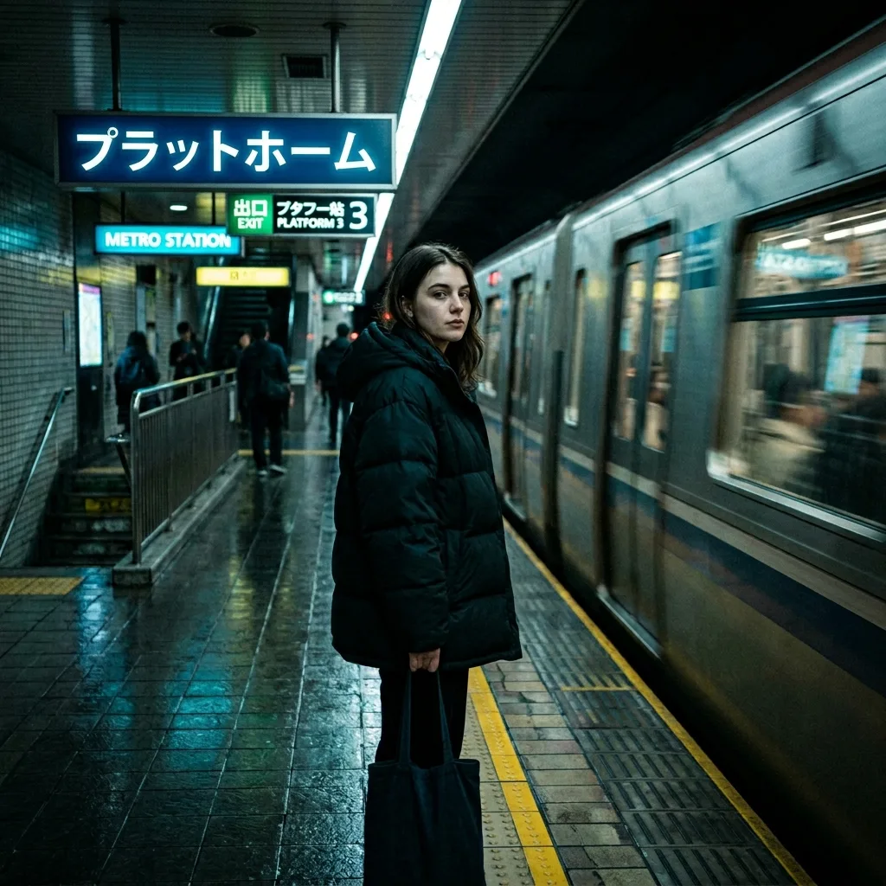

# Standing near the platform edge, body facing forward, head

[← Back to the collection](../../README.md) · Category: [Photography](../../gallery/photography.md) · Model: `Vinano Image Pro` · ID: `vn-00082`

<a href="https://vinano.ai?utm_source=github&utm_medium=readme&utm_campaign=awesome-image-video-prompts-updating&utm_content=prompt-page-image"></a>

<sub>Preview generated with <a href="https://vinano.ai?utm_source=github&utm_medium=readme&utm_campaign=awesome-image-video-prompts-updating&utm_content=prompt-page-caption">vinano.ai</a></sub>

## Prompt

```text
{
 "model": "",
 "scene": "Underground metro platform at night a train rushing past",
 "subject": {
 "type": "Young woman",
 "pose": "Standing near the platform edge, body facing forward, head turned slightly toward the camera",
 "expression": "Thoughtful, distant, quietly alert",
 "gaze": "Looking sideways toward the camera, unfixed, introspective",
 "emotion": "Isolation, reflection, restrained tension"
 },
 "appearance": {
 "hair": {
 "color": "Dark brown to black",
 "style": "Loose, straight, natural fall"
 },
 "skin": "Natural complexion soft shadows",
 "makeup": "Minimal, realistic, understated"
 },
 "attire": {
 "outerwear": "Oversized dark jacket",
 "style_note": "Functional, muted, urban anonymity"
 },
 "environment": {
 "location": "City subway platform",
 "background_elements": ["Blurred metro train in motion",
 "Neon signage",
 "Platform lights",
 "Wet reflective floor surface",
 "Metal railings and tiled platform edge"],
 "atmosphere": "Cold, nocturnal, transient"
 },
 "lighting": {
 "primary": "Artificial fluorescent platform lighting",
 "secondary": "Neon signage glow",
 "effect": "Cool-toned highlights soft facial shadows"
 },
 "camera": {
 "angle": "Eye-level, slightly behind the subject",
 "lens": "35mm cinematic street lens",
 "shutter_effect": "Motion blur on passing train",
 "depth_of_field": "Moderate, subject sharp moving background blur",
 "framing": "Vertical, cinematic street composition"
 },
 "color_palette": {
 "dominant": ["teal", "cool blue", "deep black"],
 "accents": ["neon pink", "electric yellow"]
 },
 "mood": "Lonely, cinematic, suspended in time",
 "style": {
 "aesthetic": "Neo-noir street photography",
 "realism": "true-to-life photorealistic",
 "inspiration": "Urban cinema, night transit, modern solitude",
 "post_processing": "Cool cinematic grading, slight grain, high contrast shadows"
 },
 "details": {
 "motion_contrast": "Still subject against fast-moving train",
 "floor_reflections": "Wet surface reflecting neon lights",
 "sound_implied": "Rushing train, distant city hum"
 },
 "themes": ["Urban loneliness",
 "Waiting",
 "Movement vs stillness",
 "Anonymous city life"],
 "quality": "Ultra-detailed, cinematic night street photograph motion depth"
}

Preserve realistic proportions and depth for a confident, professional finish.
```

## Try it on vinano.ai

1. Copy the prompt above.
2. Open **[vinano.ai](https://vinano.ai?utm_source=github&utm_medium=readme&utm_campaign=awesome-image-video-prompts-updating&utm_content=prompt-page-try)**, paste it into the image generator and pick a model.
3. Swap any placeholders (brand, product, city, person…) for your own details, then generate.

More prompts like this: [Photography gallery](../../gallery/photography.md) · [all categories](../../README.md#contents)
