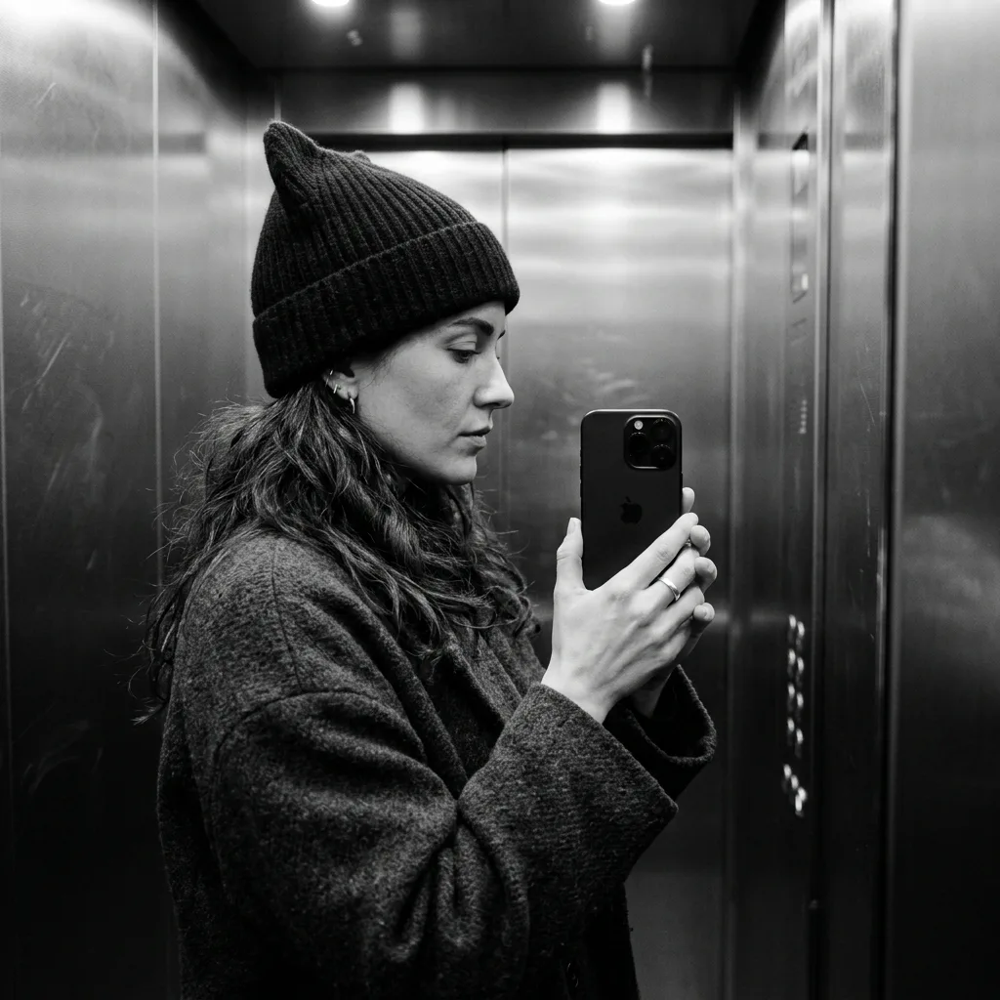

# True-to-life photorealistic profile selfie, refined minimalist and monochrome

[← Back to the collection](../../README.md) · Category: [Photography](../../gallery/photography.md) · Model: `Vinano Image v2` · ID: `vn-00083`

<a href="https://vinano.ai?utm_source=github&utm_medium=readme&utm_campaign=awesome-image-video-prompts-updating&utm_content=prompt-page-image"></a>

<sub>Preview generated with <a href="https://vinano.ai?utm_source=github&utm_medium=readme&utm_campaign=awesome-image-video-prompts-updating&utm_content=prompt-page-caption">vinano.ai</a></sub>

## Prompt

```text
A true-to-life photorealistic profile selfie, refined minimalist and monochrome: a woman in a dark oversized coat and a black knit hat cat ears, her hair falling loosely down her back; she holds a black iPhone 17 Pro Max smartphone, taking a picture of herself in an elevator mirror a matte metal surface in the background. Soft diffused lighting, calm cool color scheme (black, graphite, gray steel), slight film grain, shallow depth of field on the phone and hands, highly detailed fabric and hair textures, 3:2 vertical composition, realistic style, 4K, natural light, soft shadows, moody aesthetic. Maintain consistent colour harmony and crisp focus across the whole frame.
```

## Try it on vinano.ai

1. Copy the prompt above.
2. Open **[vinano.ai](https://vinano.ai?utm_source=github&utm_medium=readme&utm_campaign=awesome-image-video-prompts-updating&utm_content=prompt-page-try)**, paste it into the image generator and pick a model.
3. Swap any placeholders (brand, product, city, person…) for your own details, then generate.

More prompts like this: [Photography gallery](../../gallery/photography.md) · [all categories](../../README.md#contents)
