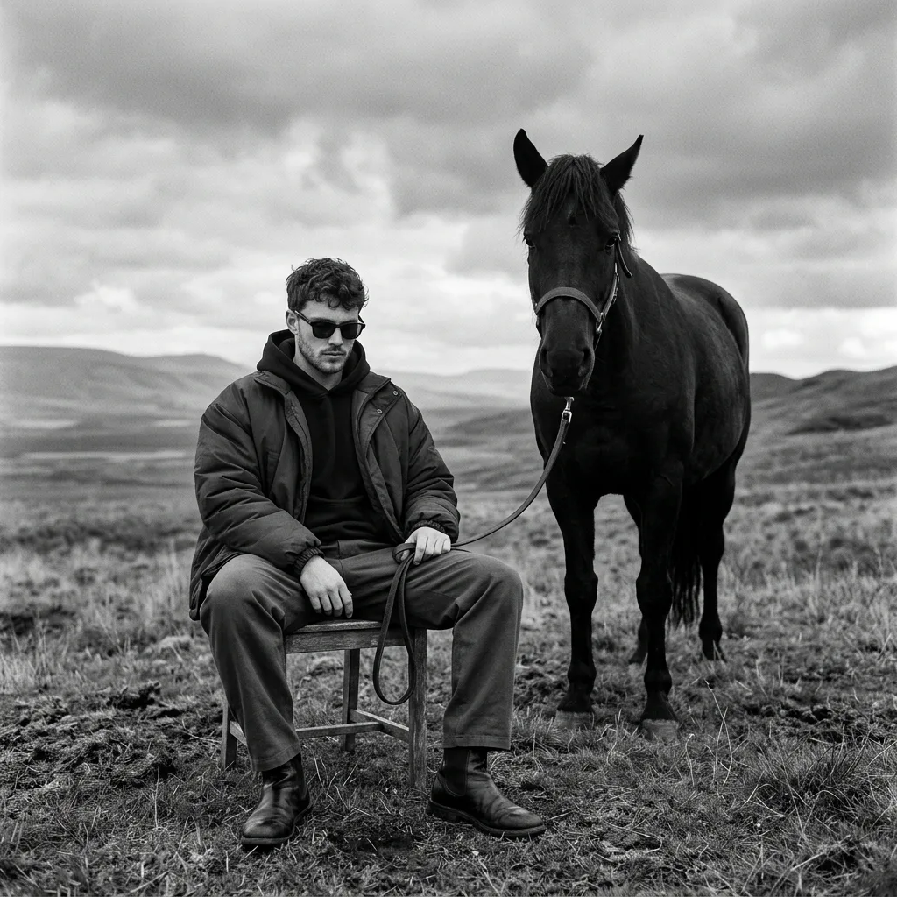

# Seated on a wooden chair, legs relaxed apart, holding

[← Back to the collection](../../README.md) · Category: [Photography](../../gallery/photography.md) · Model: `Vinano Image v2` · ID: `vn-00086`

<a href="https://vinano.ai?utm_source=github&utm_medium=readme&utm_campaign=awesome-image-video-prompts-updating&utm_content=prompt-page-image"></a>

<sub>Preview generated with <a href="https://vinano.ai?utm_source=github&utm_medium=readme&utm_campaign=awesome-image-video-prompts-updating&utm_content=prompt-page-caption">vinano.ai</a></sub>

## Prompt

```text
{
 "model": "",
 "scene": "Open field landscape under an overcast sky, minimal natural surroundings",
 "subject": {
 "type": "Young man",
 "pose": "Seated on a wooden chair, legs relaxed apart, holding a horse lead calmly",
 "expression": "Detached, introspective, controlled",
 "gaze": "Looking downward, partially obscured by sunglasses",
 "emotion": "Quiet dominance, solitude, inner gravity"
 },
 "appearance": {
 "hair": {
 "color": "Dark",
 "style": "Short, slightly tousled curls"
 },
 "facial_features": {
 "beard": "Light stubble",
 "accessories": ["Dark sunglasses"]
 },
 "skin": "Natural texture, matte finish"
 },
 "attire": {
 "outerwear": "Oversized dark padded jacket",
 "innerwear": "Dark hoodie",
 "pants": "Relaxed-fit dark trousers",
 "footwear": "Black leather boots",
 "style_note": "refined minimalist, masculine, utilitarian fashion"
 },
 "secondary_subject": {
 "type": "Black horse",
 "position": "Standing beside the man, head lowered slightly",
 "interaction": "Held calmly by a loose lead",
 "symbolism": "Strength, instinct, controlled power"
 },
 "environment": {
 "location": "Open grassy field",
 "background": ["Rolling hills",
 "Soft distant landscape",
 "No urban elements"],
 "atmosphere": "Quiet, isolated, contemplative"
 },
 "lighting": {
 "type": "Natural diffused daylight",
 "conditions": "Overcast sky",
 "effect": "Soft shadows, low contrast, even tonal range"
 },
 "camera": {
 "angle": "Eye-level to slightly low-angle",
 "lens": "50mm cinematic portrait lens",
 "depth_of_field": "Moderate, subject and horse in focus, background gently blurred",
 "framing": "Vertical, full-body portrait symbolic spacing"
 },
 "color_palette": {
 "mode": "Black and white",
 "tones": ["deep blacks", "soft grays", "muted highlights"]
 },
 "mood": "Stoic, restrained, powerful",
 "style": {
 "aesthetic": "Fine-art editorial portrait",
 "realism": "true-to-life photorealistic",
 "inspiration": "Minimalism, masculinity, symbolism",
 "post_processing": "premium-quality monochrome grading, subtle film grain, soft contrast"
 },
 "details": {
 "chair": "Simple wooden chair, understated",
 "lead_tension": "Loose, intentional calm",
 "motion": "Stillness dominates the frame"
 },
 "themes": ["Controlled power",
 "Man and instinct",
 "Silence as authority",
 "Strength without display"],
 "quality": "Ultra-detailed, cinematic black-and-white portrait editorial depth"
}

Preserve realistic proportions and depth for a confident, professional finish.
```

## Try it on vinano.ai

1. Copy the prompt above.
2. Open **[vinano.ai](https://vinano.ai?utm_source=github&utm_medium=readme&utm_campaign=awesome-image-video-prompts-updating&utm_content=prompt-page-try)**, paste it into the image generator and pick a model.
3. Swap any placeholders (brand, product, city, person…) for your own details, then generate.

More prompts like this: [Photography gallery](../../gallery/photography.md) · [all categories](../../README.md#contents)
