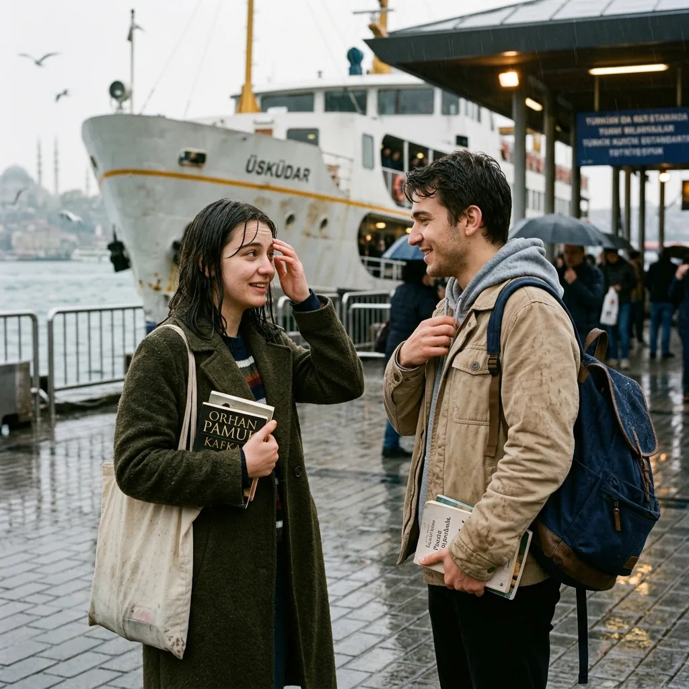

# Photography prompt #87

[← Back to the collection](../../README.md) · Category: [Photography](../../gallery/photography.md) · Model: `Vinano Image Pro` · ID: `vn-00087`

<a href="https://vinano.ai?utm_source=github&utm_medium=readme&utm_campaign=awesome-image-video-prompts-updating&utm_content=prompt-page-image"></a>

<sub>Preview generated with <a href="https://vinano.ai?utm_source=github&utm_medium=readme&utm_campaign=awesome-image-video-prompts-updating&utm_content=prompt-page-caption">vinano.ai</a></sub>

## Prompt

```text
{
 "generation_request": {
 "meta_data": {
 "tool": "",
 "task_type": "photoreal_candid_street_romance",
 "version": "v1.1_ISTANBUL_FERRY_RAIN_REUNION_LOVE_EN",
 "priority": "highest"
 },

 "output_settings": {
 "aspect_ratio": "4:5",
 "orientation": "portrait",
 "resolution_target": "ultra_high_res",
 "render_style": "ultra_photoreal_candid_street_film_still",
 "sharpness": "crisp_but_natural",
 "film_grain": "subtle_35mm",
 "color_grade": "restrained_cinematic_realism",
 "dynamic_range": "natural_not_hdr",
 "skin_rendering": "real_texture_no_retouch"
 },

 "global_rules": {
 "camera_language": "35mm lens equivalent, eye-level, imperfect framing, candid documentary feel, focus on eyes when people are present",
 "authenticity_markers": "subtle halation on highlights, tiny film gate weave, slight background motion blur only, real street clutter, no studio look",
 "lighting_language": "motivated natural light only (overcast rain daylight + ferry terminal practicals), deep but detailed shadows"
 },

 "creative_prompt": {
 "scene_summary": "Istanbul, rainy day at the ferry terminal. Two university students in their early 20s unexpectedly run into each other right in front of a ferry. A candid, unposed moment—love as a quiet accident in the rain.",

 "subjects": {
 "count": 2,
 "description": "the same young man and woman (early 20s), ordinary and real, not model-like; faces visible and sharp",
 "expression": "surprise, shy warmth, a tiny relieved smile—restrained micro-expressions only",
 "skin_and_face": "natural skin texture, slight under-eye shadows, no beauty retouch, no plastic skin"
 },

 "wardrobe_and_props": {
 "clothing": "simple student clothing in natural neutral tones (beige, grey, navy, soft brown), slightly wrinkled; no logos",
 "wetness": "hair slightly wet, fabric darkened by rain, realistic water beads on coats and backpacks",
 "props": "both hold books and carry backpacks/tote bags; book edges slightly damp; hands gripping straps naturally"
 },

 "micro_action": "they stop mid-step, realizing it’s each other; one adjusts a slipping book; the other wipes rain from their eyebrow; they share a short eye contact that lasts a second longer than normal",

 "environment_details": {
 "location": "Istanbul ferry terminal (Eminönü/Karaköy/Kadıköy vibe), directly in front of a docked ferry",
 "background": "ferry hull and windows behind them, wet pavement, puddle reflections, seagulls blurred in distance, people moving umbrellas out of focus",
 "street_elements": "rain streaks visible, water droplets on railings, worn signage shapes but no readable text"
 },

 "lighting": "overcast rain daylight, soft and diffused; practical terminal lights give gentle warm highlights; deep but detailed shadows; subtle halation on wet highlights",

 "composition": "eye-level medium shot, slightly off-center, imperfect crop, faces and eyes tack sharp; background softly receding; slight motion blur only in distant passersby and rain",

 "mood": "quiet, intimate, realistic—two people sharing a private moment in a public place"
 },

 "negative_prompt": ["studio lighting",
 "beauty retouch",
 "plastic skin",
 "model faces",
 "posed romance poster look",
 "perfect symmetry",
 "HDR",
 "AI glow",
 "fake bokeh shapes",
 "overly clean background",
 "unrealistic rain",
 "text",
 "logo",
 "watermark",
 "cartoon",
 "painterly"]
 }
}

Emphasise material texture and natural light so the final frame feels tactile and premium.
```

## Try it on vinano.ai

1. Copy the prompt above.
2. Open **[vinano.ai](https://vinano.ai?utm_source=github&utm_medium=readme&utm_campaign=awesome-image-video-prompts-updating&utm_content=prompt-page-try)**, paste it into the image generator and pick a model.
3. Swap any placeholders (brand, product, city, person…) for your own details, then generate.

More prompts like this: [Photography gallery](../../gallery/photography.md) · [all categories](../../README.md#contents)
