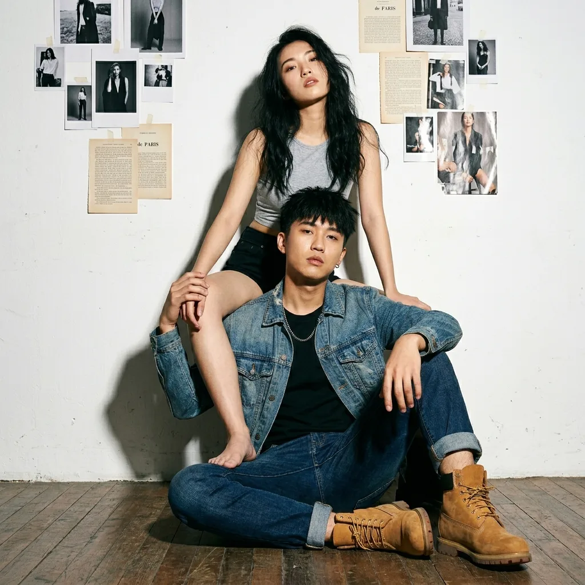

# Young Asian couple, cool/edgy fashion models

[← Back to the collection](../../README.md) · Category: [Photography](../../gallery/photography.md) · Model: `Vinano Image v2` · ID: `vn-00093`

<a href="https://vinano.ai?utm_source=github&utm_medium=readme&utm_campaign=awesome-image-video-prompts-updating&utm_content=prompt-page-image"></a>

<sub>Preview generated with <a href="https://vinano.ai?utm_source=github&utm_medium=readme&utm_campaign=awesome-image-video-prompts-updating&utm_content=prompt-page-caption">vinano.ai</a></sub>

## Prompt

```text
"Young Asian couple, cool/edgy fashion models.",
 "female_hair": "Long, black, naturally little wavy hair (soft waves, not crimped), smooth texture flyaways.",
 "male_hair": "Short, black, textured messy cut.",
 "outfits": {
 "female": "Grey crop top, black shorts, bare legs.",
 "male": "Blue denim jacket, black t-shirt, silver chain, blue jeans (one leg rolled up), mismatched boots (black combat boot on left, tan work boot on right)."
 }
 },
 "exact_pose_anatomical": {
 "male_pose": {
 "position": "Seated on the floor, facing forward.",
 "legs": "Left leg bent at knee, foot planted flat. Right leg bent inwards (cross-legged style) resting on the floor.",
 "arms": "Right arm resting casually on his own right knee. Left arm reaching up and back to hold the female's thigh securely.",
 "posture": "Leaning slightly forward, relaxed spine."
 },
 "female_pose": {
 "position": "Perched/Kneeling directly behind the male subject.",
 "legs": "Straddling the male subject's left shoulder. Her left thigh is draped over his shoulder, shin hanging down in front of his chest. Her right leg is tucked behind him (kneeling on the floor).",
 "arms": "Right hand resting on top of the male's right shoulder for balance. Left arm obscured.",
 "posture": "Torso upright, looming over the male figure.",
 "head": "Tilted slightly to the left, chin up."
 }
 },
 "camera_technical_values": {
 "perspective": "Low Angle / Eye-level seated subjects.",
 "focal_length": "35mm (Capturing the full interaction and wall context).",
 "lighting": "Direct On-Camera Flash. Hard shadows cast directly behind the subjects on the wall.",
 "environment": "White wall taped B&W photos and vintage book pages ('de PARIS'). Wooden floor."

Preserve realistic proportions and depth for a confident, professional finish.
```

## Try it on vinano.ai

1. Copy the prompt above.
2. Open **[vinano.ai](https://vinano.ai?utm_source=github&utm_medium=readme&utm_campaign=awesome-image-video-prompts-updating&utm_content=prompt-page-try)**, paste it into the image generator and pick a model.
3. Swap any placeholders (brand, product, city, person…) for your own details, then generate.

More prompts like this: [Photography gallery](../../gallery/photography.md) · [all categories](../../README.md#contents)
