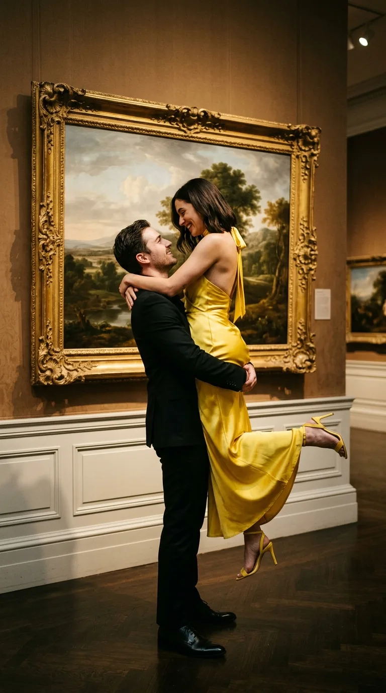

# Black suit, black trousers, black shoes

[← Back to the collection](../../README.md) · Category: [Photography](../../gallery/photography.md) · Model: `Vinano Image Pro` · ID: `vn-00097`

<a href="https://vinano.ai?utm_source=github&utm_medium=readme&utm_campaign=awesome-image-video-prompts-updating&utm_content=prompt-page-image"></a>

<sub>Preview generated with <a href="https://vinano.ai?utm_source=github&utm_medium=readme&utm_campaign=awesome-image-video-prompts-updating&utm_content=prompt-page-caption">vinano.ai</a></sub>

## Prompt

```text
{
 "generation_request": {
 "meta_data": {
 "tool": "",
 "task_type": "photoreal_cinematic_romantic_fine_art_editorial",
 "version": "v1.1_GALLERY_FRAME_COUPLE_LIFT_EMBRACE_YELLOW_HALTER_SATIN",
 "priority": "highest"
 },

 "references": {
 "reference_image_1": {
 "source": "UPLOAD_REFERENCE_IMAGE",
 "purpose": "POSE_COMPOSITION_LIGHTING_REFERENCE",
 "strict_lock": true,
 "match_reference_priority": "MAX",
 "preserve_pose_geometry": true,
 "preserve_framing_and_cropping": true,
 "preserve_background_structure": true,
 "preserve_mood_and_lighting": true,
 "no_style_drift": true
 },
 "reference_image_2": {
 "source": "UPLOAD_FACE_REFERENCE (OPTIONAL)",
 "purpose": "FACE_IDENTITY_LOCK_FEMALE",
 "strict_lock": true,
 "face_similarity_priority": "MAX",
 "no_identity_blending": true,
 "no_beautify": true,
 "no_age_shift": true,
 "preserve_skin_texture": true,
 "preserve_facial_proportions": true
 },
 "reference_image_3": {
 "source": "UPLOAD_FACE_REFERENCE (OPTIONAL)",
 "purpose": "FACE_IDENTITY_LOCK_MALE",
 "strict_lock": true,
 "face_similarity_priority": "MAX",
 "no_identity_blending": true,
 "no_beautify": true,
 "no_age_shift": true,
 "preserve_skin_texture": true,
 "preserve_facial_proportions": true
 }
 },

 "creative_direction": {
 "concept": "A cinematic, museum-gallery romance scene: a couple in an intimate lift embrace, posed in front of a large ornate framed classical landscape painting. High-end editorial, dramatic but elegant. The woman wears a striking yellow satin halter-neck gown tied at the back of the neck, matching yellow high heels.",
 "mood": "intimate, luxurious, timeless, fine-art cinematic",
 "style_keywords": "old-master atmosphere, museum lighting, romantic tension, film still"
 },

 "scene": {
 "location": "museum/gallery interior",
 "background": {
 "hero_object": "a large ornate gold frame containing a classical landscape painting",
 "wall": "warm brown gallery wall",
 "lower_wall": "white wainscoting / panel molding",
 "floor": "dark warm wood"
 },
 "composition": "full-body vertical frame, couple centered, painting fills most of the background"
 },

 "subjects": {
 "male": {
 "wardrobe": "black suit, black trousers, black shoes",
 "pose": "standing, lifting the woman at her waist/thigh, stable posture, looking up at her face"
 },
 "female": {
 "wardrobe": {
 "dress": "yellow silk satin halter-neck gown, neck-tie strap (tied behind the neck), fitted bodice, elegant drape, subtle sheen, high-fashion finish",
 "fabric_notes": "realistic satin highlights, soft folds, premium couture construction"
 },
 "shoes": "yellow high-heel sandals or classic yellow pumps (matching the dress)",
 "pose": "arched back, head tilted upward, hair flowing, one leg bent and lifted, arms around his shoulders/neck",
 "vibe": "elegant, sensual, not explicit"
 }
 },

 "photography": {
 "camera_style": "cinematic fashion/editorial still",
 "lens": "50mm prime (natural perspective)",
 "lighting": {
 "key": "soft directional gallery light from above/front",
 "fill": "minimal, moody shadows preserved",
 "highlights": "subtle sheen on frame gilding and strong satin specular highlights on the yellow dress"
 },
 "depth_of_field": "moderate (couple sharp, painting slightly softer but readable)",
 "color_grade": "warm cinematic browns, deep blacks, luminous yellow satin, subtle film contrast",
 "film_look": "subtle 35mm grain, gentle halation on highlights"
 },

 "output_settings": {
 "aspect_ratio": "9:16",
 "orientation": "portrait",
 "resolution_target": "ultra_high_res",
 "render_style": "ultra_photoreal_cinematic_film_still",
 "sharpness": "crisp_but_natural",
 "film_grain": "subtle_35mm",
 "dynamic_range": "natural_not_hdr",
 "no_text": true,
 "no_watermark": true,
 "no_logo": true
 },

 "quality_controls": {
 "anatomy": {
 "no_deformed_hands": true,
 "no_extra_fingers": true,
 "natural_lift_pose_physics": true
 },
 "wardrobe_materials": {
 "satin_reads_real": true,
 "strong_satin_speculars": true,
 "suit_fabric_reads_real": true,
 "gold_frame_detail_high": true
 }
 },

 "negative_prompt": ["white lace dress",
 "wrong dress color (not yellow)",
 "wrong dress neckline (not halter-neck tie)",
 "wrong shoe color (not yellow)",
 "text, watermark, logo",
 "cartoon, anime, illustration",
 "overexposed HDR look",
 "messy background clutter",
 "warped frame geometry",
 "incorrect lift pose physics",
 "deformed hands, extra fingers",
 "overly sexual explicit nudity"]
 }
}

Render with rich micro-detail while keeping the layout uncluttered and intentional.
```

## Try it on vinano.ai

1. Copy the prompt above.
2. Open **[vinano.ai](https://vinano.ai?utm_source=github&utm_medium=readme&utm_campaign=awesome-image-video-prompts-updating&utm_content=prompt-page-try)**, paste it into the image generator and pick a model.
3. Swap any placeholders (brand, product, city, person…) for your own details, then generate.

More prompts like this: [Photography gallery](../../gallery/photography.md) · [all categories](../../README.md#contents)
