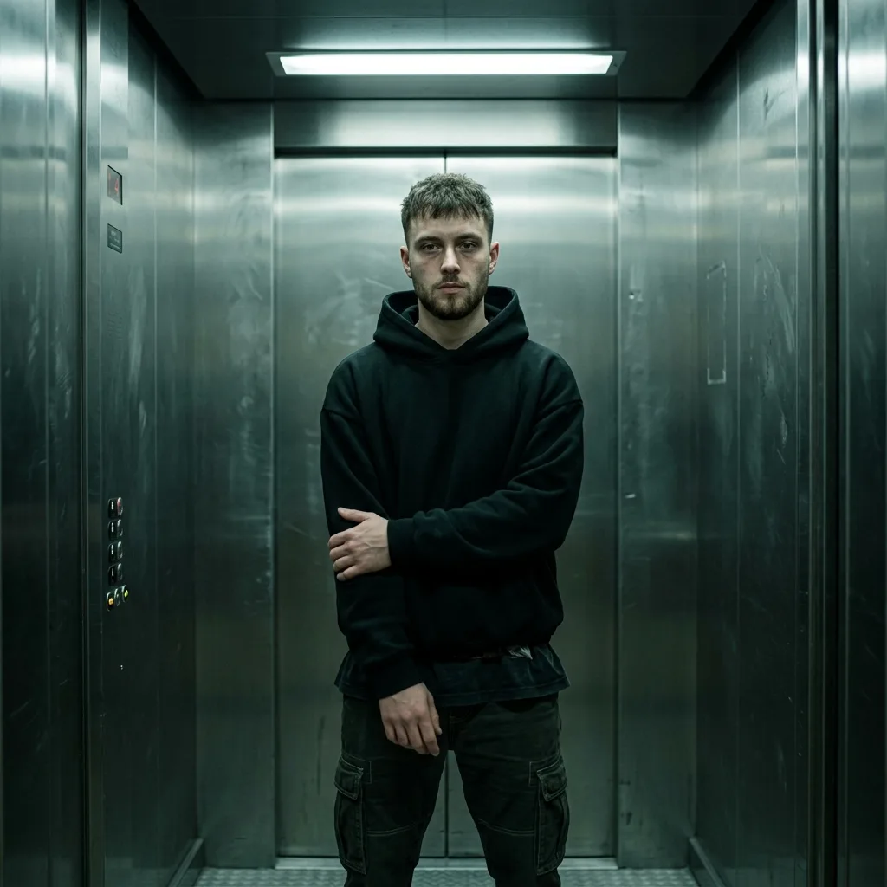

# Urban realism , mood

[← Back to the collection](../../README.md) · Category: [Photography](../../gallery/photography.md) · Model: `Vinano Image Pro` · ID: `vn-00098`

<a href="https://vinano.ai?utm_source=github&utm_medium=readme&utm_campaign=awesome-image-video-prompts-updating&utm_content=prompt-page-image"></a>

<sub>Preview generated with <a href="https://vinano.ai?utm_source=github&utm_medium=readme&utm_campaign=awesome-image-video-prompts-updating&utm_content=prompt-page-caption">vinano.ai</a></sub>

## Prompt

```text
{
 "genre": "cinematic urban realism",
 "mood": ["tense", "cold", "isolated", "quiet intensity"],
 "theme": "a man caught in a moment of silence inside a sterile industrial elevator"
 },
 "subject": {
 "description": "young man calm intense expression",
 "face": {
 "skin": "natural pores, realistic texture, slight under-eye shadow, no retouching",
 "beard": "short trimmed beard, natural density",
 "expression": "neutral but intimidating, relaxed jaw, eyes locked on camera"
 },
 "hair": {
 "style": "messy short crop",
 "detail": "slight volume on top, natural uneven strands, not styled too clean"
 },
 "pose": {
 "body_language": "still and grounded, subtle confidence",
 "hands": "one arm folded across torso, other arm relaxed downward",
 "stance": "centered, shoulders slightly forward, minimal movement"
 }
 },
 "wardrobe": {
 "top": "oversized black hoodie, heavy fabric, matte texture",
 "layering": "dark graphic tee slightly visible below the hoodie hem",
 "bottom": "dark cargo pants stitched pockets",
 "styling_notes": "streetwear minimal, clean silhouette, no bright branding"
 },
 "environment": {
 "location": "metal elevator interior",
 "materials": ["brushed stainless steel walls", "reflective panels", "subtle fingerprints and smudges"],
 "lighting_elements": "overhead fluorescent light panels",
 "atmosphere": "thin mist/smoke floating around subject, faint haze near corners",
 "background": "no extra people, no clutter, clean symmetrical elevator geometry"
 },
 "cinematography": {
 "shot_type": "medium-full portrait",
 "framing": "perfect symmetrical centered composition",
 "camera_angle": "slightly low angle for dominance and tension",
 "lens": {
 "focal_length": "35mm",
 "look": "cinematic wide portrait depth",
 "distortion_control": "minimal distortion, straight vertical elevator lines"
 },
 "depth_of_field": {
 "aperture": "f/2.8",
 "focus": "sharp focus on eyes and face",
 "falloff": "soft background blur but still readable environment"
 }
 },
 "lighting": {
 "type": "overhead harsh fluorescent top-light",
 "contrast": "medium-high deep shadows under jaw and hoodie folds",
 "highlights": "soft bloom on metallic walls, controlled, not blown out",
 "fill": "very subtle ambient bounce to keep facial details visible",
 "notes": "keep lighting realistic and slightly underexposed for cinematic tension"
 },
 "color_grade": {
 "style": "dark cinematic teal-green industrial grade",
 "shadows": "cool teal tint",
 "highlights": "neutral to slightly cold",
 "saturation": "muted low saturation",
 "contrast": "clean but gritty",
 "black_levels": "slightly crushed blacks, not fully clipped"
 },
 "texture_details": {
 "skin": "realistic pores and micro texture",
 "fabric": "hoodie fleece texture visible, natural folds and weight",
 "metal": "subtle reflections, tiny scratches, elevator realism",
 "grain": "subtle film grain throughout"
 },
 "post_processing": {
 "sharpness": "sharp only on face, not over-sharpened",
 "vignette": "soft vignette around corners",
 "haze": "light haze for depth separation",
 "final_finish": "cinematic, grounded, documentary realism"
 },
 "negative_prompt": ["plastic skin",
 "beauty retouch",
 "anime",
 "cartoon",
 "overly smooth face",
 "HDR glow",
 "over-saturated colors",
 "extreme bokeh",
 "warped elevator walls",
 "extra fingers",
 "distorted hands",
 "unrealistic reflections",
 "text",
 "logos",
 "watermark"],
 "output_settings": {
 "aspect_ratio": "3:4 vertical portrait",
 "resolution": "high detail",
 "quality": "true-to-life photorealistic",
 "style": "cinematic realism"
 }
}

Maintain consistent colour harmony and crisp focus across the whole frame.
```

## Try it on vinano.ai

1. Copy the prompt above.
2. Open **[vinano.ai](https://vinano.ai?utm_source=github&utm_medium=readme&utm_campaign=awesome-image-video-prompts-updating&utm_content=prompt-page-try)**, paste it into the image generator and pick a model.
3. Swap any placeholders (brand, product, city, person…) for your own details, then generate.

More prompts like this: [Photography gallery](../../gallery/photography.md) · [all categories](../../README.md#contents)
