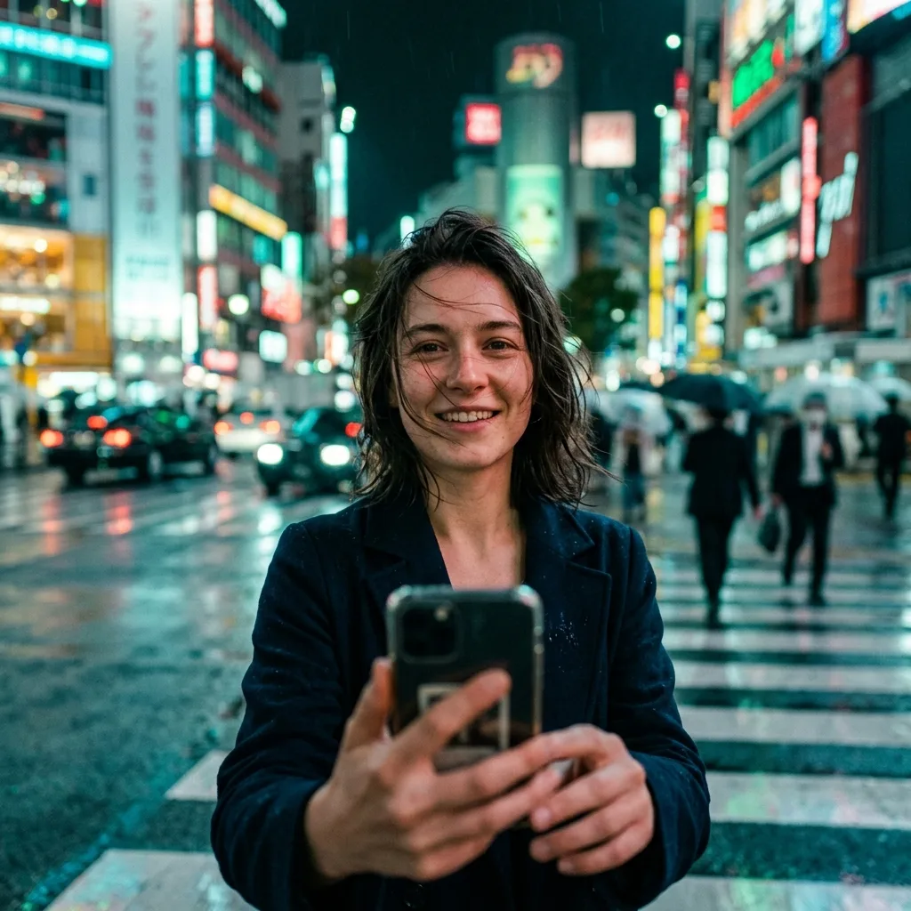

# Standing in the middle of a crosswalk, holding

[← Back to the collection](../../README.md) · Category: [Photography](../../gallery/photography.md) · Model: `Vinano Image Pro` · ID: `vn-00100`

<a href="https://vinano.ai?utm_source=github&utm_medium=readme&utm_campaign=awesome-image-video-prompts-updating&utm_content=prompt-page-image"></a>

<sub>Preview generated with <a href="https://vinano.ai?utm_source=github&utm_medium=readme&utm_campaign=awesome-image-video-prompts-updating&utm_content=prompt-page-caption">vinano.ai</a></sub>

## Prompt

```text
{
 "model": "gemini--pro",
 "mode": "image",
 "aspect_ratio": "4:5",
 "quality": "ultra",
 "style": "cinematic_realism",
 "scene": {
 "setting": "busy neon-lit city street at night, wet road after rain, glowing signboards and traffic behind subject",
 "weather": "light drizzle just ended, reflective pavement, humid atmosphere",
 "background": "soft bokeh city lights, moving cars, faint pedestrian motion blur, tall buildings colorful signage",
 "time": "night"
 },
 "subject": {
 "type": "young woman",
 "pose": "standing in the middle of a crosswalk, holding a smartphone close to camera",
 "expression": "natural warm smile, candid and joyful",
 "hair": "slightly messy hair blown across face by wind",
 "wardrobe": "dark coat or blazer, minimal accessories",
 "props": ["smartphone"]
 },
 "composition": {
 "framing": "close-up portrait wide-angle distortion, subject centered, phone in foreground",
 "camera_distance": "very close, intimate street-photo feel",
 "perspective": "wide lens perspective, slight fisheye look, background stretching outward",
 "depth_of_field": "shallow to medium, subject readable but background lights creamy",
 "foreground_detail": "phone and hands slightly soft due to motion and lens character"
 },
 "camera": {
 "lens": "24mm wide-angle (slight fisheye character)",
 "aperture": "f/1.8",
 "shutter_speed": "1/40",
 "iso": "1600",
 "focus": "face focus, slight falloff on phone"
 },
 "lighting": {
 "key_light": "neon signage spill lighting face mixed cyan/green and warm highlights",
 "fill": "streetlight bounce from wet ground",
 "mood": "dreamy urban nightlife, soft contrast, romantic realism"
 },
 "color_grading": {
 "palette": "teal, cyan, green neon mixed warm skin tones",
 "contrast": "soft contrast lifted shadows",
 "highlights": "glowy bloom on neon signs",
 "film_emulation": "35mm film look"
 },
 "texture_and_detail": {
 "film_grain": "strong visible grain, authentic",
 "bloom": "subtle halation on lights",
 "sharpness": "slightly imperfect, organic street photography",
 "skin_texture": "natural pores, no plastic smoothing"
 },
 "motion": {
 "hair_movement": "wind-blown strands across face",
 "background_motion": "light streaking from cars and walking people",
 "camera_feel": "handheld candid shot"
 },
 "negative_prompt": ["plastic skin",
 "overly sharp face",
 "clean studio lighting",
 "anime",
 "cartoon",
 "hyper-symmetrical face",
 "over-saturated neon",
 "HDR look",
 "fake depth blur edges",
 "extra fingers",
 "distorted hands",
 "text artifacts",
 "logo distortions",
 "AI glossy skin",
 "perfectly clean background"]
}

Preserve realistic proportions and depth for a confident, professional finish.
```

## Try it on vinano.ai

1. Copy the prompt above.
2. Open **[vinano.ai](https://vinano.ai?utm_source=github&utm_medium=readme&utm_campaign=awesome-image-video-prompts-updating&utm_content=prompt-page-try)**, paste it into the image generator and pick a model.
3. Swap any placeholders (brand, product, city, person…) for your own details, then generate.

More prompts like this: [Photography gallery](../../gallery/photography.md) · [all categories](../../README.md#contents)
