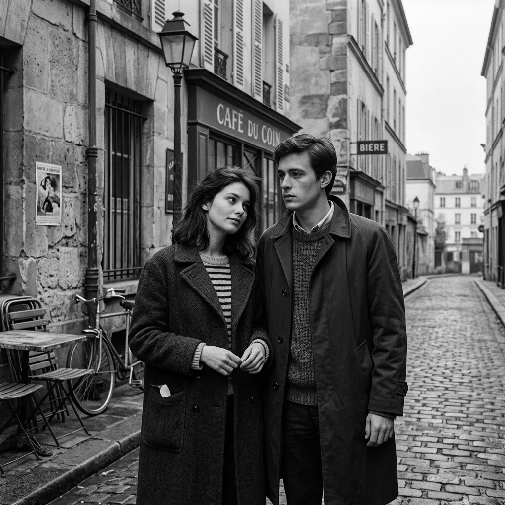

# French New Wave–style refined minimalist lovers scene, black

[← Back to the collection](../../README.md) · Category: [Photography](../../gallery/photography.md) · Model: `Vinano Image v2` · ID: `vn-00102`

<a href="https://vinano.ai?utm_source=github&utm_medium=readme&utm_campaign=awesome-image-video-prompts-updating&utm_content=prompt-page-image"></a>

<sub>Preview generated with <a href="https://vinano.ai?utm_source=github&utm_medium=readme&utm_campaign=awesome-image-video-prompts-updating&utm_content=prompt-page-caption">vinano.ai</a></sub>

## Prompt

```text
A French New Wave–style refined minimalist lovers scene, black and white, 1950s–1960s European cinema tone. A couple standing close but not touching, quiet intimacy expressed through proximity rather than action. The woman leans slightly toward the man; the man looks past her, thoughtful. Simple, understated clothing — trench coats, wool coats, knit sweaters, classic shirts. No glamour, no styling excess. Natural faces, minimal makeup, authentic expressions.
Set on an empty Parisian street or narrow European alley, early morning or overcast daylight. Café chairs stacked, a bicycle against a wall, stone textures, shuttered windows. Static camera, eye-level framing, wide negative space, imperfect composition. Soft natural light, gentle shadows, subtle 35mm film grain.
Emotion conveyed through stillness, silence, and unresolved tension — love present but unspoken. Minimal dialogue energy, poetic realism, quiet longing, human fragility. Inspired by Godard / Truffaut, anti-dramatic, observational cinema, timeless intimacy, restrained romance, art-house melancholy.

Emphasise material texture and natural light so the final frame feels tactile and premium.
```

## Try it on vinano.ai

1. Copy the prompt above.
2. Open **[vinano.ai](https://vinano.ai?utm_source=github&utm_medium=readme&utm_campaign=awesome-image-video-prompts-updating&utm_content=prompt-page-try)**, paste it into the image generator and pick a model.
3. Swap any placeholders (brand, product, city, person…) for your own details, then generate.

More prompts like this: [Photography gallery](../../gallery/photography.md) · [all categories](../../README.md#contents)
