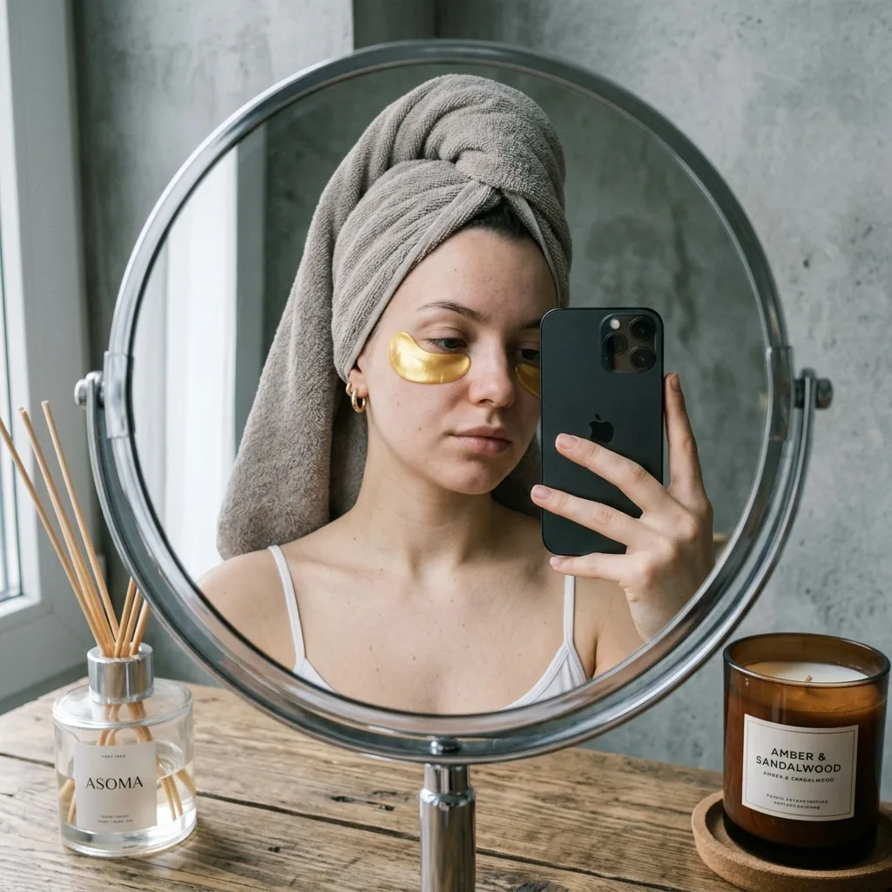

# Highly realistic mirror selfie of a young woman taken

[← Back to the collection](../../README.md) · Category: [Photography](../../gallery/photography.md) · Model: `Vinano Image v2` · ID: `vn-00103`

<a href="https://vinano.ai?utm_source=github&utm_medium=readme&utm_campaign=awesome-image-video-prompts-updating&utm_content=prompt-page-image"></a>

<sub>Preview generated with <a href="https://vinano.ai?utm_source=github&utm_medium=readme&utm_campaign=awesome-image-video-prompts-updating&utm_content=prompt-page-caption">vinano.ai</a></sub>

## Prompt

```text
A highly realistic mirror selfie of a young woman taken through the reflection of a round tabletop mirror a chrome metal frame and stand. The composition feels intimate and natural, like a quiet personal care moment.
She is wearing a thin white spaghetti-strap tank top. Her head is wrapped in a soft grey-beige terry towel styled as a turban, fully covering her hair. Under her left eye, a single pair of gold hydrogel eyepatches is applied — semi-circular, slightly reflective a subtle metallic sheen.
Her face appears makeup-free or very minimal natural makeup. Skin looks fresh, hydrated, and real, visible natural texture, soft pores, slight tonal variations, and gentle under-eye shadows. Lips have a neutral tone a light natural gloss. She wears small gold hoop earrings.
She holds a black iPhone a triple-camera module (similar to iPhone 11 Pro or newer) in her right hand, angled toward the mirror. Her expression is calm and relaxed, slightly tired but peaceful, her gaze directed slightly downward at the phone screen.
Environment & background:
Behind her is a grey concrete-textured wall. On the left side of the frame, a window allows soft natural daylight to enter, creating gentle, diffused illumination a slightly cool tone.
On the table in front of the mirror:
On the left: a clear glass diffuser bottle wooden sticks, labeled “ASOMA”.
On the right: a brown glass candle jar, partially burned, visible wax residue.
Mood & lighting:
Soft natural daylight, subtle shadows, no harsh highlights. Scandinavian / loft-style bathroom atmosphere, minimalistic, cozy, quiet. Color palette consists of muted greys, warm beige, soft whites, and restrained gold accents.
Photographic realism, candid lifestyle photography feel, shallow depth of field, natural lens perspective (50–85mm equivalent), true-to-life proportions, no beauty retouching, no plastic skin, no exaggerated features, high detail, realistic reflections, authentic mirror distortion, editorial-quality realism.

Maintain consistent colour harmony and crisp focus across the whole frame.
```

## Try it on vinano.ai

1. Copy the prompt above.
2. Open **[vinano.ai](https://vinano.ai?utm_source=github&utm_medium=readme&utm_campaign=awesome-image-video-prompts-updating&utm_content=prompt-page-try)**, paste it into the image generator and pick a model.
3. Swap any placeholders (brand, product, city, person…) for your own details, then generate.

More prompts like this: [Photography gallery](../../gallery/photography.md) · [all categories](../../README.md#contents)
