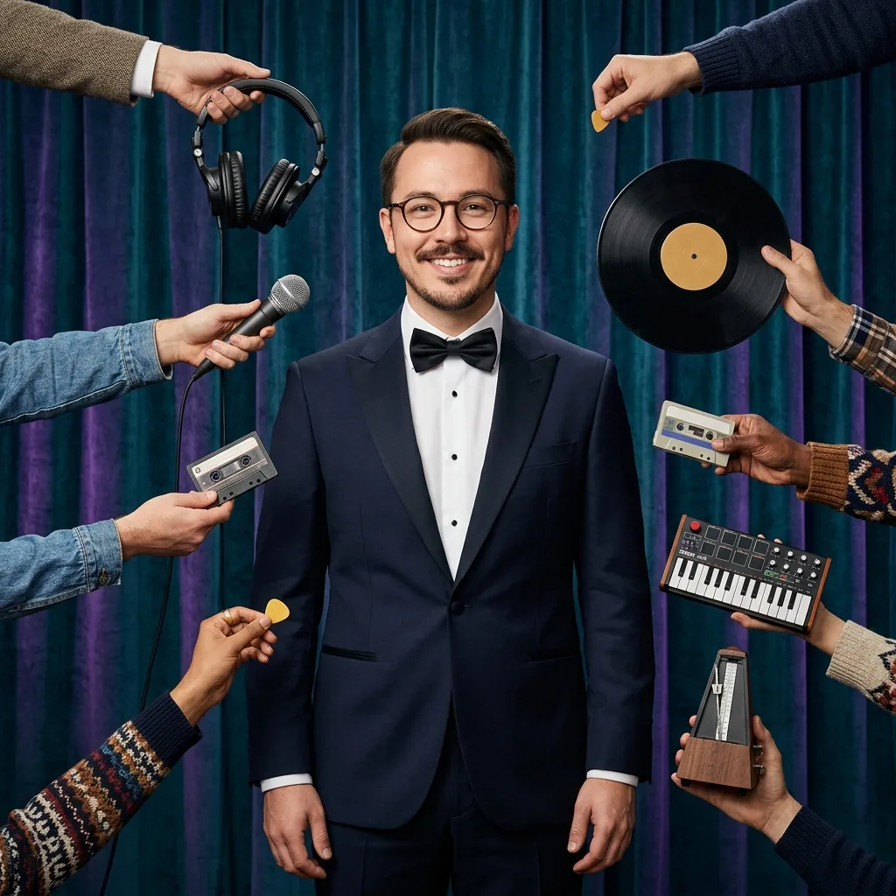

# Hyper-real studio photograph that matches the composition

[← Back to the collection](../../README.md) · Category: [Photography](../../gallery/photography.md) · Model: `Vinano Image Pro` · ID: `vn-00106`

<a href="https://vinano.ai?utm_source=github&utm_medium=readme&utm_campaign=awesome-image-video-prompts-updating&utm_content=prompt-page-image"></a>

<sub>Preview generated with <a href="https://vinano.ai?utm_source=github&utm_medium=readme&utm_campaign=awesome-image-video-prompts-updating&utm_content=prompt-page-caption">vinano.ai</a></sub>

## Prompt

```text
{
 "task": "Generate a hyper-real studio photograph that matches the composition of the reference image: a centered adult person in a tuxedo, surrounded by many hands entering the frame from all sides holding objects toward the person, a curtain backdrop whose color matches the theme.",
 "variables": {
 "USER_PHOTO": "<<UPLOAD_OR_URL_TO_USER_FACE_OR_PORTRAIT>>",
 "SUBJECT_THEME": "<<ONE_CLEAR SUBJECT, e.g. 'music', 'gaming', 'cooking', 'finance', 'fitness'>>",
 "HAND_PROPS": ["<<PROP_1 RELATED TO SUBJECT_THEME>>",
 "<<PROP_2 RELATED TO SUBJECT_THEME>>",
 "<<PROP_3 RELATED TO SUBJECT_THEME>>",
 "<<PROP_4 RELATED TO SUBJECT_THEME>>",
 "<<PROP_5 RELATED TO SUBJECT_THEME>>",
 "<<PROP_6 RELATED TO SUBJECT_THEME>>",
 "<<PROP_7 RELATED TO SUBJECT_THEME>>",
 "<<PROP_8 RELATED TO SUBJECT_THEME>>"]
 },
 "prompt": "Create an ultra true-to-life photorealistic studio photo (hyper-real, DSLR look) the SAME composition and framing as the reference: a centered adult person standing front-facing, waist-up to mid-thigh visible, wearing a dark navy tuxedo jacket, crisp white shirt, and black bow tie, smiling confidently. The person has round eyeglasses and neat facial hair (mustache + short beard), but the FACE must be replaced the user's likeness from USER_PHOTO while keeping natural skin texture, pores, and realistic facial proportions (no plastic skin, no cartooning). The lighting is clean professional studio lighting soft shadows, high dynamic range, crisp detail.\n\nSurround the person 8–10 different hands and forearms entering the frame from the edges (top, left, right, bottom), each holding an object and aiming it toward the center person (close to the face/upper torso). The hands belong to different people (varied sleeves/patterns/colors), but keep them realistic and anatomically correct.\n\nIMPORTANT: The ONLY changing elements across generations are: (1) the user's face from USER_PHOTO, and (2) the objects held in the hands. Everything else stays consistent: the tuxedo pose, camera angle, lens look, and overall composition.\n\nOBJECT RULE: Select HAND_PROPS so they are strongly related to SUBJECT_THEME. The objects must be clearly visible, realistic, and varied (mix of modern and vintage if it fits). Examples by theme:\n- music: studio headphones, microphone, vinyl record, cassette, guitar pick, small synth, metronome\n- gaming: controller, handheld console, gaming headset, mouse, keyboard, VR accessory\n- cooking: chef thermometer, whisk, spice grinder, mini pan, piping bag, recipe card\n- finance: calculator, credit card reader, stock ticker printout, smartphone finance app, receipt roll\n- fitness: smartwatch, resistance band, shaker bottle, jump rope handle\n\nBACKGROUND: Use a curtain backdrop (like a stage/studio curtain) a color palette that matches SUBJECT_THEME (e.g., deep teal/purple for music, neon accents for gaming, warm beige/terracotta for cooking, cool gray/blue for finance, fresh greens for fitness). Keep the curtain texture and folds realistic.\n\nCamera/Render: 50mm lens look, shallow-to-moderate depth of field, sharp focus on the person’s face, slightly softer hands near the edges, high resolution, editorial portrait photography, natural reflections on objects, accurate specular highlights, no distortion.\n\nMaintain the exact 'surrounded by hands offering devices' vibe, but swap devices for theme-related objects. No text, no logos, no brand marks.",
 "reference_instructions": {
 "use_user_photo_as_identity_reference": true,
 "identity_strength": "high",
 "preserve_pose_and_outfit": true,
 "preserve_composition": "strict",
 "only_allow_changes": ["center face identity from USER_PHOTO",
 "HAND_PROPS objects",
 "curtain color palette matched to SUBJECT_THEME"]
 },

Keep edges clean and the overall composition balanced for a polished, gallery-ready result.
```

## Try it on vinano.ai

1. Copy the prompt above.
2. Open **[vinano.ai](https://vinano.ai?utm_source=github&utm_medium=readme&utm_campaign=awesome-image-video-prompts-updating&utm_content=prompt-page-try)**, paste it into the image generator and pick a model.
3. Swap any placeholders (brand, product, city, person…) for your own details, then generate.

More prompts like this: [Photography gallery](../../gallery/photography.md) · [all categories](../../README.md#contents)
