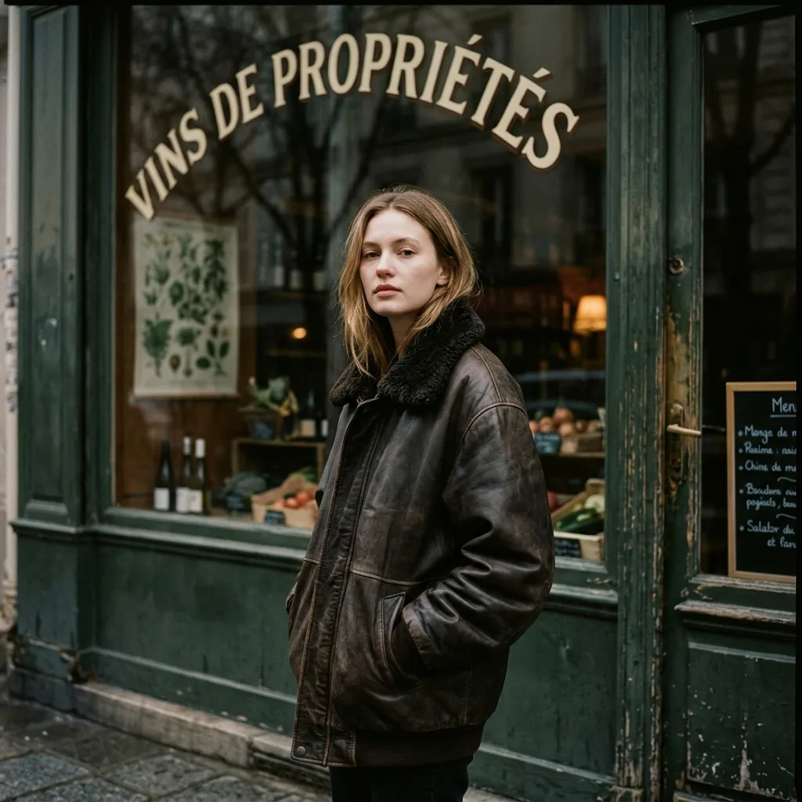

# Moody Paris street editorial portrait

[← Back to the collection](../../README.md) · Category: [Photography](../../gallery/photography.md) · Model: `Vinano Image Pro` · ID: `vn-00111`

<a href="https://vinano.ai?utm_source=github&utm_medium=readme&utm_campaign=awesome-image-video-prompts-updating&utm_content=prompt-page-image"></a>

<sub>Preview generated with <a href="https://vinano.ai?utm_source=github&utm_medium=readme&utm_campaign=awesome-image-video-prompts-updating&utm_content=prompt-page-caption">vinano.ai</a></sub>

## Prompt

```text
Ultra-realistic moody Paris street editorial portrait, shot outside a vintage shopfront at dusk/overcast twilight, film-scanned look. A young woman (early–mid 20s), fair skin, slim build, shoulder-length light brown/dark blonde hair a soft center/loose part, slightly tousled ends. Expression: calm, distant, slightly tired gaze; lips relaxed, almost pouting; eyes looking straight at camera subtle softness. Pose: standing close to the shop entrance, shoulders slightly forward, body angled 3/4; one hand tucked into the coat pocket (hand visible at pocket opening), the other arm relaxed inside the oversized coat. She is framed from mid-thigh to a little above head, vertical portrait.

Wardrobe: oversized brown leather/bomber-style coat a worn matte sheen, slightly wrinkled texture; very large fit dropped shoulders. Collar: thick black shearling/faux-fur collar folded up around the neck. No visible logos, no jewelry emphasis.

Location / Background details:

•She stands at the edge of a dark green/black painted wooden doorframe aged patina; the frame runs vertically on the right side of the image.

•Behind her is a large shop window reflective glass showing faint street reflections (trees/sky shapes), but interior objects remain visible.

•At the very top of the window, large curved cream lettering reads: “VINS DE PROPRIÉTÉS” (French text, arched across the glass).

•Inside the shop window, a botanical poster is visible on the left side (green leaves illustration), slightly blurred due to depth/reflection.

•Lower left inside the window: a display area dark surfaces and small objects (bottles/produce-like shapes), dimly lit.

•On the far right edge, partially inside the frame, a black menu/chalkboard small white writing is visible (text not fully readable), aligned vertically near the doorframe.

Lighting: natural ambient street light, soft and diffused; gentle highlights on cheekbones and nose; shadows are deep but not crushed. No direct flash. The shop interior glows faintly warm compared to the cooler exterior.

Color / Tone / Aesthetic: muted brown, olive-green, charcoal palette; cinematic, slightly desaturated; subtle warm sundayfunday undertone in skin and shop interior; overall dark, cozy, rainy-winter vibe (even if no rain visible). Film grain present, slight halation on highlights, mild vignette, soft contrast roll-off. Background softly blurred but readable; subject sharpest point is face and coat collar. Cooks.

Composition / Camera: vertical portrait (approx 4:5 feel), subject centered slightly left; window text occupies upper third; doorframe and menu board anchor the right third; medium shot at eye level, ~50mm perspective, shallow-to-moderate depth of field, realistic lens softness toward edges.

Surface / python Texture cues: aged paint on doorframe, smudged window reflections, leather coat creases, fur collar fibers visible, fine pores and natural skin texture.

Negative constraints: no extra props, no different outfit, no hat, no scarf, no bright colors, no neon signs, no modern clean storefront, no heavy HDR, no glossy beauty retouching, no smiling, no dramatic rim light, no changed text—keep “VINS DE PROPRIÉTÉS” exactly, keep the same framing and moody film vibe.

Render tags: ultra-realistic editorial street portrait, vintage Paris storefront, window typography, muted cinematic film scan, soft natural light, shallow DOF, fine grain, 4:5 vertical.

Emphasise material texture and natural light so the final frame feels tactile and premium.
```

## Try it on vinano.ai

1. Copy the prompt above.
2. Open **[vinano.ai](https://vinano.ai?utm_source=github&utm_medium=readme&utm_campaign=awesome-image-video-prompts-updating&utm_content=prompt-page-try)**, paste it into the image generator and pick a model.
3. Swap any placeholders (brand, product, city, person…) for your own details, then generate.

More prompts like this: [Photography gallery](../../gallery/photography.md) · [all categories](../../README.md#contents)
