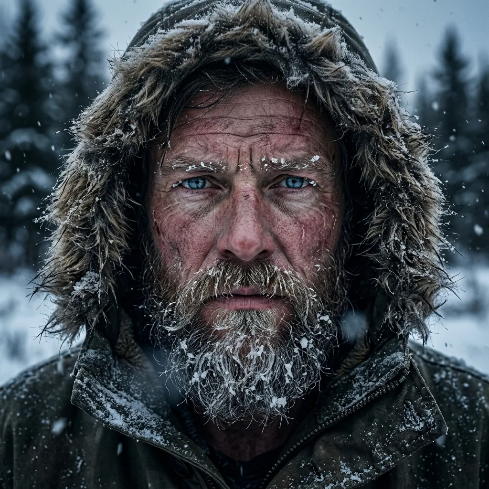

# Survival, resilience, endurance against nature

[← Back to the collection](../../README.md) · Category: [Photography](../../gallery/photography.md) · Model: `Vinano Image v2` · ID: `vn-00116`

<a href="https://vinano.ai?utm_source=github&utm_medium=readme&utm_campaign=awesome-image-video-prompts-updating&utm_content=prompt-page-image"></a>

<sub>Preview generated with <a href="https://vinano.ai?utm_source=github&utm_medium=readme&utm_campaign=awesome-image-video-prompts-updating&utm_content=prompt-page-caption">vinano.ai</a></sub>

## Prompt

```text
{
 "Objective": "Create an intense cinematic close-up portrait conveying survival, resilience, and raw human strength in a harsh winter environment",
 "PersonaDetails": {
 "Subject": {
 "Type": "Rugged adult man",
 "Eyes": {
 "Color": "Piercing icy blue",
 "Focus": "Primary focal point of the image, razor sharp"
 },
 "FacialFeatures": {
 "Beard": "Thick, full beard",
 "Skin": "Weathered visible pores, fine texture, and subtle scars"
 },
 "Expression": "Intense, stoic, emotionally restrained",
 "Wardrobe": {
 "Outerwear": "Heavy winter coat fur-lined hood",
 "Framing": "Hood partially framing the face"
 }
 }
 },
 "EnvironmentalDetails": {
 "Season": "Winter",
 "Atmosphere": "Cold, harsh, unforgiving",
 "Snow": {
 "Details": "Snowflakes clinging to hair, eyelashes, eyebrows, and beard",
 "Motion": "Frozen mid-air and resting naturally on facial hair"
 }
 },
 "Composition": {
 "Framing": "Extreme close-up portrait",
 "Crop": "Tight crop emphasizing eyes and facial texture",
 "DepthOfField": "Very shallow depth of field",
 "Focus": "Ultra-sharp on eyes, soft falloff toward edges"
 },
 "LightingAndMood": {
 "LightingStyle": "Dramatic low-key filmic, cinematic lighting",
 "KeyLight": "Soft, directional light sculpting facial structure",
 "RimLight": "Cold rim light separating subject from background",
 "ColorGrading": "Moody cinematic tones cold blues and warm brown accents",
 "Mood": "Intense, raw, powerful, solitary"
 },
 "ArtDirection": {
 "Style": "Hyper-realistic cinematic photography",
 "Aesthetic": "Survival realism, raw human endurance",
 "TextureEmphasis": ["true-to-life photorealistic skin pores",
 "Beard hair detail",
 "Fur-lined fabric texture",
 "Ice and snow particles"]
 },
 "PhotographyStyle": {
 "Genre": "Cinematic survival portrait photography",
 "RealismLevel": "Extreme photorealism",
 "DetailLevel": "8K ultra-high detail controlled sharpness"
 },
 "Theme": {
 "Concept": "Survival, resilience, endurance against nature",
 "EmotionalImpact": "Strength, determination, quiet defiance"
 },
 "NegativePrompt": ["smooth skin",
 "beauty retouching",
 "flat lighting",
 "low contrast",
 "cartoon",
 "anime",
 "fantasy illustration",
 "blurry eyes"],
 "ResponseFormat": {
 "Type": "Single image",
 "Orientation": "Portrait",
 "AspectRatio": "2:3"
 }
}

Render with rich micro-detail while keeping the layout uncluttered and intentional.
```

## Try it on vinano.ai

1. Copy the prompt above.
2. Open **[vinano.ai](https://vinano.ai?utm_source=github&utm_medium=readme&utm_campaign=awesome-image-video-prompts-updating&utm_content=prompt-page-try)**, paste it into the image generator and pick a model.
3. Swap any placeholders (brand, product, city, person…) for your own details, then generate.

More prompts like this: [Photography gallery](../../gallery/photography.md) · [all categories](../../README.md#contents)
