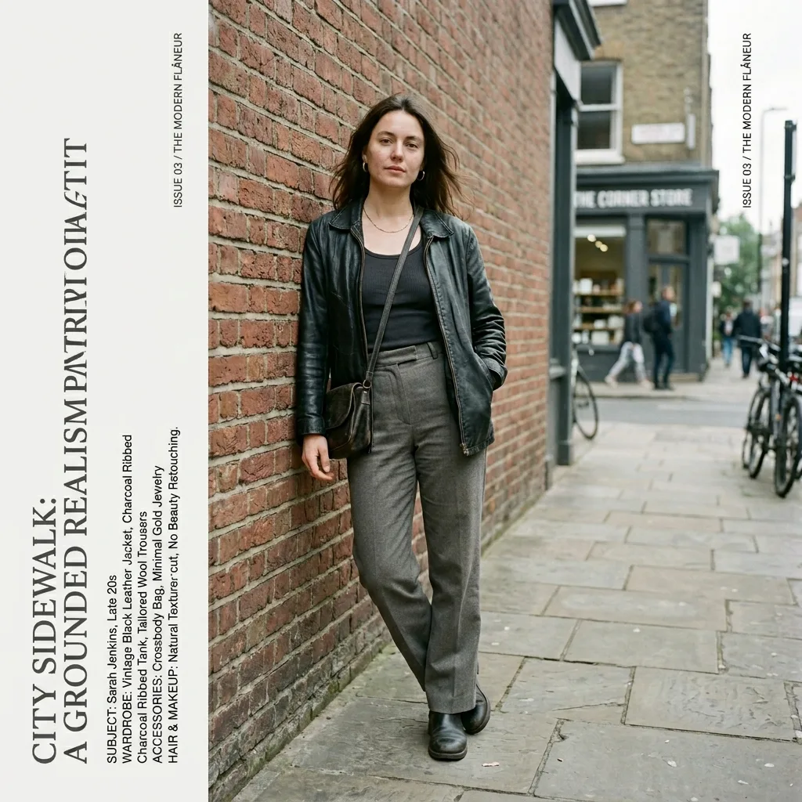

# Late 20s to early 30s

[← Back to the collection](../../README.md) · Category: [Photography](../../gallery/photography.md) · Model: `Vinano Image v2` · ID: `vn-00117`

<a href="https://vinano.ai?utm_source=github&utm_medium=readme&utm_campaign=awesome-image-video-prompts-updating&utm_content=prompt-page-image"></a>

<sub>Preview generated with <a href="https://vinano.ai?utm_source=github&utm_medium=readme&utm_campaign=awesome-image-video-prompts-updating&utm_content=prompt-page-caption">vinano.ai</a></sub>

## Prompt

```text
{
 "scene": "Urban street portrait on a quiet city sidewalk",
 "subject": {
 "gender": "female",
 "age_range": "late 20s to early 30s",
 "expression": "neutral, introspective, calm confidence",
 "pose": "standing casually, leaning slightly against a brick wall, weight shifted to one leg, arms relaxed",
 "gaze": "looking directly at camera, unfazed, understated presence"
 },
 "wardrobe": {
 "outerwear": "black leather jacket natural wear and soft creases",
 "top": "dark charcoal ribbed tank top",
 "bottom": "high-waisted tailored wool trousers in muted grey",
 "accessories": "small dark leather crossbody bag, minimal jewelry",
 "styling_notes": "effortless, functional, lived-in fashion, no trend exaggeration"
 },
 "hair_and_makeup": {
 "hair": "natural medium-length hair, loose and slightly wind-touched, no styling product shine",
 "makeup": "minimal or none, natural skin texture visible, subtle under-eye shadows, real pores"
 },
 "environment": {
 "location": "narrow city street brick wall and storefronts",
 "background": "softly out-of-focus bicycles and pedestrians in the distance",
 "era_feel": "timeless contemporary, everyday realism"
 },
 "lighting": {
 "type": "natural overcast daylight",
 "direction": "soft frontal gentle side falloff",
 "contrast": "low to medium contrast",
 "notes": "no harsh highlights, no dramatic rim light"
 },
 "camera": {
 "lens": "50mm full-frame look",
 "framing": "full-body portrait, eye-level perspective",
 "depth_of_field": "moderately shallow, subject separated subtly from background",
 "movement": "static, documentary stillness"
 },
 "color_and_texture": {
 "color_palette": "muted earth tones, soft greys, natural skin tones",
 "texture": "visible fabric weave, brick texture, light film grain",
 "grading": "neutral, slightly cool, filmic, no teal-orange"
 },
 "aesthetic_constraints": ["no plastic skin",
 "no beauty retouching",
 "no cinematic exaggeration",
 "no fashion editorial posing",
 "no artificial glow",
 "avoid AI symmetry"],
 "overall_vibe": "quiet confidence, observational, grounded realism, modern street portrait"
}

Aim for an editorial, design-driven look with deliberate negative space.
```

## Try it on vinano.ai

1. Copy the prompt above.
2. Open **[vinano.ai](https://vinano.ai?utm_source=github&utm_medium=readme&utm_campaign=awesome-image-video-prompts-updating&utm_content=prompt-page-try)**, paste it into the image generator and pick a model.
3. Swap any placeholders (brand, product, city, person…) for your own details, then generate.

More prompts like this: [Photography gallery](../../gallery/photography.md) · [all categories](../../README.md#contents)
