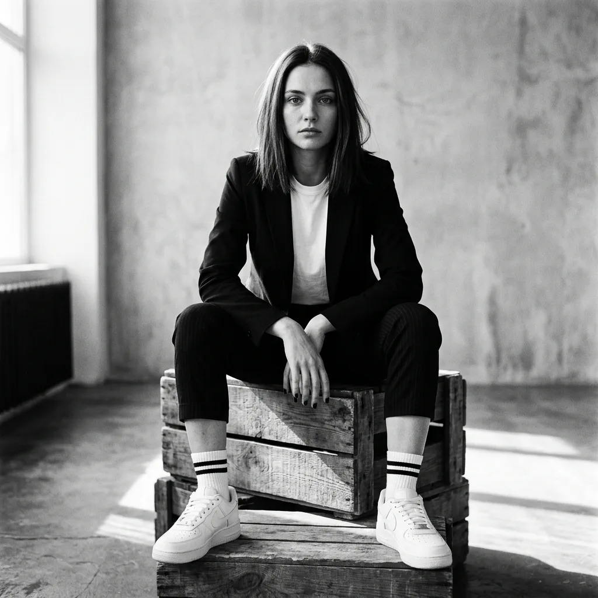

# Photography prompt #122

[← Back to the collection](../../README.md) · Category: [Photography](../../gallery/photography.md) · Model: `Vinano Image v2` · ID: `vn-00122`

<a href="https://vinano.ai?utm_source=github&utm_medium=readme&utm_campaign=awesome-image-video-prompts-updating&utm_content=prompt-page-image"></a>

<sub>Preview generated with <a href="https://vinano.ai?utm_source=github&utm_medium=readme&utm_campaign=awesome-image-video-prompts-updating&utm_content=prompt-page-caption">vinano.ai</a></sub>

## Prompt

```text
Create a realistic portrait (100% identical face, no editing allowed).
A hyper-realistic black-and-white portrait of a young beautiful woman a calm, serious, and introspective expression, sitting casually on a stack of rustic wooden crates in a refined minimalist studio setting. She faces the camera directly a relaxed yet confident posture, her legs slightly apart, one hand resting naturally between her knees and the other loosely stretched across her thigh, creating a powerful editorial fashion pose.
She has straight, dark, shoulder-length hair a natural center parting, slightly tousled, gently framing her face. Her facial features are delicate and symmetrical, a naturally smooth skin texture, subtle shadows under her eyes, soft, slightly parted lips, and deep, expressive eyes staring directly into the lens, conveying a calm confidence and emotional depth. The lack of heavy makeup emphasizes the natural editorial aesthetic.
Clothing & Style:
She wears a fitted black blazer structured shoulders over a simple white crew-neck T-shirt, paired cropped black striped trousers. On her feet are modern, chunky white sneakers, paired white calf-length socks bold black horizontal stripes, adding a casual street-style contrast to the formal blazer. Minimal accessories, no visible jewelry. Her nails are painted black.
Lighting & Ambiance:
High-contrast filmic, cinematic lighting strong, directional natural light coming in from the side, creating dramatic diagonal streaks of light and shadow on the plain studio walls and partly on her body. The lighting creates depth, texture, and a moody editorial atmosphere reminiscent of a high-end fashion magazine. Soft shadows preserve facial details while maintaining strong contrast.
Camera & Composition:
Medium-full-length shot, eye-level perspective, centered composition. Shot a professional DSLR or medium format camera, a prime lens (50mm–85mm). Shallow depth of field sharp focus on the subject, subtle background blur. Sharp details, subtle texture of fabric, visible skin pores, realistic falloff.

Style & Quality:
Editorial fashion photography, refined minimalist, cinematic, monochrome aesthetic, Vogue-style portraiture, ultra-high resolution, sharp focus, film-like contrast, timeless and modern atmosphere.

Render with rich micro-detail while keeping the layout uncluttered and intentional.
```

## Try it on vinano.ai

1. Copy the prompt above.
2. Open **[vinano.ai](https://vinano.ai?utm_source=github&utm_medium=readme&utm_campaign=awesome-image-video-prompts-updating&utm_content=prompt-page-try)**, paste it into the image generator and pick a model.
3. Swap any placeholders (brand, product, city, person…) for your own details, then generate.

More prompts like this: [Photography gallery](../../gallery/photography.md) · [all categories](../../README.md#contents)
