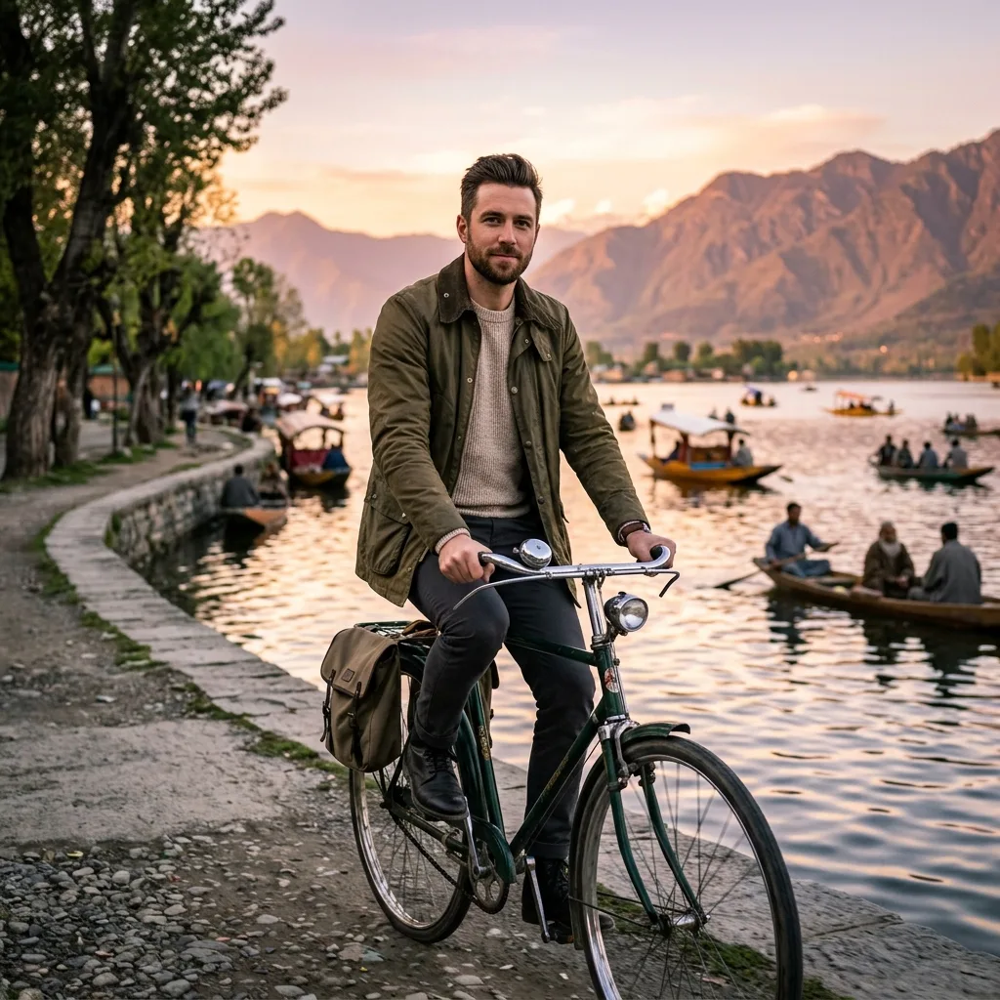

# Photograph of a handsome man riding a bicycle along

[← Back to the collection](../../README.md) · Category: [Photography](../../gallery/photography.md) · Model: `Vinano Image v2` · ID: `vn-00124`

<a href="https://vinano.ai?utm_source=github&utm_medium=readme&utm_campaign=awesome-image-video-prompts-updating&utm_content=prompt-page-image"></a>

<sub>Preview generated with <a href="https://vinano.ai?utm_source=github&utm_medium=readme&utm_campaign=awesome-image-video-prompts-updating&utm_content=prompt-page-caption">vinano.ai</a></sub>

## Prompt

```text
A realistic cinematic photograph of a handsome man riding a bicycle along the edge of Dal Lake at sunset, wearing an olive-green jacket over a light sweater, black trousers and dark shoes. He has short styled hair and a trimmed beard, looking calmly toward the camera a slight confident expression. Warm golden-hour light reflecting on the lake, traditional shikara boats people rowing in the background, soft ripples in the water, distant mountains under a pastel sky orange and pink hues. Shallow depth of field, natural colors, high detail, lifestyle travel photography, ultra-realistic, 4K quality. Maintain consistent colour harmony and crisp focus across the whole frame.
```

## Try it on vinano.ai

1. Copy the prompt above.
2. Open **[vinano.ai](https://vinano.ai?utm_source=github&utm_medium=readme&utm_campaign=awesome-image-video-prompts-updating&utm_content=prompt-page-try)**, paste it into the image generator and pick a model.
3. Swap any placeholders (brand, product, city, person…) for your own details, then generate.

More prompts like this: [Photography gallery](../../gallery/photography.md) · [all categories](../../README.md#contents)
