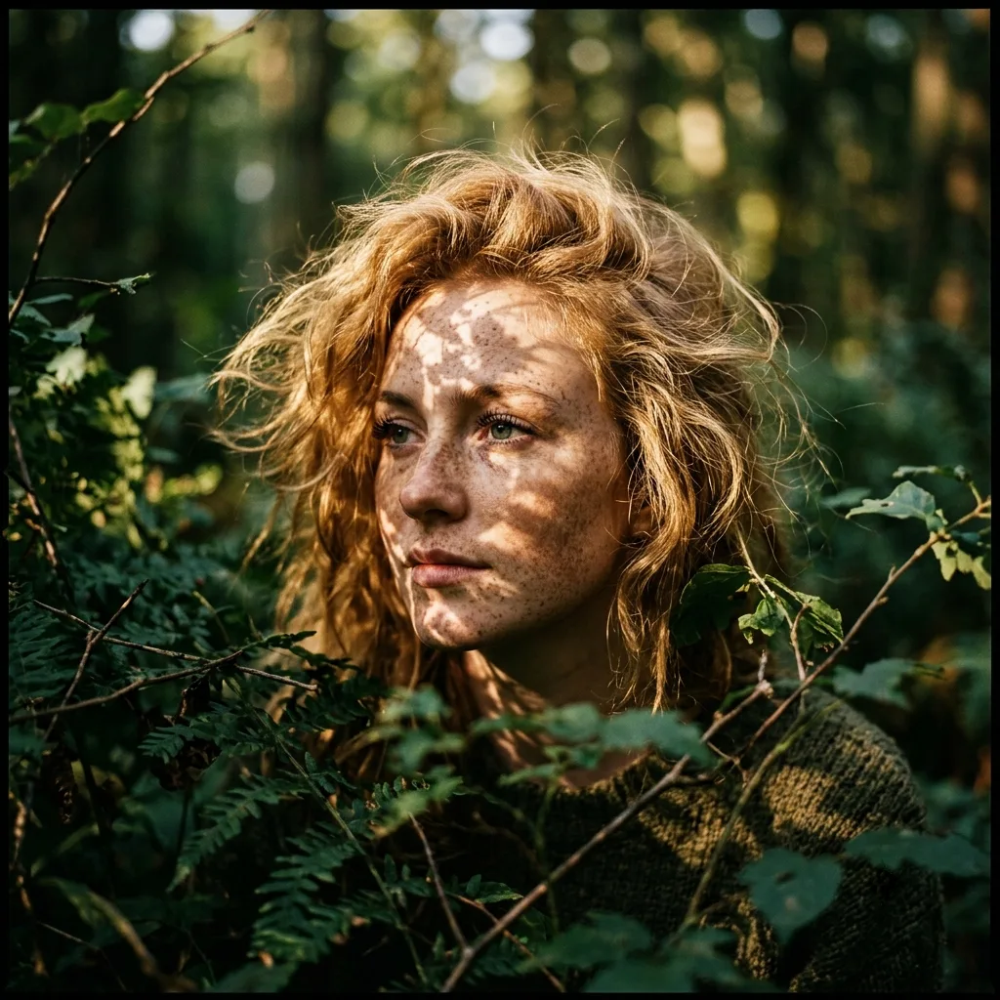

# Close-up portrait of a young woman messy, voluminous strawberry

[← Back to the collection](../../README.md) · Category: [Photography](../../gallery/photography.md) · Model: `Vinano Image v2` · ID: `vn-00129`

<a href="https://vinano.ai?utm_source=github&utm_medium=readme&utm_campaign=awesome-image-video-prompts-updating&utm_content=prompt-page-image"></a>

<sub>Preview generated with <a href="https://vinano.ai?utm_source=github&utm_medium=readme&utm_campaign=awesome-image-video-prompts-updating&utm_content=prompt-page-caption">vinano.ai</a></sub>

## Prompt

```text
Close-up portrait of a young woman messy, voluminous strawberry blonde hair and heavy freckles across her nose and cheeks. She is partially obscured by dark green forest foliage in the foreground. Dramatic filmic, cinematic lighting dappled golden sunlight filtering through leaves, creating high-contrast shadows across her face. Dreamy, ethereal atmosphere, soft bokeh background of a dense forest, shot on 35mm film, earthy tones, hyper-realistic skin textures.
​Key Elements to Tweak
​If you want to adjust the vibe, try changing these specific keywords:
​Lighting: Swap "dappled sunlight" for "rim lighting" to get a glowing outline around her hair, or "overcast" for a moodier, softer look.
​Framing: Use "extreme close-up" to focus purely on the eyes and freckles, or "medium shot" to show more of the forest environment.
​Color Palette: Add "analog film aesthetic" for that slightly grainy, nostalgic feel seen in your image, or "vibrant forest greens" to make the leaves pop.

Preserve realistic proportions and depth for a confident, professional finish.
```

## Try it on vinano.ai

1. Copy the prompt above.
2. Open **[vinano.ai](https://vinano.ai?utm_source=github&utm_medium=readme&utm_campaign=awesome-image-video-prompts-updating&utm_content=prompt-page-try)**, paste it into the image generator and pick a model.
3. Swap any placeholders (brand, product, city, person…) for your own details, then generate.

More prompts like this: [Photography gallery](../../gallery/photography.md) · [all categories](../../README.md#contents)
