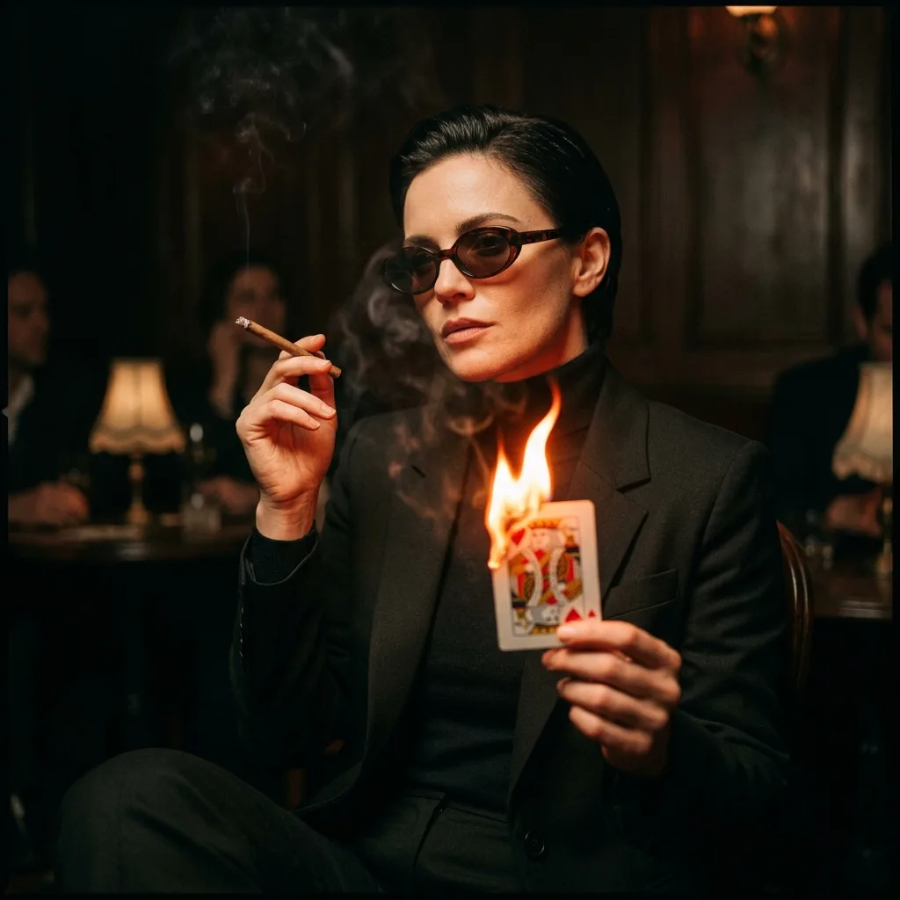

# Moody portrait of a stylish women in dark suit

[← Back to the collection](../../README.md) · Category: [Photography](../../gallery/photography.md) · Model: `Vinano Image v2` · ID: `vn-00130`

<a href="https://vinano.ai?utm_source=github&utm_medium=readme&utm_campaign=awesome-image-video-prompts-updating&utm_content=prompt-page-image"></a>

<sub>Preview generated with <a href="https://vinano.ai?utm_source=github&utm_medium=readme&utm_campaign=awesome-image-video-prompts-updating&utm_content=prompt-page-caption">vinano.ai</a></sub>

## Prompt

```text
A cinematic, moody portrait of a stylish women in dark suit and oval sunglasses, smoking a thin medium cigar while holding a burning playing card in his hand king of hearts, dramatic fire and smoke swirling in the air, low-key lighting, warm orange fire glow illuminating her face, dark blurred background, shallow depth of field, ultra-realistic, high contrast, cinematic photography, 35mm lens look, soft bokeh, detailed skin texture, sharp focus, professional lighting, dark noir atmosphere. Maintain consistent colour harmony and crisp focus across the whole frame.
```

## Try it on vinano.ai

1. Copy the prompt above.
2. Open **[vinano.ai](https://vinano.ai?utm_source=github&utm_medium=readme&utm_campaign=awesome-image-video-prompts-updating&utm_content=prompt-page-try)**, paste it into the image generator and pick a model.
3. Swap any placeholders (brand, product, city, person…) for your own details, then generate.

More prompts like this: [Photography gallery](../../gallery/photography.md) · [all categories](../../README.md#contents)
