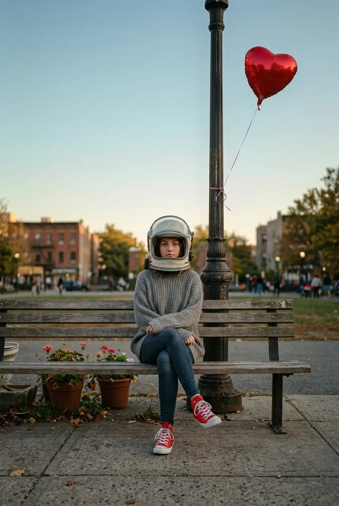

# Image type

[← Back to the collection](../../README.md) · Category: [Photography](../../gallery/photography.md) · Model: `Vinano Image Pro` · ID: `vn-00131`

<a href="https://vinano.ai?utm_source=github&utm_medium=readme&utm_campaign=awesome-image-video-prompts-updating&utm_content=prompt-page-image"></a>

<sub>Preview generated with <a href="https://vinano.ai?utm_source=github&utm_medium=readme&utm_campaign=awesome-image-video-prompts-updating&utm_content=prompt-page-caption">vinano.ai</a></sub>

## Prompt

```text
{
"image_type": "photograph",
"orientation": "vertical",
"aspect_ratio": "2:3",
"composition": {
"framing": "centered subject strong vertical symmetry",
"rule_of_thirds": "subject centered vertically, balloon positioned upper-right third",
"depth": "moderate depth of field softly blurred background",
"leading_elements": "bench slats and lamppost create vertical and horizontal structure",
"negative_space": "open sky occupying upper half of frame"
},
"primary_subject": {
"description": "young person seated on a wooden park bench wearing an astronaut helmet",
"pose": "seated, knees together, arms folded inward, posing towards camera",
"emotion": "introspective, melancholic, whimsical loneliness",
"clothing": {
"top": "oversized gray sweater",
"bottom": "dark skinny jeans",
"footwear": "red high-top sneakers white laces",
"accessories": "vintage-style astronaut helmet"
}
},
"secondary_subjects": [{
"type": "object",
"description": "red heart-shaped helium balloon",
"position": "upper right, tethered to lamppost",
"symbolism": "love, longing, fragility"
},
{
"type": "environment_object",
"description": "classic street lamppost",
"position": "right side of frame",
"function": "anchor point for balloon string"
}],
"environment": {
"location_type": "urban park or public square",
"foreground": "flower pots small blooming flowers beneath bench",
"background": "low-rise buildings and distant urban elements",
"sky": "clear soft gradient"
},
"color_palette": {
"dominant_colors": ["muted teal sky",
"warm brown wood",
"charcoal gray clothing"],
"accent_colors": ["vivid red balloon",
"bright red sneakers"],
"overall_tone": "muted selective saturation"
},
"lighting": {
"type": "natural light",
"time_of_day": "golden hour or late afternoon",
"direction": "soft ambient, slightly directional from left",
"contrast": "low to medium",
"highlights": "subtle reflections on astronaut visor and balloon surface",
"shadows": "soft, diffused shadows under bench and subject"
},
"technical_details": {
"camera_angle": "eye-level",
"lens_effect": "slight background compression suggesting mid-range focal length",
"focus": "sharp on subject, gentle background blur",
"grain": "minimal, clean digital look"
},
"artistic_style": {
"genre": "conceptual portrait photography",
"mood": "surreal, poetic, nostalgic",
"themes": ["isolation",
"imagination",
"emotional distance",
"childhood wonder"],
"visual_metaphors": ["astronaut helmet representing emotional separation",
"heart balloon symbolizing unattainable or fragile love"]
},
"typography": {
"present": false
},
"overall_aesth
etic": "cinematic, dreamy, modern surrealism lifestyle photography influences"
}

Emphasise material texture and natural light so the final frame feels tactile and premium.
```

## Try it on vinano.ai

1. Copy the prompt above.
2. Open **[vinano.ai](https://vinano.ai?utm_source=github&utm_medium=readme&utm_campaign=awesome-image-video-prompts-updating&utm_content=prompt-page-try)**, paste it into the image generator and pick a model.
3. Swap any placeholders (brand, product, city, person…) for your own details, then generate.

More prompts like this: [Photography gallery](../../gallery/photography.md) · [all categories](../../README.md#contents)
