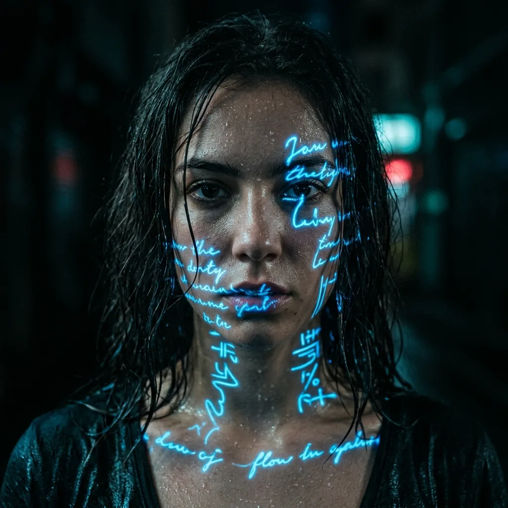

# Close-up portrait of a mysterious young woman in darkness

[← Back to the collection](../../README.md) · Category: [Photography](../../gallery/photography.md) · Model: `Vinano Image v2` · ID: `vn-00134`

<a href="https://vinano.ai?utm_source=github&utm_medium=readme&utm_campaign=awesome-image-video-prompts-updating&utm_content=prompt-page-image"></a>

<sub>Preview generated with <a href="https://vinano.ai?utm_source=github&utm_medium=readme&utm_campaign=awesome-image-video-prompts-updating&utm_content=prompt-page-caption">vinano.ai</a></sub>

## Prompt

```text
A cinematic, hyper-realistic close-up portrait of a mysterious young woman in darkness, wet skin glistening as if in rain. Neon blue glowing handwritten text and symbols are projected across her face and upper body, wrapping around her eyes, cheeks, lips, and collarbones like living poetry. Her intense gaze looks directly into the camera, eyes sharp and reflective. Damp, tousled hair frames her face, partially shadowed. The lighting is low-key and dramatic, teal and cyan highlights illuminating her skin while the background fades into deep black. Ultra-detailed skin texture, glossy reflections, shallow depth of field, cyber-poetic aesthetic, futuristic noir mood, emotional and intimate atmosphere, filmic, cinematic lighting, 8K, photorealism. Preserve realistic proportions and depth for a confident, professional finish.
```

## Try it on vinano.ai

1. Copy the prompt above.
2. Open **[vinano.ai](https://vinano.ai?utm_source=github&utm_medium=readme&utm_campaign=awesome-image-video-prompts-updating&utm_content=prompt-page-try)**, paste it into the image generator and pick a model.
3. Swap any placeholders (brand, product, city, person…) for your own details, then generate.

More prompts like this: [Photography gallery](../../gallery/photography.md) · [all categories](../../README.md#contents)
