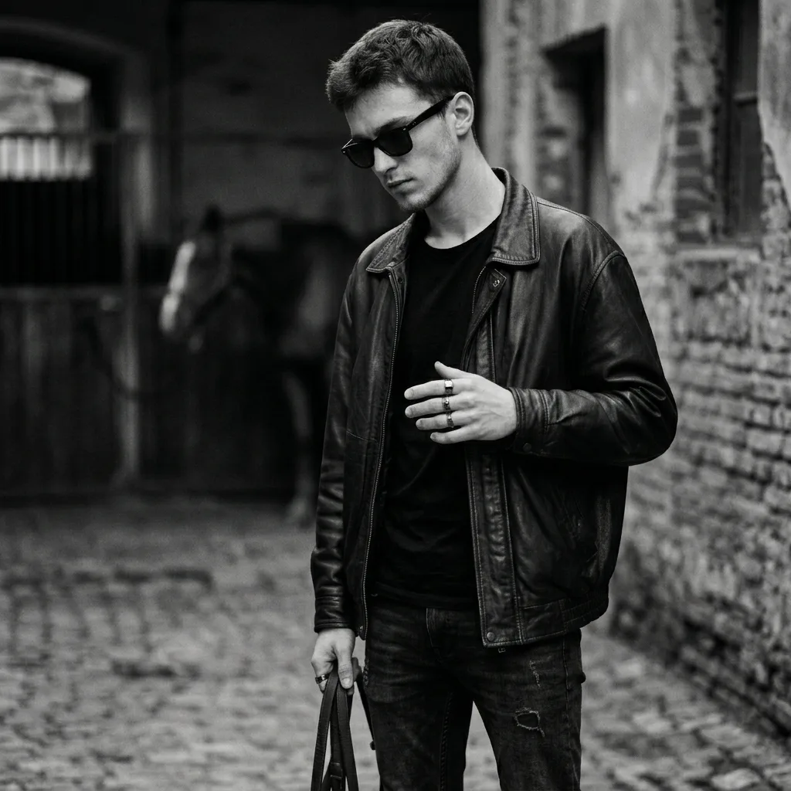

# 8K cinematic black-and-white portrait photograph, portrait aspect ratio 1664

[← Back to the collection](../../README.md) · Category: [Photography](../../gallery/photography.md) · Model: `Vinano Image v2` · ID: `vn-00135`

<a href="https://vinano.ai?utm_source=github&utm_medium=readme&utm_campaign=awesome-image-video-prompts-updating&utm_content=prompt-page-image"></a>

<sub>Preview generated with <a href="https://vinano.ai?utm_source=github&utm_medium=readme&utm_campaign=awesome-image-video-prompts-updating&utm_content=prompt-page-caption">vinano.ai</a></sub>

## Prompt

```text
Ultra-realistic 8K cinematic black-and-white portrait photograph, portrait aspect ratio 1664*2080. An 18-year young handsome man a slim skinny body, lean physique, narrow shoulders and waist, youthful proportions, captured in a COMPLETELY NEW attitude-heavy pose a NEW background position. He is standing this time (not seated), slightly off-center in the frame, body angled three-quarters away from the camera, one shoulder closer to lens, head tilted downward chin tucked, strong swag-filled stance. One hand casually gripping the horse lead near his thigh, the other hand lifted near chest level relaxed fingers to clearly show rings. Keep my face exactly the same as in the uploaded photo - do not change or edit my face. 100% face accuracy. Facial expression is cold, detached, controlled dominance; gaze downward and sideways, partially hidden behind dark sunglasses, creating a mysterious authority vibe. Natural facial structure light stubble, real skin pores Aim for an editorial, design-driven look with deliberate negative space.
```

## Try it on vinano.ai

1. Copy the prompt above.
2. Open **[vinano.ai](https://vinano.ai?utm_source=github&utm_medium=readme&utm_campaign=awesome-image-video-prompts-updating&utm_content=prompt-page-try)**, paste it into the image generator and pick a model.
3. Swap any placeholders (brand, product, city, person…) for your own details, then generate.

More prompts like this: [Photography gallery](../../gallery/photography.md) · [all categories](../../README.md#contents)
