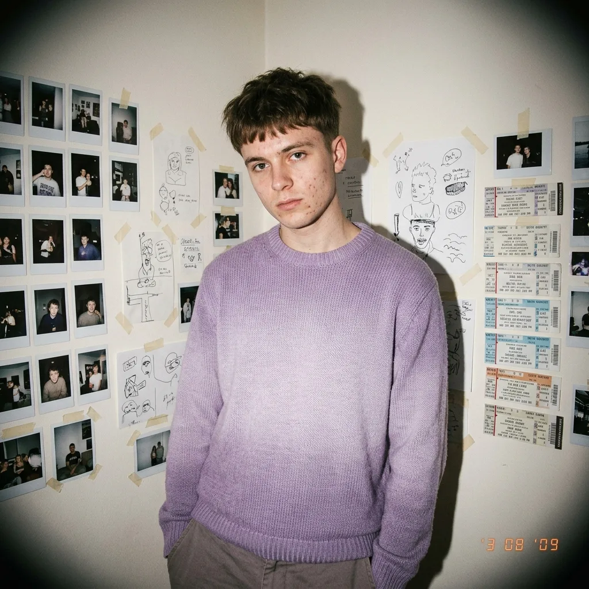

# Calm, slightly guarded, introspective

[← Back to the collection](../../README.md) · Category: [Photography](../../gallery/photography.md) · Model: `Vinano Image v2` · ID: `vn-00137`

<a href="https://vinano.ai?utm_source=github&utm_medium=readme&utm_campaign=awesome-image-video-prompts-updating&utm_content=prompt-page-image"></a>

<sub>Preview generated with <a href="https://vinano.ai?utm_source=github&utm_medium=readme&utm_campaign=awesome-image-video-prompts-updating&utm_content=prompt-page-caption">vinano.ai</a></sub>

## Prompt

```text
{
 "scene": "An intimate indoor portrait taken in a personal bedroom or studio space, walls covered taped photos, sketches, and ticket stubs",
 "subject": {
 "gender": "male",
 "age": "early 20s",
 "expression": "calm, slightly guarded, introspective",
 "pose": "standing casually, shoulders relaxed, slight lean, hands out of frame",
 "gaze": "direct but unforced eye contact the camera",
 "hair": "short, messy crop natural volume, slightly uneven fringe",
 "wardrobe": {
 "top": "textured knit sweater soft purple gradient fade",
 "bottom": "muted trousers, understated and casual",
 "style": "effortless, lived-in, indie editorial"
 }
 },
 "environment": {
 "location": "personal room or creative space",
 "background_elements": ["polaroid photographs taped to wall",
 "handwritten sketches and doodles",
 "concert or travel ticket stubs",
 "masking tape visible and imperfect"],
 "atmosphere": "nostalgic, personal, slightly raw"
 },
 "lighting": {
 "type": "direct on-camera flash",
 "quality": "harsh but controlled",
 "shadow": "hard shadows falling behind subject",
 "mood": "late 90s / early 2000s candid realism"
 },
 "camera": {
 "shot_type": "medium portrait",
 "lens": "35mm",
 "perspective": "eye-level, snapshot-style framing",
 "depth_of_field": "deep enough to keep wall details readable",
 "imperfections": "slight vignetting, flash falloff"
 },
 "color_grading": {
 "palette": "muted neutrals soft lavender emphasis",
 "contrast": "moderate",
 "tones": "natural skin tones slight warmth"
 },
 "texture_and_detail": {
 "skin": "real texture, visible blemishes, no smoothing",
 "fabric": "clearly defined knit texture",
 "grain": "noticeable film grain",
 "timestamp": "subtle date stamp in corner"
 },
 "style": "analog-inspired, diary-like portrait, lo-fi editorial realism",
 "negative_prompt": ["studio lighting",
 "beauty retouching",
 "plastic skin",
 "perfect symmetry",
 "over-sharpening",
 "clean minimal background",
 "AI artifacts"]
}

Emphasise material texture and natural light so the final frame feels tactile and premium.
```

## Try it on vinano.ai

1. Copy the prompt above.
2. Open **[vinano.ai](https://vinano.ai?utm_source=github&utm_medium=readme&utm_campaign=awesome-image-video-prompts-updating&utm_content=prompt-page-try)**, paste it into the image generator and pick a model.
3. Swap any placeholders (brand, product, city, person…) for your own details, then generate.

More prompts like this: [Photography gallery](../../gallery/photography.md) · [all categories](../../README.md#contents)
