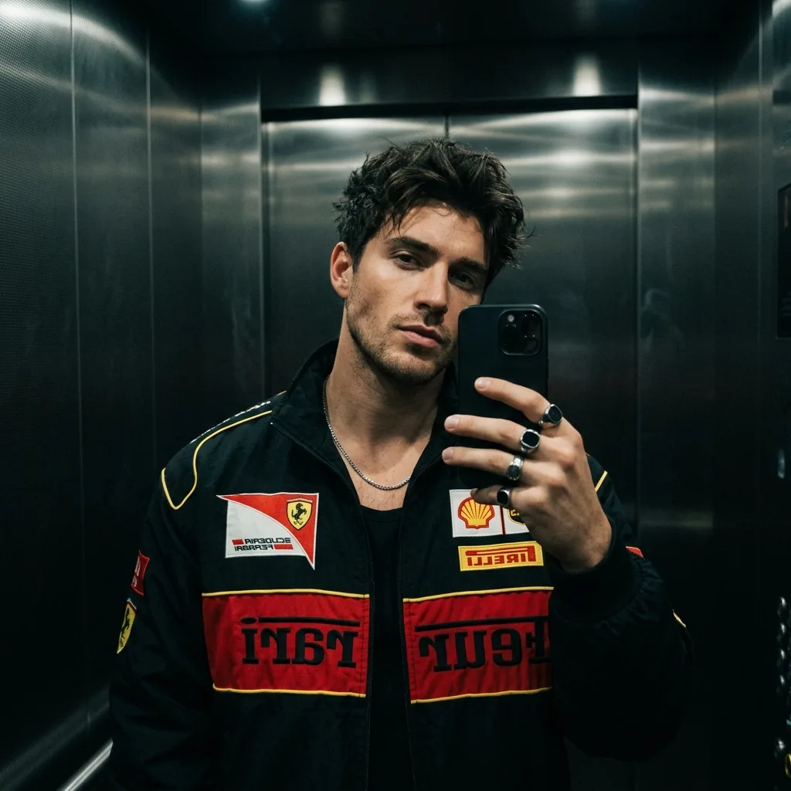

# Moody cinematic mirror selfie of a stylish young man

[← Back to the collection](../../README.md) · Category: [Photography](../../gallery/photography.md) · Model: `Vinano Image v2` · ID: `vn-00140`

<a href="https://vinano.ai?utm_source=github&utm_medium=readme&utm_campaign=awesome-image-video-prompts-updating&utm_content=prompt-page-image"></a>

<sub>Preview generated with <a href="https://vinano.ai?utm_source=github&utm_medium=readme&utm_campaign=awesome-image-video-prompts-updating&utm_content=prompt-page-caption">vinano.ai</a></sub>

## Prompt

```text
A moody cinematic mirror selfie of a stylish young man use image for face reference tousled dark hair and light stubble, wearing a black Ferrari racing jacket red and yellow stripes and motorsport patches. He has a silver chain necklace and multiple rings, holding a modern smartphone in one hand. Low-key dramatic lighting, dark elevator interior soft reflections, shallow depth of field, sharp focus on the subject’s face. Fashion editorial style, masculine aesthetic, realistic skin texture, ultra-detailed, 35mm photography, cinematic color grading, high contrast, true-to-life photorealistic, 4K. Aim for an editorial, design-driven look with deliberate negative space.
```

## Try it on vinano.ai

1. Copy the prompt above.
2. Open **[vinano.ai](https://vinano.ai?utm_source=github&utm_medium=readme&utm_campaign=awesome-image-video-prompts-updating&utm_content=prompt-page-try)**, paste it into the image generator and pick a model.
3. Swap any placeholders (brand, product, city, person…) for your own details, then generate.

More prompts like this: [Photography gallery](../../gallery/photography.md) · [all categories](../../README.md#contents)
