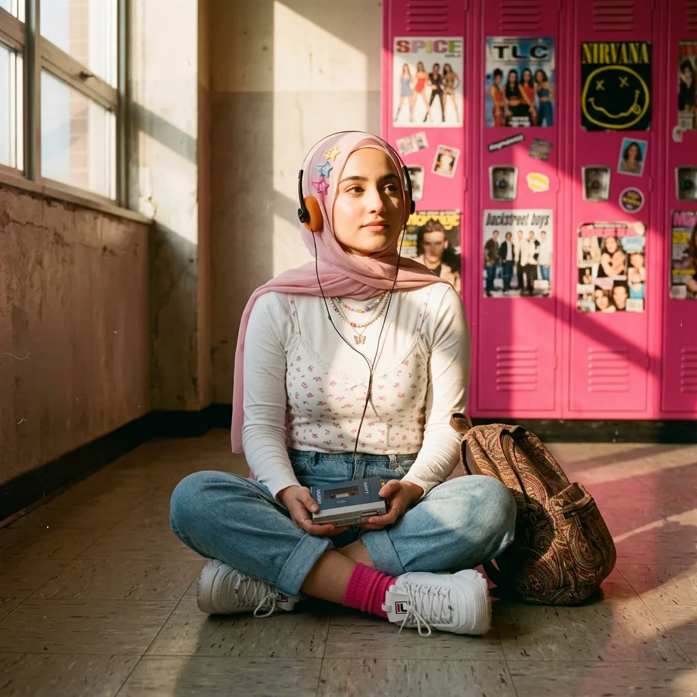

# Photography prompt #142

[← Back to the collection](../../README.md) · Category: [Photography](../../gallery/photography.md) · Model: `Vinano Image v2` · ID: `vn-00142`

<a href="https://vinano.ai?utm_source=github&utm_medium=readme&utm_campaign=awesome-image-video-prompts-updating&utm_content=prompt-page-image"></a>

<sub>Preview generated with <a href="https://vinano.ai?utm_source=github&utm_medium=readme&utm_campaign=awesome-image-video-prompts-updating&utm_content=prompt-page-caption">vinano.ai</a></sub>

## Prompt

```text
A cinematic, nostalgic portrait of a young hijab woman (use the reference photo) sitting cross-legged on the floor of a retro school hallway, bathed in warm, golden-hour sunlight. She has a soft, contemplative expression, gazing dreamily off-camera to the right. She wears a pink chiffon hijab adorned colorful star-shaped hair clips on the left side.Her outfit is Y2K-inspired: a white long shirt layered under a white spaghetti-strap camisole a delicate vintagefloral print, layered pearl necklaces, high-waisted light-wash denim jeans cuffed at the ankles, vibrant hot-pink ribbed socks, and chunky white sneakers. She holds a vintage silver cassette player in both hands and wears large, retro orange foam headphones. A woven paisley-patterned backpack sits next to her.The background features a row of vibrant hot-pink metal lockers covered in retro magazine cutouts and band posters. Strong, diagonal shadows from a nearby window cast a dramatic, warm glow across the lockers and her face. Dreamy coming-of-age movie aesthetic, high-resolution textures, soft depth of field, 35mm film grain style --ar 9:16 --style raw Preserve realistic proportions and depth for a confident, professional finish.
```

## Try it on vinano.ai

1. Copy the prompt above.
2. Open **[vinano.ai](https://vinano.ai?utm_source=github&utm_medium=readme&utm_campaign=awesome-image-video-prompts-updating&utm_content=prompt-page-try)**, paste it into the image generator and pick a model.
3. Swap any placeholders (brand, product, city, person…) for your own details, then generate.

More prompts like this: [Photography gallery](../../gallery/photography.md) · [all categories](../../README.md#contents)
