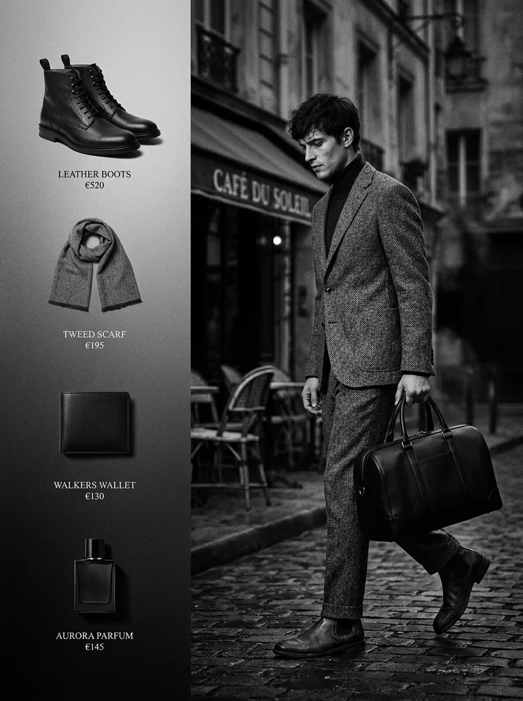

# High-fashion black and white editorial campaign image a 3:4

[← Back to the collection](../../README.md) · Category: [Photography](../../gallery/photography.md) · Model: `Vinano Image Pro` · ID: `vn-00143`

<a href="https://vinano.ai?utm_source=github&utm_medium=readme&utm_campaign=awesome-image-video-prompts-updating&utm_content=prompt-page-image"></a>

<sub>Preview generated with <a href="https://vinano.ai?utm_source=github&utm_medium=readme&utm_campaign=awesome-image-video-prompts-updating&utm_content=prompt-page-caption">vinano.ai</a></sub>

## Prompt

```text
A high-fashion black and white editorial campaign image a 3:4 aspect ratio, split into two vertical sections. Strong contrast, rich tonal depth, cinematic grain.
RIGHT SIDE:

A man captured mid-step in a Parisian street café scene. Architecture dissolves into soft gradients and shadow. Light sculpts the face and garments rather than illuminating the scene.
He wears a tweed tailored jacket and matching trousers, the fabric rendered through contrast and texture rather than color. The tweed weave is emphasized through light and shadow.

Black leather Chelsea boots blend into the tonal range.

A structured leather bag appears as a bold silhouette.
Expression is introspective, distant. Movement feels frozen, deliberate.
STYLE & MOOD:

Timeless, cinematic, intellectual, masculine restraint, European fashion cinema.
LEFT SIDE:

A monochrome product composition on a light-to-dark gradient background. Items float slightly, defined by shadow and form. Minimal typographic price indicators.
OVERALL FEEL:

Classic fashion cinema, archival quality, serious tone.
NEGATIVE PROMPT:

Color accents, glossy lighting, modern street aesthetics, commercial catalog look.

Preserve realistic proportions and depth for a confident, professional finish.
```

## Try it on vinano.ai

1. Copy the prompt above.
2. Open **[vinano.ai](https://vinano.ai?utm_source=github&utm_medium=readme&utm_campaign=awesome-image-video-prompts-updating&utm_content=prompt-page-try)**, paste it into the image generator and pick a model.
3. Swap any placeholders (brand, product, city, person…) for your own details, then generate.

More prompts like this: [Photography gallery](../../gallery/photography.md) · [all categories](../../README.md#contents)
