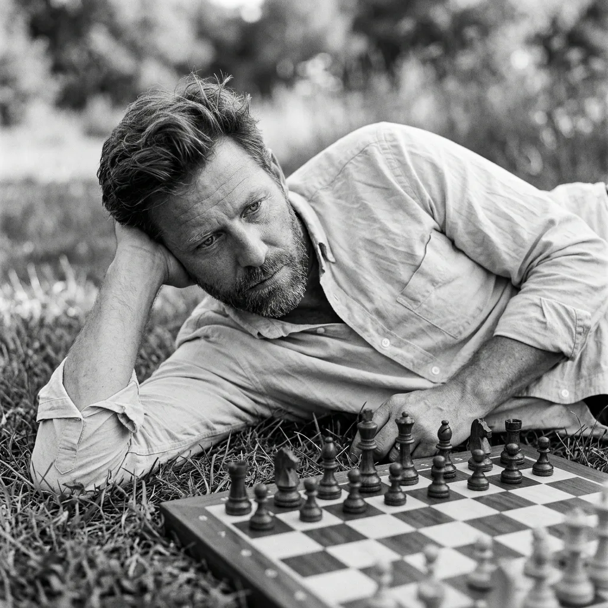

# Lying on side head resting on forearm

[← Back to the collection](../../README.md) · Category: [Photography](../../gallery/photography.md) · Model: `Vinano Image Pro` · ID: `vn-00145`

<a href="https://vinano.ai?utm_source=github&utm_medium=readme&utm_campaign=awesome-image-video-prompts-updating&utm_content=prompt-page-image"></a>

<sub>Preview generated with <a href="https://vinano.ai?utm_source=github&utm_medium=readme&utm_campaign=awesome-image-video-prompts-updating&utm_content=prompt-page-caption">vinano.ai</a></sub>

## Prompt

```text
{
"scene_overview": {
"description": "A monochrome, contemplative portrait of a man lying on grass, resting his head on his forearm while gazing intently at a chessboard in the foreground.",
"mood": "Introspective, calm, slightly melancholic, strategic contemplation",
"style": "Fine art documentary portrait"
},
"composition": {
"camera_angle": "Low, ground-level perspective aligned the chessboard",
"framing": "Horizontal close-to-medium shot strong foreground emphasis",
"rule_of_thirds": "Subject’s eye positioned near the upper-left third; chess pieces dominate the lower foreground",
"depth": "Shallow depth of field; foreground chess pieces partially blurred, subject’s face in sharp focus",
"leading_elements": "Chessboard grid lines and aligned chess pieces lead the eye toward the subject’s face",
"balance": "Asymmetrical balance between the heavy foreground objects and the subject’s head and arm"
},
"subjects": {
"primary_subject": {
"type": "Adult male",
"pose": "Lying on side head resting on forearm",
"expression": "Focused, thoughtful, slightly fatigued",
"gaze": "Directed toward chessboard and pieces",
"facial_hair": "Short, well-groomed beard",
"hair": "Short, textured, slightly tousled",
"clothing": "Light-colored, long-sleeve button-up shirt visible fabric creases"
},
"secondary_subjects": {
"objects": [{
"type": "Chessboard",
"material": "Wood",
"pattern": "Classic checkered grid",
"position": "Foreground, partially out of focus"
},
{
"type": "Chess pieces",
"material": "Wood",
"variety": "Mixed pawns and major pieces",
"arrangement": "Mid-game configuration, scattered strategic spacing"
}]
}
},
"environment": {
"setting": "Outdoor grassy area",
"ground_texture": "Short grass visible blades and uneven natural texture",
"background": "Minimal and softly blurred, no discernible structures or distractions"
},
"lighting": {
"type": "Natural light",
"direction": "Soft side lighting from above-left",
"contrast": "Moderate contrast gentle highlights and smooth shadow falloff",
"highlights": "Subtle highlights on forehead, cheekbone, and knuckles",
"shadows": "Soft shadows under the arm, chin, and chess pieces"
},
"color_and_tone": {
"color_mode": "Black and white",
"tonal_range": "Wide grayscale range from deep blacks to bright whites",
"dominant_tones": "Mid-grays and soft highlights",
"texture_emphasis": "Enhanced skin texture, fabric fibers, wood grain, and grass"
},
"technical_characteristics": {
"lens_look": "Portrait lens feel, likely medium focal length",
"aperture_effect": "Wide aperture producing shallow depth of field",
"sharpness": "High sharpness on subject’s eye and facial features",
"grain": "Fine, subtle film-like grain",
"dynamic_range": "Well-preserved highlights and shadow details"
},
"artistic_elements": {
"theme": "Strategy, contemplation, mental focus",
"symbolism": "Chessboard as a metaphor for life decisions and planning",
"emotional_tone": "Quiet, reflective, intellectually engaged",
"timelessness": "Classic monochrome treatment removes temporal context"
},
"typography": {
"presence": "None",
"text_elements": "No visible text or lettering"
},
"overall_aesthetic": {
"genre": "Fine art portrait photography",
"influences": "Humanist photography, editorial portraiture",
"use_case": "Art print, editorial feature, conceptual storytelling, AI style reference"
}
}

Preserve realistic proportions and depth for a confident, professional finish.
```

## Try it on vinano.ai

1. Copy the prompt above.
2. Open **[vinano.ai](https://vinano.ai?utm_source=github&utm_medium=readme&utm_campaign=awesome-image-video-prompts-updating&utm_content=prompt-page-try)**, paste it into the image generator and pick a model.
3. Swap any placeholders (brand, product, city, person…) for your own details, then generate.

More prompts like this: [Photography gallery](../../gallery/photography.md) · [all categories](../../README.md#contents)
