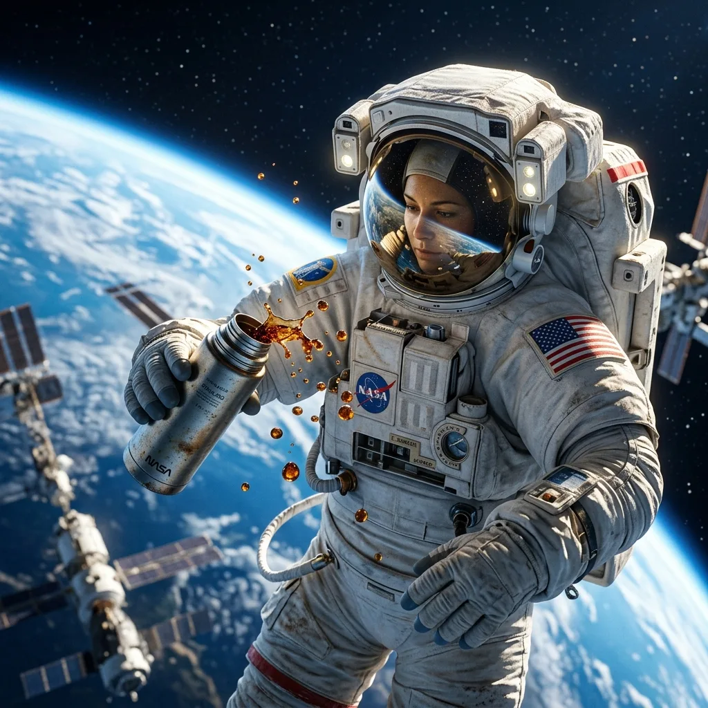

# High-detail, cinematic shot of an astronaut floating in outer

[← Back to the collection](../../README.md) · Category: [Photography](../../gallery/photography.md) · Model: `Vinano Image v2` · ID: `vn-00147`

<a href="https://vinano.ai?utm_source=github&utm_medium=readme&utm_campaign=awesome-image-video-prompts-updating&utm_content=prompt-page-image"></a>

<sub>Preview generated with <a href="https://vinano.ai?utm_source=github&utm_medium=readme&utm_campaign=awesome-image-video-prompts-updating&utm_content=prompt-page-caption">vinano.ai</a></sub>

## Prompt

```text
A high-detail, cinematic shot of an astronaut floating in outer space the Earth's blue curvature and atmosphere in the background. The astronaut is wearing a realistic, weathered white space suit. They are holding a metallic thermos from which dark coffee or amber liquid is spilling out, forming perfect spherical droplets and a beautiful splash due to zero gravity. The lighting is dramatic, a strong glow from the sun reflecting off the helmet's visor and the liquid droplets. 8k resolution, hyper-realistic, true-to-life photorealistic, cosmic atmosphere. Render with rich micro-detail while keeping the layout uncluttered and intentional.
```

## Try it on vinano.ai

1. Copy the prompt above.
2. Open **[vinano.ai](https://vinano.ai?utm_source=github&utm_medium=readme&utm_campaign=awesome-image-video-prompts-updating&utm_content=prompt-page-try)**, paste it into the image generator and pick a model.
3. Swap any placeholders (brand, product, city, person…) for your own details, then generate.

More prompts like this: [Photography gallery](../../gallery/photography.md) · [all categories](../../README.md#contents)
