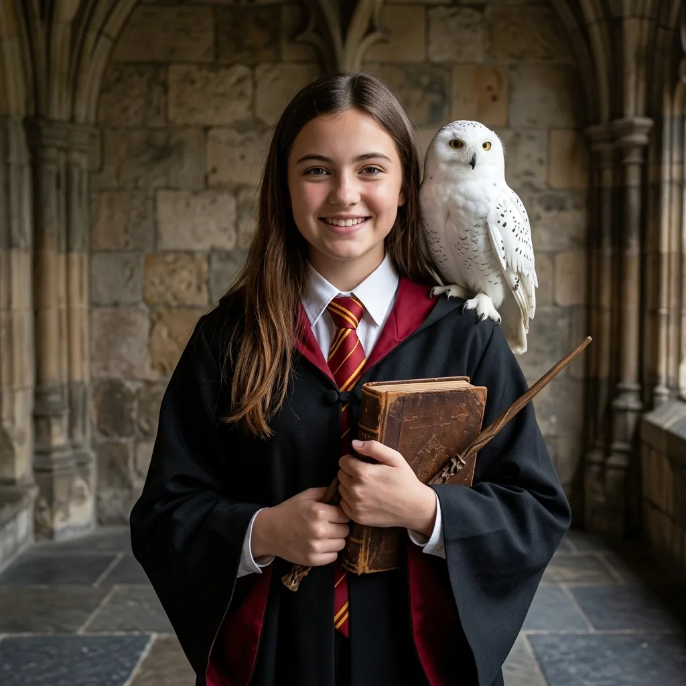

# Photography prompt #148

[← Back to the collection](../../README.md) · Category: [Photography](../../gallery/photography.md) · Model: `Vinano Image v2` · ID: `vn-00148`

<a href="https://vinano.ai?utm_source=github&utm_medium=readme&utm_campaign=awesome-image-video-prompts-updating&utm_content=prompt-page-image"></a>

<sub>Preview generated with <a href="https://vinano.ai?utm_source=github&utm_medium=readme&utm_campaign=awesome-image-video-prompts-updating&utm_content=prompt-page-caption">vinano.ai</a></sub>

## Prompt

```text
USE UPLOADED PHOTO AS REFERENCE. HOGWARTS-STYLE PHOTOSHOOT. THE GIRL IS POSING, IN A BLACK ROBE, THE UNDERSIDE OF THE ROBE IS RED, A WHITE COLLAR AND A TIED TIE OF GRYFFINDOR COLOR ARE VISIBLE. HER HAIR IS LOOSE, A DILAPIDATED, OLD BOOK IS PRESSED TO HER BODY IN HER HANDS. HE HOLDS A MAGIC WAND IN ONE HAND. A WHITE OWL SITS ON THE SHOULDER, THE BACKGROUND IS AN OLD STONE WALL, THE BACKGROUND IS SLAY. THEMATIC PHOTO SESSION. DETAILING, premium quality. PORTRAIT. Keep edges clean and the overall composition balanced for a polished, gallery-ready result.
```

## Try it on vinano.ai

1. Copy the prompt above.
2. Open **[vinano.ai](https://vinano.ai?utm_source=github&utm_medium=readme&utm_campaign=awesome-image-video-prompts-updating&utm_content=prompt-page-try)**, paste it into the image generator and pick a model.
3. Swap any placeholders (brand, product, city, person…) for your own details, then generate.

More prompts like this: [Photography gallery](../../gallery/photography.md) · [all categories](../../README.md#contents)
