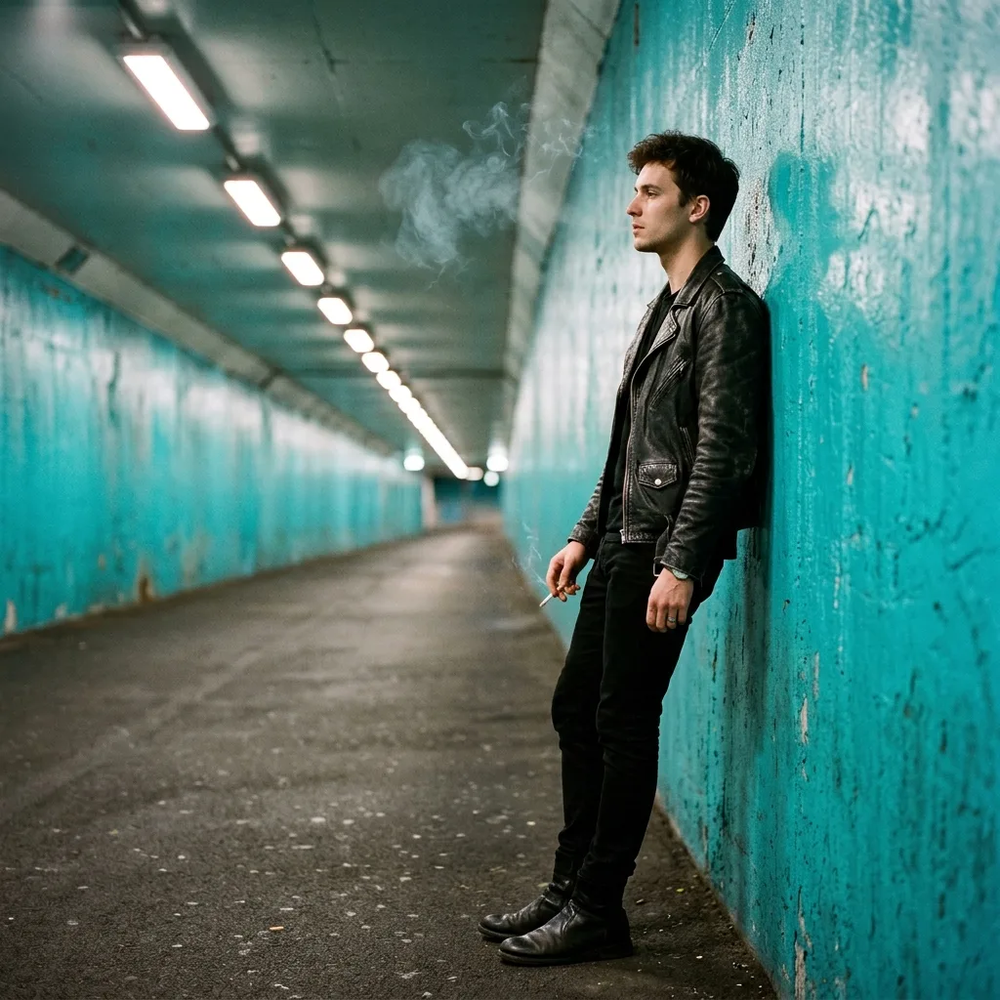

# Full shot captures a young man in profile, leaning

[← Back to the collection](../../README.md) · Category: [Photography](../../gallery/photography.md) · Model: `Vinano Image v2` · ID: `vn-00149`

<a href="https://vinano.ai?utm_source=github&utm_medium=readme&utm_campaign=awesome-image-video-prompts-updating&utm_content=prompt-page-image"></a>

<sub>Preview generated with <a href="https://vinano.ai?utm_source=github&utm_medium=readme&utm_campaign=awesome-image-video-prompts-updating&utm_content=prompt-page-caption">vinano.ai</a></sub>

## Prompt

```text
A full shot captures a young man in profile, leaning against a textured turquoise wall inside a brightly lit tunnel. He is dressed in a sleek black leather jacket and black pants. His short, dark hair is casually styled, framing a contemplative expression as he gazes forward. Wisps of smoke curl subtly above his head. The background features a series of evenly spaced rectangular lights along the tunnel's ceiling, creating a strong sense of depth and leading the eye. The overall lighting casts a cool, ethereal glow on the scene, the vibrant turquoise of the walls contrasting the stark brightness of the lights. The image conveys a mood of quiet introspection and urban coolness. Emphasise material texture and natural light so the final frame feels tactile and premium.
```

## Try it on vinano.ai

1. Copy the prompt above.
2. Open **[vinano.ai](https://vinano.ai?utm_source=github&utm_medium=readme&utm_campaign=awesome-image-video-prompts-updating&utm_content=prompt-page-try)**, paste it into the image generator and pick a model.
3. Swap any placeholders (brand, product, city, person…) for your own details, then generate.

More prompts like this: [Photography gallery](../../gallery/photography.md) · [all categories](../../README.md#contents)
