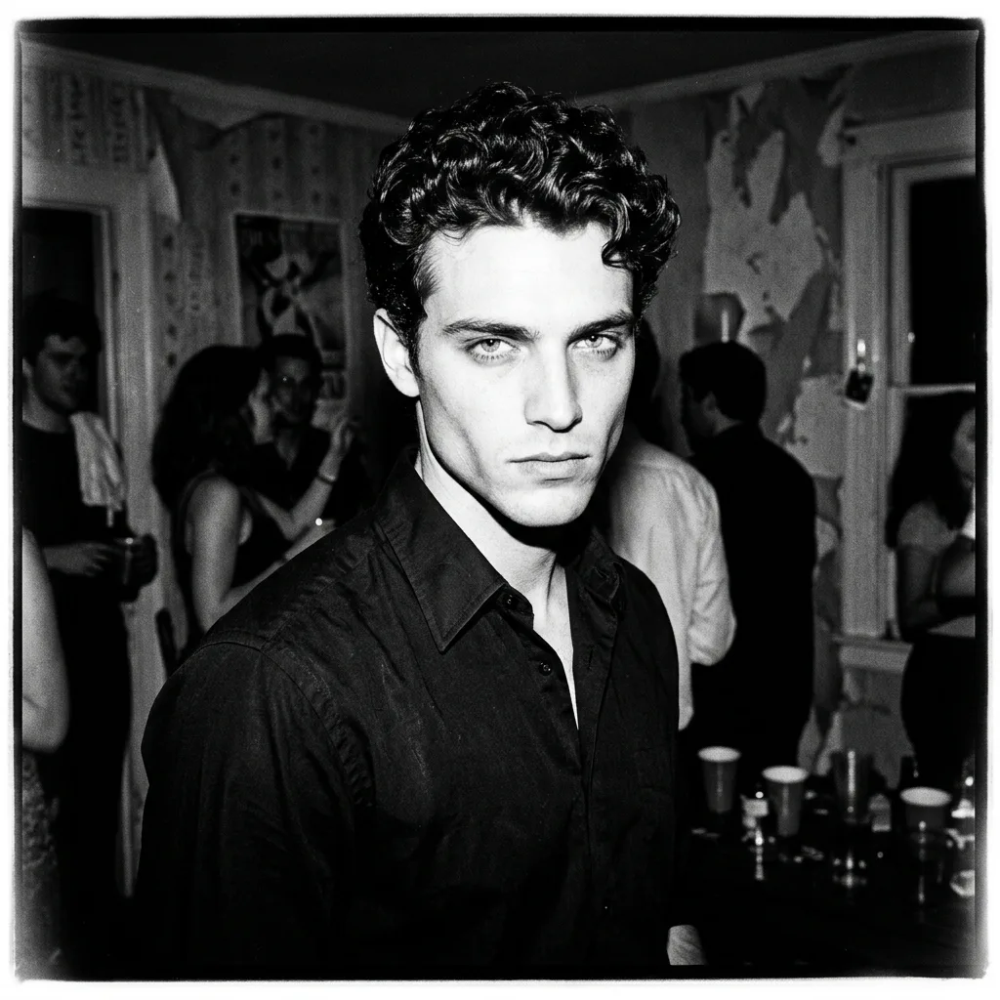

# High-contrast black and white photo taken a 1990s disposable

[← Back to the collection](../../README.md) · Category: [Photography](../../gallery/photography.md) · Model: `Vinano Image v2` · ID: `vn-00150`

<a href="https://vinano.ai?utm_source=github&utm_medium=readme&utm_campaign=awesome-image-video-prompts-updating&utm_content=prompt-page-image"></a>

<sub>Preview generated with <a href="https://vinano.ai?utm_source=github&utm_medium=readme&utm_campaign=awesome-image-video-prompts-updating&utm_content=prompt-page-caption">vinano.ai</a></sub>

## Prompt

```text
High-contrast black and white photo taken a 1990s disposable camera at a dark house party. A handsome young man dark, curly hair and a sharp jawline is staring directly into the lens. Focus on the eyes: intense, light-colored irises a piercing, predatory gaze, slightly heavy-lidded (siren eyes), reflecting the harsh camera flash. He is wearing a black button-down shirt. The image is grainy, lo-fi, a "dark academia" bad boy aesthetic. (use my face from the uploaded selfie) Keep edges clean and the overall composition balanced for a polished, gallery-ready result.
```

## Try it on vinano.ai

1. Copy the prompt above.
2. Open **[vinano.ai](https://vinano.ai?utm_source=github&utm_medium=readme&utm_campaign=awesome-image-video-prompts-updating&utm_content=prompt-page-try)**, paste it into the image generator and pick a model.
3. Swap any placeholders (brand, product, city, person…) for your own details, then generate.

More prompts like this: [Photography gallery](../../gallery/photography.md) · [all categories](../../README.md#contents)
