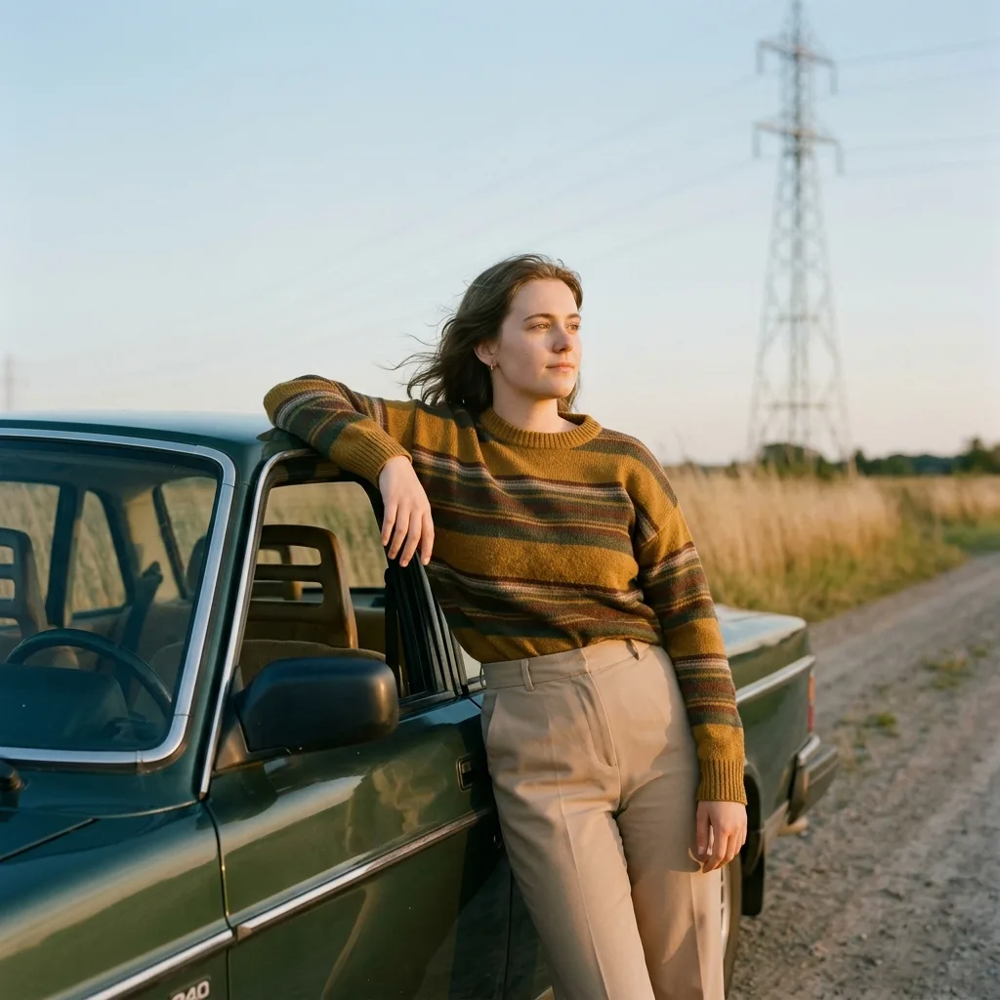

# Casually leaning against a vintage car, one arm resting

[← Back to the collection](../../README.md) · Category: [Photography](../../gallery/photography.md) · Model: `Vinano Image v2` · ID: `vn-00152`

<a href="https://vinano.ai?utm_source=github&utm_medium=readme&utm_campaign=awesome-image-video-prompts-updating&utm_content=prompt-page-image"></a>

<sub>Preview generated with <a href="https://vinano.ai?utm_source=github&utm_medium=readme&utm_campaign=awesome-image-video-prompts-updating&utm_content=prompt-page-caption">vinano.ai</a></sub>

## Prompt

```text
{
 "image_generation": {
 "reference": {"use_uploaded_photo": true, "role": "main subject", "identity_preservation": true},
 "scene": {
 "location": "rural countryside",
 "background": ["tall dry grass fields", "distant metal powerline tower"],
 "time": "golden hour",
 "atmosphere": "calm, nostalgic road trip mood"
 },
 "subject": {
 "pose": "casually leaning against a vintage car, one arm resting on the open door frame",
 "expression": "thoughtful, relaxed, looking off to the side",
 "hair": "gently moved by the wind",
 "style": "natural, candid portrait"
 },
 "outfit": {
 "top": "retro striped sweater in warm earthy tones",
 "bottom": "high waisted beige trousers"
 },
 "lighting": {"type": "soft sunset light", "highlights": "warm", "shadows": "cool", "contrast": "soft"},
 "camera": {
 "lens": "35mm analog look",
 "depth_of_field": "shallow",
 "focus": "sharp on subject, smooth background falloff",
 "composition": "editorial fashion portrait"
 },
 "color_grading": {"style": "muted vintage tones", "saturation": "slightly reduced", "film_grain": "subtle"},
 "quality": {"realism": "high", "texture": "natural skin and fabric detail", "render": "cinematic, editorial, realistic"}
 }
}

Aim for an editorial, design-driven look with deliberate negative space.
```

## Try it on vinano.ai

1. Copy the prompt above.
2. Open **[vinano.ai](https://vinano.ai?utm_source=github&utm_medium=readme&utm_campaign=awesome-image-video-prompts-updating&utm_content=prompt-page-try)**, paste it into the image generator and pick a model.
3. Swap any placeholders (brand, product, city, person…) for your own details, then generate.

More prompts like this: [Photography gallery](../../gallery/photography.md) · [all categories](../../README.md#contents)
