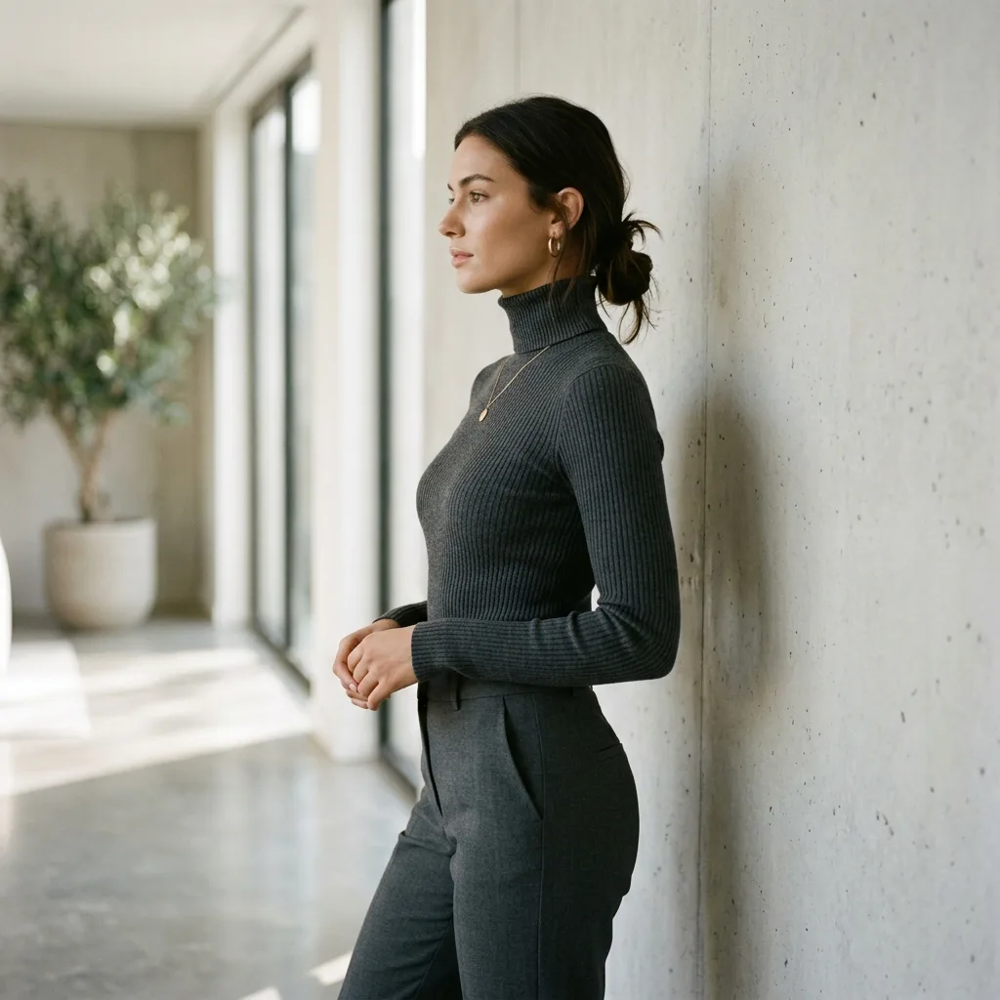

# Confident individual captured in side profile

[← Back to the collection](../../README.md) · Category: [Photography](../../gallery/photography.md) · Model: `Vinano Image v2` · ID: `vn-00155`

<a href="https://vinano.ai?utm_source=github&utm_medium=readme&utm_campaign=awesome-image-video-prompts-updating&utm_content=prompt-page-image"></a>

<sub>Preview generated with <a href="https://vinano.ai?utm_source=github&utm_medium=readme&utm_campaign=awesome-image-video-prompts-updating&utm_content=prompt-page-caption">vinano.ai</a></sub>

## Prompt

```text
{
 "content_goal": "clean, elegant, viral side-pose visual",
 "image_type": "ultra-true-to-life photorealistic lifestyle / editorial portrait",
 "visual_style": {
 "aesthetic": "cinematic, editorial, modern minimalism",
 "vibe": "confident, graceful, premium",
 "realism": "high-end professional realism"
 },
 "composition": {
 "framing": "mid-to-full body side view",
 "camera_angle": "true side angle (90-degree profile)",
 "subject_position": "slightly off-center for balance",
 "perspective": "clean silhouette depth"
 },
 "subject": {
 "description": "confident individual captured in side profile",
 "pose": "standing or seated side pose elongated posture",
 "body_language": "relaxed yet strong, controlled stance",
 "expression": "calm confidence, subtle elegance",
 "gaze": "forward or slightly downward"
 },
 "facial_details": {
 "emotion": "composed, self-assured",
 "micro_details": "natural skin texture, defined profile lines"
 },
 "wardrobe": {
 "clothing": "form-fitting or flowing outfit highlighting profile",
 "textures": "smooth, soft fabric natural folds",
 "color_tones": "neutral, monochrome, or muted pastels"
 },
 "lighting": {
 "type": "directional studio or natural lighting",
 "quality": "soft yet sculpting",
 "direction": "side-lit to enhance contours",
 "highlight_focus": "face profile, shoulder line, waist curve",
 "shadow_style": "gentle, controlled shadows"
 },
 "color_palette": {
 "primary": ["soft neutrals", "warm skin tones", "subtle shadows"],
 "mood": "clean, elegant, confident"
 },
 "environment": {
 "location": "minimal studio, modern interior, or outdoor urban space",
 "background": "simple gradient or uncluttered backdrop",
 "atmosphere": "premium, calm, stylish"
 },
 "camera_details": {
 "camera_type": "professional camera simulation",
 "lens": "50mm or 85mm portrait lens",
 "focus": "sharp focus on profile",
 "depth_of_field": "soft background blur",
 "resolution": "editorial-grade clarity"
 },
 "quality_control": {
 "anatomy_accuracy": "natural posture and proportions",
 "fabric_realism": "realistic drape and texture",
 "ai_artifacts": "none",
 "professional_finish": "magazine-quality output"
 },
 "overall_mood": "confident, refined, cinematic",
 "intended_use": {
 "primary": "viral aesthetic post on X",
 "secondary": "personal branding, editorial photography"
 }
}

Keep edges clean and the overall composition balanced for a polished, gallery-ready result.
```

## Try it on vinano.ai

1. Copy the prompt above.
2. Open **[vinano.ai](https://vinano.ai?utm_source=github&utm_medium=readme&utm_campaign=awesome-image-video-prompts-updating&utm_content=prompt-page-try)**, paste it into the image generator and pick a model.
3. Swap any placeholders (brand, product, city, person…) for your own details, then generate.

More prompts like this: [Photography gallery](../../gallery/photography.md) · [all categories](../../README.md#contents)
