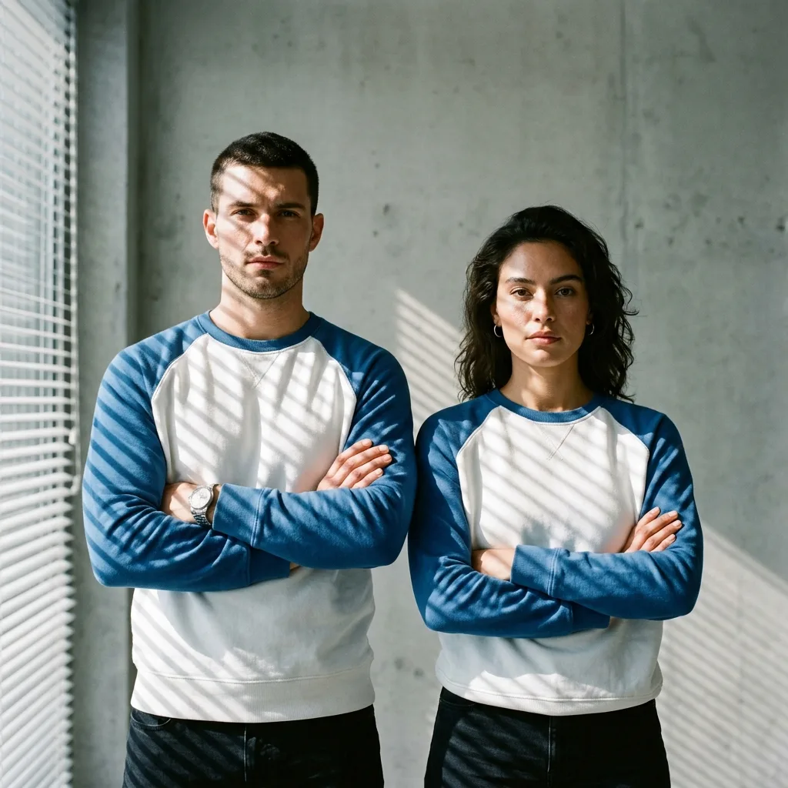

# Fashion studio portrait of a confident man and woman

[← Back to the collection](../../README.md) · Category: [Photography](../../gallery/photography.md) · Model: `Vinano Image v2` · ID: `vn-00157`

<a href="https://vinano.ai?utm_source=github&utm_medium=readme&utm_campaign=awesome-image-video-prompts-updating&utm_content=prompt-page-image"></a>

<sub>Preview generated with <a href="https://vinano.ai?utm_source=github&utm_medium=readme&utm_campaign=awesome-image-video-prompts-updating&utm_content=prompt-page-caption">vinano.ai</a></sub>

## Prompt

```text
Ultra-realistic fashion studio portrait of a confident man and woman standing arms crossed, wearing matching white sweatshirts blue sleeves, dramatic sunlight streaming through window blinds casting striped shadows across their faces and clothing, clean minimal studio background, strong facial features, natural skin texture, filmic, cinematic lighting, high contrast shadow patterns, editorial fashion photography style, 85mm lens, shallow depth of field, ultra-detailed skin and fabric texture, professional studio lighting, 8K. Aim for an editorial, design-driven look with deliberate negative space.
```

## Try it on vinano.ai

1. Copy the prompt above.
2. Open **[vinano.ai](https://vinano.ai?utm_source=github&utm_medium=readme&utm_campaign=awesome-image-video-prompts-updating&utm_content=prompt-page-try)**, paste it into the image generator and pick a model.
3. Swap any placeholders (brand, product, city, person…) for your own details, then generate.

More prompts like this: [Photography gallery](../../gallery/photography.md) · [all categories](../../README.md#contents)
