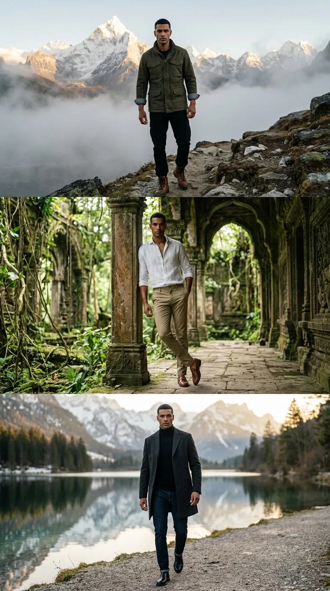

# Three-panel vertical cinematic collage in 9:16 aspect ratio, editorial

[← Back to the collection](../../README.md) · Category: [Photography](../../gallery/photography.md) · Model: `Vinano Image Pro` · ID: `vn-00162`

<a href="https://vinano.ai?utm_source=github&utm_medium=readme&utm_campaign=awesome-image-video-prompts-updating&utm_content=prompt-page-image"></a>

<sub>Preview generated with <a href="https://vinano.ai?utm_source=github&utm_medium=readme&utm_campaign=awesome-image-video-prompts-updating&utm_content=prompt-page-caption">vinano.ai</a></sub>

## Prompt

```text
Create a hyper-realistic three-panel vertical cinematic collage in 9:16 aspect ratio, editorial fashion photography style. The collage consists of three distinct vertical frames stacked seamlessly, each featuring the exact same man consistent face, skin tone, short black hair, sharp jawline, and intense gaze directly at the viewer, as if from the same reference photo.

Top panel: The man stands confidently on a misty mountain ridge at sunrise, dramatic Himalayan peaks in the background golden light piercing through low clouds. He wears a rugged dark olive green tactical field jacket rolled sleeves, black cargo pants, and sturdy hiking boots. Cool blue-gray color grading subtle film grain.

Middle panel: The man leans against an ancient stone pillar inside a grand abandoned temple in a dense tropical jungle, soft diffused sunlight filtering through overgrown vines and carved arches. He wears a lightweight white linen button-up shirt (slightly unbuttoned at the top) tucked into slim khaki trousers, brown leather loafers. Warm earthy tones teal shadows and cinematic haze.

Bottom panel: The man walks along a serene lakeside at golden hour, crystal-clear water reflecting snow-capped mountains in the distance, surrounded by pine trees. He wears a black merino wool turtleneck sweater layered under a tailored charcoal wool overcoat, dark jeans, and polished Chelsea boots. Moody teal-orange cinematic grading soft bokeh and gentle film grain.

Maintain perfect facial consistency across all three panels — same man, same reference face, no variations in features. Ultra-detailed skin texture, realistic fabric details, natural lighting per environment. Cinematic color grading, subtle film grain, editorial composition, high-end fashion photography aesthetic, shot on 35mm film, 4k resolution, true-to-life photorealistic, masterpiece.

Render with rich micro-detail while keeping the layout uncluttered and intentional.
```

## Try it on vinano.ai

1. Copy the prompt above.
2. Open **[vinano.ai](https://vinano.ai?utm_source=github&utm_medium=readme&utm_campaign=awesome-image-video-prompts-updating&utm_content=prompt-page-try)**, paste it into the image generator and pick a model.
3. Swap any placeholders (brand, product, city, person…) for your own details, then generate.

More prompts like this: [Photography gallery](../../gallery/photography.md) · [all categories](../../README.md#contents)
