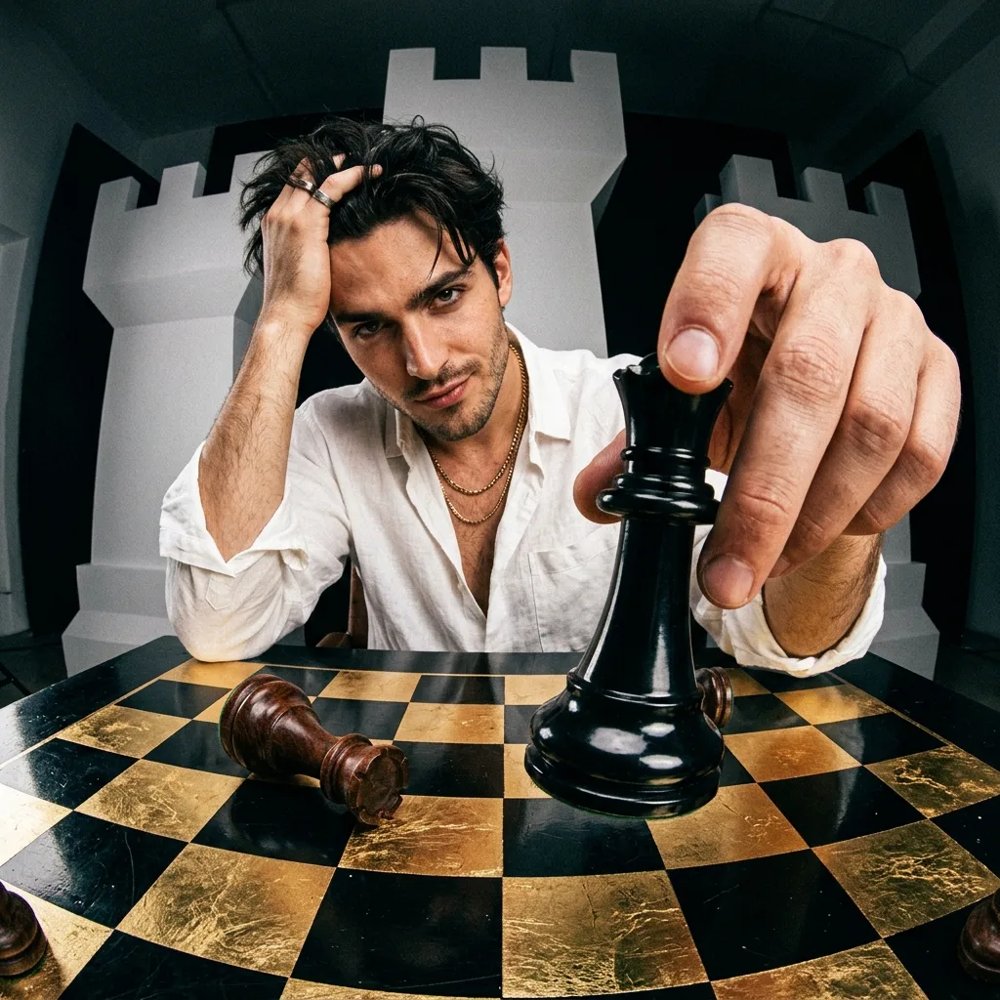

# Photography prompt #163

[← Back to the collection](../../README.md) · Category: [Photography](../../gallery/photography.md) · Model: `Vinano Image v2` · ID: `vn-00163`

<a href="https://vinano.ai?utm_source=github&utm_medium=readme&utm_campaign=awesome-image-video-prompts-updating&utm_content=prompt-page-image"></a>

<sub>Preview generated with <a href="https://vinano.ai?utm_source=github&utm_medium=readme&utm_campaign=awesome-image-video-prompts-updating&utm_content=prompt-page-caption">vinano.ai</a></sub>

## Prompt

```text
Creative fashion photography distorted perspective (wide-angle lens/fisheye effect).

The frame features a young, handsome European-looking man dark hair.

He is seated at a table, resting his left hand on his head (a relaxed, pensive pose), and looking directly into the lens a confident, slightly arrogant expression. Key element (foreground): His right arm is extended strongly forward toward the camera, palm facing down.

In extreme close-up. He holds a large, glossy black chess piece (the Queen), making a move. Due to the perspective, the hand and piece appear enormous compared to the head. Setting: The table is a stylized chessboard: alternating glossy black squares and squares of textured gold leaf, strong reflections on the surface. In the background, a black chess piece lies overturned on the table. Clothing: A loose white shirt an open collar, a gold chain around the neck.

Background: Dark, almost black, large white abstract geometric shapes (reminiscent of the silhouettes of a chess rook's battlements) at the edges of the frame. Lighting and Style: Studio lighting, contrasting light, high detail in the leather texture and gold, glossy magazine style, unusual angle.

Aim for an editorial, design-driven look with deliberate negative space.
```

## Try it on vinano.ai

1. Copy the prompt above.
2. Open **[vinano.ai](https://vinano.ai?utm_source=github&utm_medium=readme&utm_campaign=awesome-image-video-prompts-updating&utm_content=prompt-page-try)**, paste it into the image generator and pick a model.
3. Swap any placeholders (brand, product, city, person…) for your own details, then generate.

More prompts like this: [Photography gallery](../../gallery/photography.md) · [all categories](../../README.md#contents)
