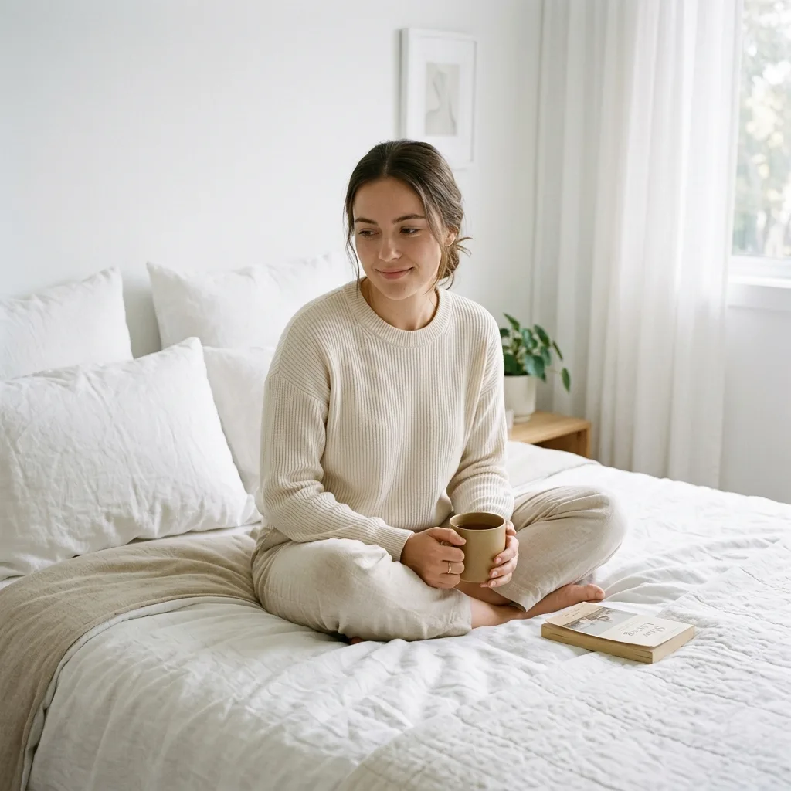

# Person sitting casually on a bed

[← Back to the collection](../../README.md) · Category: [Photography](../../gallery/photography.md) · Model: `Vinano Image v2` · ID: `vn-00165`

<a href="https://vinano.ai?utm_source=github&utm_medium=readme&utm_campaign=awesome-image-video-prompts-updating&utm_content=prompt-page-image"></a>

<sub>Preview generated with <a href="https://vinano.ai?utm_source=github&utm_medium=readme&utm_campaign=awesome-image-video-prompts-updating&utm_content=prompt-page-caption">vinano.ai</a></sub>

## Prompt

```text
{
 "content_goal": "relatable, calm, lifestyle aesthetic",
 "image_type": "ultra-true-to-life photorealistic lifestyle photography",
 "visual_style": {
 "aesthetic": "clean, cozy, minimal",
 "vibe": "soft, relaxed, natural",
 "realism": "high-end professional realism"
 },
 "composition": {
 "framing": "mid-shot",
 "camera_angle": "slightly above eye-level",
 "subject_position": "naturally centered",
 "perspective": "intimate but respectful"
 },
 "subject": {
 "description": "person sitting casually on a bed",
 "pose": "relaxed seated pose legs folded or stretched comfortably",
 "body_language": "natural, unposed, confident ease",
 "expression": "calm, thoughtful, soft smile or neutral face"
 },
 "wardrobe": {
 "clothing": "casual homewear or loungewear",
 "style": "modest, relaxed fit",
 "textures": "soft cotton or linen",
 "color_tones": "neutral or pastel shades"
 },
 "environment": {
 "location": "minimal bedroom",
 "bed": "neatly arranged bed soft pillows",
 "background": "clean wall or soft curtains",
 "atmosphere": "peaceful, morning or late-afternoon calm"
 },
 "lighting": {
 "type": "natural window light",
 "quality": "soft and diffused",
 "direction": "side lighting",
 "shadow_style": "gentle, natural shadows"
 },
 "color_palette": {
 "primary": ["warm white", "beige", "soft grey"],
 "accent": ["pastel tones"],
 "mood": "comforting and serene"
 },
 "camera_details": {
 "lens": "35mm or 50mm",
 "focus": "sharp on subject",
 "depth_of_field": "slight background blur",
 "realism": "editorial lifestyle photography"
 },
 "quality_control": {
 "skin_texture": "natural, realistic",
 "fabric_detail": "visible soft folds",
 "ai_artifacts": "none",
 "finish": "clean, professional"
 },
 "overall_mood": "casual confidence, calm presence",
 "intended_use": {
 "primary": "aesthetic lifestyle post on X",
 "secondary": "personal branding or daily vibe content"
 }
}

Render with rich micro-detail while keeping the layout uncluttered and intentional.
```

## Try it on vinano.ai

1. Copy the prompt above.
2. Open **[vinano.ai](https://vinano.ai?utm_source=github&utm_medium=readme&utm_campaign=awesome-image-video-prompts-updating&utm_content=prompt-page-try)**, paste it into the image generator and pick a model.
3. Swap any placeholders (brand, product, city, person…) for your own details, then generate.

More prompts like this: [Photography gallery](../../gallery/photography.md) · [all categories](../../README.md#contents)
