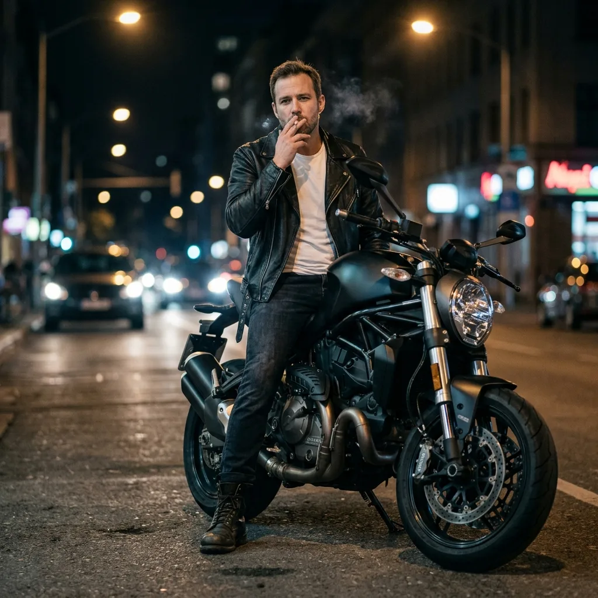

# Adult man smoking a cigarette while sitting

[← Back to the collection](../../README.md) · Category: [Photography](../../gallery/photography.md) · Model: `Vinano Image v2` · ID: `vn-00166`

<a href="https://vinano.ai?utm_source=github&utm_medium=readme&utm_campaign=awesome-image-video-prompts-updating&utm_content=prompt-page-image"></a>

<sub>Preview generated with <a href="https://vinano.ai?utm_source=github&utm_medium=readme&utm_campaign=awesome-image-video-prompts-updating&utm_content=prompt-page-caption">vinano.ai</a></sub>

## Prompt

```text
{
 "style": "true-to-life photorealistic",
 "subject": "adult man smoking a cigarette while sitting on a motorbike",
 "appearance": {
 "age": "mid-30s",
 "expression": "calm, slightly serious",
 "beard": "light stubble",
 "clothing": "black leather jacket, white t-shirt, dark jeans, boots"
 },
 "pose": "sitting casually on the motorbike, one foot on the ground, holding a cigarette near his mouth",
 "vehicle": {
 "type": "modern sport motorbike",
 "color": "matte black",
 "details": "clean chrome accents, realistic reflections"
 },
 "environment": {
 "location": "urban street at night",
 "lighting": "cinematic street lights, soft rim light, subtle neon reflections",
 "atmosphere": "slight smoke haze blending cigarette smoke"
 },
 "camera": {
 "angle": "low angle shot",
 "lens": "85mm",
 "depth_of_field": "shallow depth of field, blurred background bokeh"
 },
 "quality": {
 "resolution": "8k",
 "details": "ultra-detailed skin texture, realistic smoke, natural shadows",
 "rendering": "high dynamic range, sharp focus"
 }
}

Preserve realistic proportions and depth for a confident, professional finish.
```

## Try it on vinano.ai

1. Copy the prompt above.
2. Open **[vinano.ai](https://vinano.ai?utm_source=github&utm_medium=readme&utm_campaign=awesome-image-video-prompts-updating&utm_content=prompt-page-try)**, paste it into the image generator and pick a model.
3. Swap any placeholders (brand, product, city, person…) for your own details, then generate.

More prompts like this: [Photography gallery](../../gallery/photography.md) · [all categories](../../README.md#contents)
