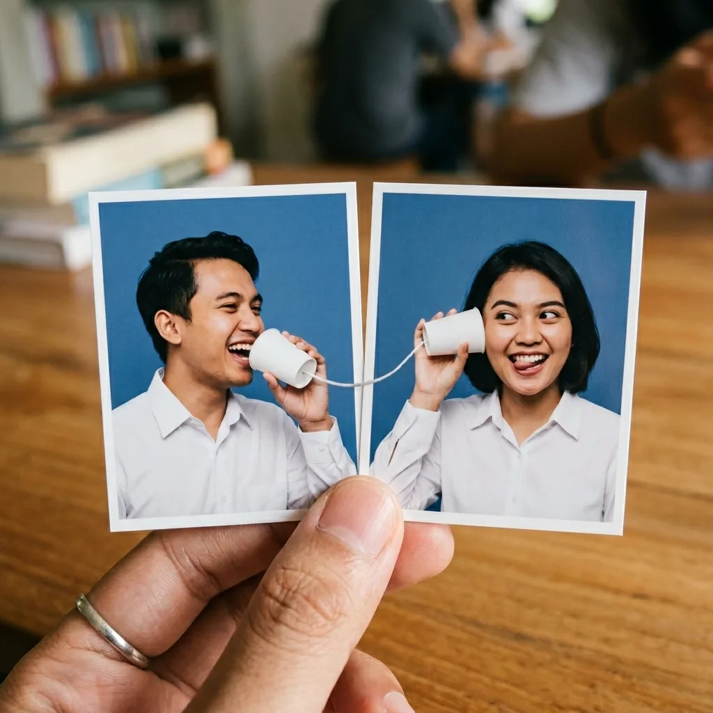

# Portrait Master Object

[← Back to the collection](../../README.md) · Category: [Photography](../../gallery/photography.md) · Model: `Vinano Image v2` · ID: `vn-00167`

<a href="https://vinano.ai?utm_source=github&utm_medium=readme&utm_campaign=awesome-image-video-prompts-updating&utm_content=prompt-page-image"></a>

<sub>Preview generated with <a href="https://vinano.ai?utm_source=github&utm_medium=readme&utm_campaign=awesome-image-video-prompts-updating&utm_content=prompt-page-caption">vinano.ai</a></sub>

## Prompt

```text
Create a Portrait Master Object: Two passport-sized photo prints held side-by-side by a person's thumb and index finger.
**Passport Photo Background:** Use a solid blue background (the standard official passport photo color for Indonesian marriage books for certain even/odd birth years).
**Clothing:** Both subjects in the photo wear formal and neat white collared shirts.
**Male Subject (Left Photo):** Make his face and hair 100% similar to the given reference.
He poses as if talking into a white paper cup, a cheerful laughing expression.
**Female Subject (Right Photo):** Make her face and hair 100% similar to the given reference.
She poses as if holding a white paper cup to her ear, listening. Her expression is funny a wide smile and a slightly stuck-out tongue.
**Interactive Prop:** There is a white string coming out from under the male's paper cup and connecting to the female's paper cup. Because the two photos are placed next to each other, this prop creates the illusion of a "string phone" connecting the two photos.

Maintain consistent colour harmony and crisp focus across the whole frame.
```

## Try it on vinano.ai

1. Copy the prompt above.
2. Open **[vinano.ai](https://vinano.ai?utm_source=github&utm_medium=readme&utm_campaign=awesome-image-video-prompts-updating&utm_content=prompt-page-try)**, paste it into the image generator and pick a model.
3. Swap any placeholders (brand, product, city, person…) for your own details, then generate.

More prompts like this: [Photography gallery](../../gallery/photography.md) · [all categories](../../README.md#contents)
