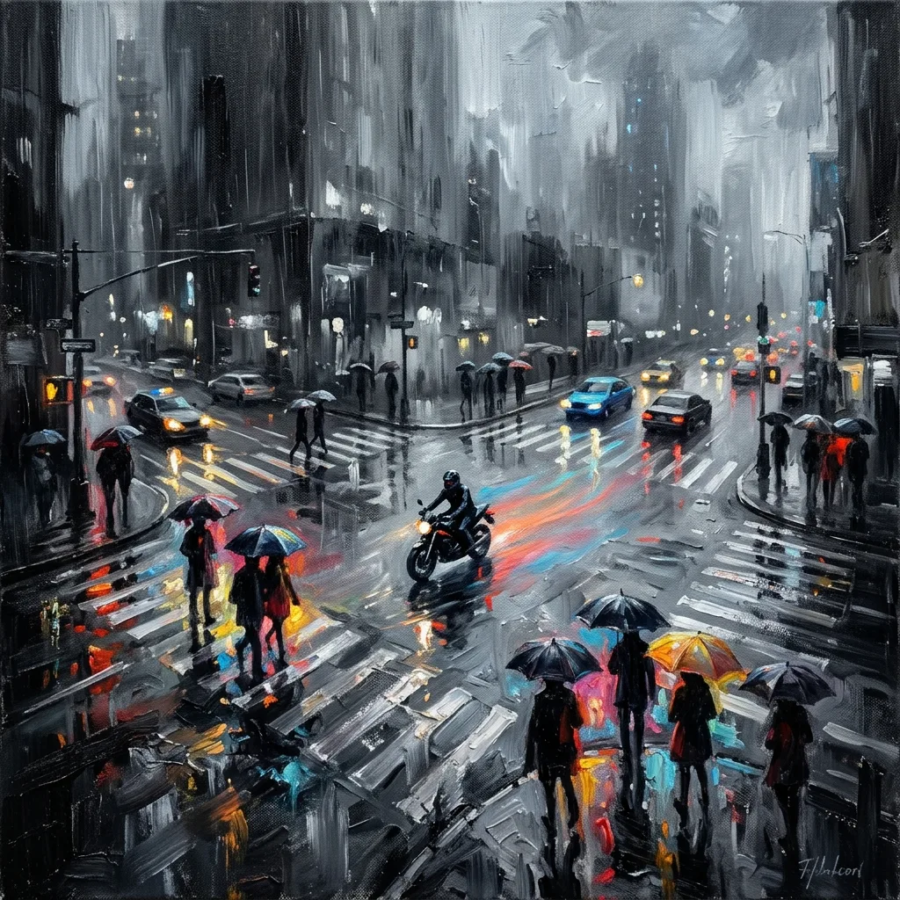

# High-angle, wide-composition Impressionist oil painting of a rainy urban

[← Back to the collection](../../README.md) · Category: [Photography](../../gallery/photography.md) · Model: `Vinano Image v2` · ID: `vn-00168`

<a href="https://vinano.ai?utm_source=github&utm_medium=readme&utm_campaign=awesome-image-video-prompts-updating&utm_content=prompt-page-image"></a>

<sub>Preview generated with <a href="https://vinano.ai?utm_source=github&utm_medium=readme&utm_campaign=awesome-image-video-prompts-updating&utm_content=prompt-page-caption">vinano.ai</a></sub>

## Prompt

```text
A high-angle, wide-composition Impressionist oil painting of a rainy urban intersection. The scene is primarily monochrome deep charcoal blacks and silvery grays, but features vibrant, colorful glowing lights at the footsteps of pedestrians crossing the street and beneath their umbrellas. A lone motorcyclist in the center leaves a trail of soft, colorful light, and car headlights emit small, brilliant pops of color. The style is heavily blurred and painterly, loose, expressive brushstrokes and vague silhouettes, prioritizing mood and 'urban solitude' over sharp detail. The pavement is rain-soaked, reflecting both the gray sky and the neon-like colorful glows in shimmering, broken patterns. Misty atmosphere distant buildings fading into soft tonal washes. Emphasise material texture and natural light so the final frame feels tactile and premium.
```

## Try it on vinano.ai

1. Copy the prompt above.
2. Open **[vinano.ai](https://vinano.ai?utm_source=github&utm_medium=readme&utm_campaign=awesome-image-video-prompts-updating&utm_content=prompt-page-try)**, paste it into the image generator and pick a model.
3. Swap any placeholders (brand, product, city, person…) for your own details, then generate.

More prompts like this: [Photography gallery](../../gallery/photography.md) · [all categories](../../README.md#contents)
