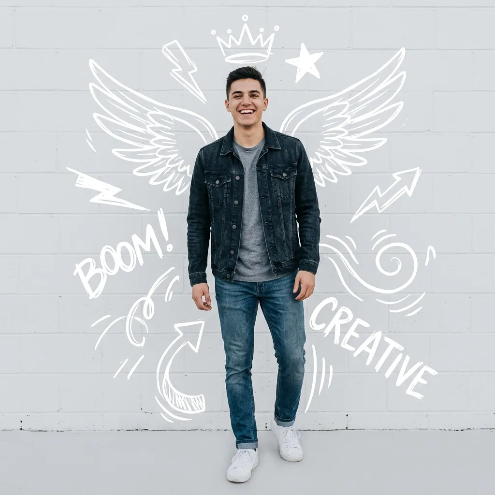

# Creative photo of a person the face

[← Back to the collection](../../README.md) · Category: [Photography](../../gallery/photography.md) · Model: `Vinano Image v2` · ID: `vn-00172`

<a href="https://vinano.ai?utm_source=github&utm_medium=readme&utm_campaign=awesome-image-video-prompts-updating&utm_content=prompt-page-image"></a>

<sub>Preview generated with <a href="https://vinano.ai?utm_source=github&utm_medium=readme&utm_campaign=awesome-image-video-prompts-updating&utm_content=prompt-page-caption">vinano.ai</a></sub>

## Prompt

```text
Create a creative photo of a person the face from the uploaded image. The person is standing in a simple environment while surrounded by hand-drawn doodle elements. Around them are sketch-style drawings like arrows, lightning, stars, scribbles, and abstract shapes, as if drawn a marker. Some doodles interact the person, like wings on their back, a crown above their head, or energy lines around their body. The style is a mix of real photo and doodle art. The person is wearing casual modern clothes like a t-shirt, jacket, jeans, and sneakers. The background is clean so the doodles stand out. High contrast, creative composition, slightly messy sketch style, fun and expressive, ultra detailed, modern social media aesthetic. Render with rich micro-detail while keeping the layout uncluttered and intentional.
```

## Try it on vinano.ai

1. Copy the prompt above.
2. Open **[vinano.ai](https://vinano.ai?utm_source=github&utm_medium=readme&utm_campaign=awesome-image-video-prompts-updating&utm_content=prompt-page-try)**, paste it into the image generator and pick a model.
3. Swap any placeholders (brand, product, city, person…) for your own details, then generate.

More prompts like this: [Photography gallery](../../gallery/photography.md) · [all categories](../../README.md#contents)
