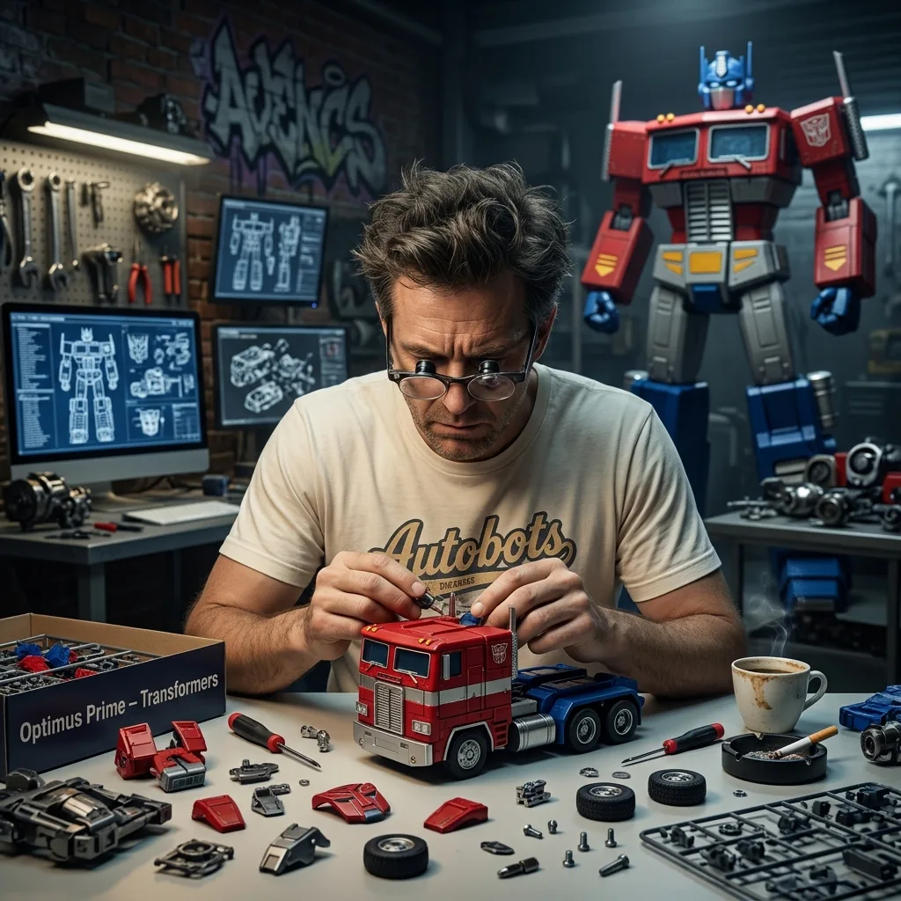

# Optimus Prime Toy Assembly Workshop

[← Back to the collection](../../README.md) · Category: [Photography](../../gallery/photography.md) · Model: `Vinano Image v2` · ID: `vn-00175`

<a href="https://vinano.ai?utm_source=github&utm_medium=readme&utm_campaign=awesome-image-video-prompts-updating&utm_content=prompt-page-image"></a>

<sub>Preview generated with <a href="https://vinano.ai?utm_source=github&utm_medium=readme&utm_campaign=awesome-image-video-prompts-updating&utm_content=prompt-page-caption">vinano.ai</a></sub>

## Prompt

```text
{
 "title": "Optimus Prime Toy Assembly Workshop",
 "style": "Hyper-realistic cinematic portrait",
 "composition": {
 "aspect_ratio": "9:16",
 "orientation": "vertical",
 "resolution": "16K HD",
 "depth_of_field": "shallow",
 "lighting": "dim cinematic workshop lighting focused on the subject",
 "atmosphere": "dramatic, mechanical, highly detailed"
 },
 "subject": {
 "character": "man (based on image 2)",
 "hair": "messy",
 "expression": "focused and meticulous",
 "pose": "sitting at a work table assembling a toy model",
 "clothing": {
 "tshirt_color": "ivory",
 "logo": "Autobots"
 }
 },
 "main_object": {
 "name": "Optimus Prime toy assembly model",
 "source_reference": "image 1",
 "scale": "1/4",
 "state": "partially assembled truck model",
 "box_text": "Optimus Prime – Transformers"
 },
 "environment": {
 "location": "mechanical workshop",
 "wall_details": "graffiti art",
 "computers": "screens displaying Optimus Prime assembly blueprints and mechanical diagrams",
 "tools": ["screwdrivers",
 "bolts",
 "robot parts",
 "mechanical components"]
 },
 "table_details": {
 "objects": ["robot armor parts",
 "wheels",
 "mechanical pieces",
 "cup of coffee",
 "cigarette"]
 },
 "background": {
 "feature": "heroic replica statue of Optimus Prime"
 },
 "visual_quality": {
 "textures": "ultra-detailed",
 "render_style": "hyper-realistic",
 "cinematic_tone": true
 }
}

Preserve realistic proportions and depth for a confident, professional finish.
```

## Try it on vinano.ai

1. Copy the prompt above.
2. Open **[vinano.ai](https://vinano.ai?utm_source=github&utm_medium=readme&utm_campaign=awesome-image-video-prompts-updating&utm_content=prompt-page-try)**, paste it into the image generator and pick a model.
3. Swap any placeholders (brand, product, city, person…) for your own details, then generate.

More prompts like this: [Photography gallery](../../gallery/photography.md) · [all categories](../../README.md#contents)
