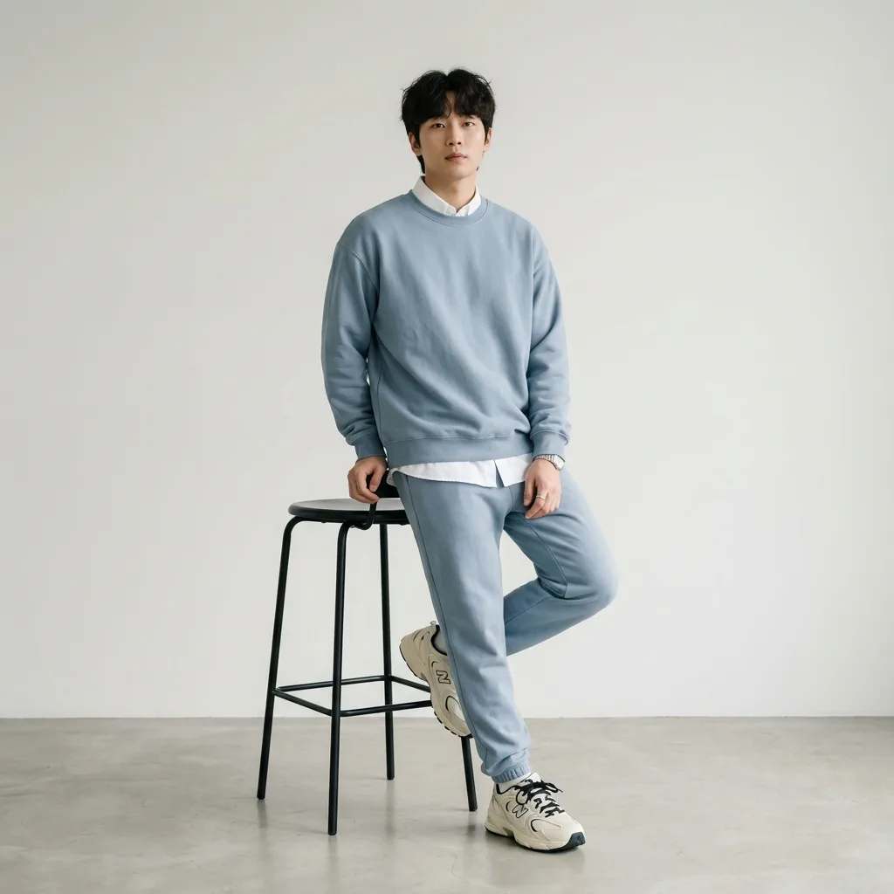

# Photography prompt #177

[← Back to the collection](../../README.md) · Category: [Photography](../../gallery/photography.md) · Model: `Vinano Image v2` · ID: `vn-00177`

<a href="https://vinano.ai?utm_source=github&utm_medium=readme&utm_campaign=awesome-image-video-prompts-updating&utm_content=prompt-page-image"></a>

<sub>Preview generated with <a href="https://vinano.ai?utm_source=github&utm_medium=readme&utm_campaign=awesome-image-video-prompts-updating&utm_content=prompt-page-caption">vinano.ai</a></sub>

## Prompt

```text
Subject & Pose

Full-body studio fashion photography of a young East Asian man styled, dark, textured hair. He is leaning against a tall, slender black metal barstool, posing one foot resting on the floor and the other leg bent at the knee. His expression is calm and neutral, looking directly at the camera.
Outfit & Styling

Top: A light dusty blue oversized crewneck sweatshirt layered over a crisp white collared button-down shirt, the collar and hem visible.Bottoms: Matching light dusty blue jogger-style sweatpants.Footwear: Chunky cream and white athletic sneakers black laces and subtle grey accents.
Technical Specifications

Lighting: Soft, even studio lighting minimal shadows to create a clean, high-end commercial look.Background: A solid, refined minimalist light grey or off-white seamless studio backdrop.Composition: Vertical full-body shot, eye-level perspective, sharp focus, 8k Contemporary K-fashion editorial, soft color palette, polished and airy aesthetic.

Aim for an editorial, design-driven look with deliberate negative space.
```

## Try it on vinano.ai

1. Copy the prompt above.
2. Open **[vinano.ai](https://vinano.ai?utm_source=github&utm_medium=readme&utm_campaign=awesome-image-video-prompts-updating&utm_content=prompt-page-try)**, paste it into the image generator and pick a model.
3. Swap any placeholders (brand, product, city, person…) for your own details, then generate.

More prompts like this: [Photography gallery](../../gallery/photography.md) · [all categories](../../README.md#contents)
