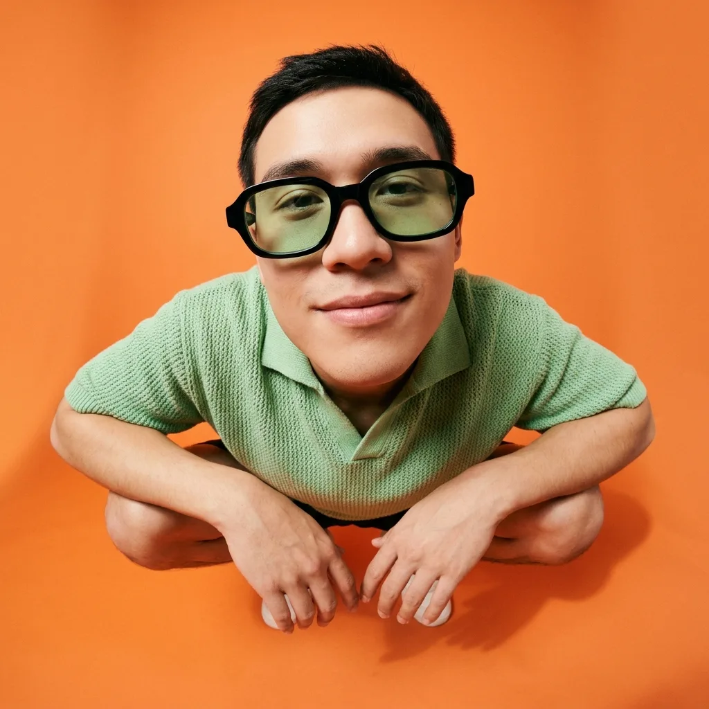

# High-fashion editorial image of a young man,

[← Back to the collection](../../README.md) · Category: [Photography](../../gallery/photography.md) · Model: `Vinano Image v2` · ID: `vn-00180`

<a href="https://vinano.ai?utm_source=github&utm_medium=readme&utm_campaign=awesome-image-video-prompts-updating&utm_content=prompt-page-image"></a>

<sub>Preview generated with <a href="https://vinano.ai?utm_source=github&utm_medium=readme&utm_campaign=awesome-image-video-prompts-updating&utm_content=prompt-page-caption">vinano.ai</a></sub>

## Prompt

```text
Create a A high-fashion editorial image of a young man, of the person from the uploaded character reference photo. KEEP FACE FEATURES AS ORIGINAL at all times. A high-fashion editorial image captured in an exaggerated fisheye lens close-up. The camera is angled slightly from below, and the man is crouching or squatting forward both hands resting on his knees, leaning his upper body toward the lens. His face is looking downward into the camera, exaggerated by fisheye distortion so it appears large and rounded, cartoonish proportions. He has a neutral smile, relaxed and completely smile, expression confident but emotionless.

He wears a trendy, summery knitted shirt in a pastel green shade light, breathable, visible texture, reflecting Gen Z summer fashion. He also wears oversized black-framed sunglasses, lenses tinted in light green.

The background is a clean, solid orange color soft, realistic studio lighting, creating gentle shadows cast from his head, shoulders, and arms.

No direct sunlight light is controlled and evenly diffused, like a fashion set. The overall style is playful, surreal, and modern, inspired by 2025 Gen Z fashion culture and bold editorial covers. Ultra-clean details, slight grain, bold composition.

Maintain consistent colour harmony and crisp focus across the whole frame.
```

## Try it on vinano.ai

1. Copy the prompt above.
2. Open **[vinano.ai](https://vinano.ai?utm_source=github&utm_medium=readme&utm_campaign=awesome-image-video-prompts-updating&utm_content=prompt-page-try)**, paste it into the image generator and pick a model.
3. Swap any placeholders (brand, product, city, person…) for your own details, then generate.

More prompts like this: [Photography gallery](../../gallery/photography.md) · [all categories](../../README.md#contents)
