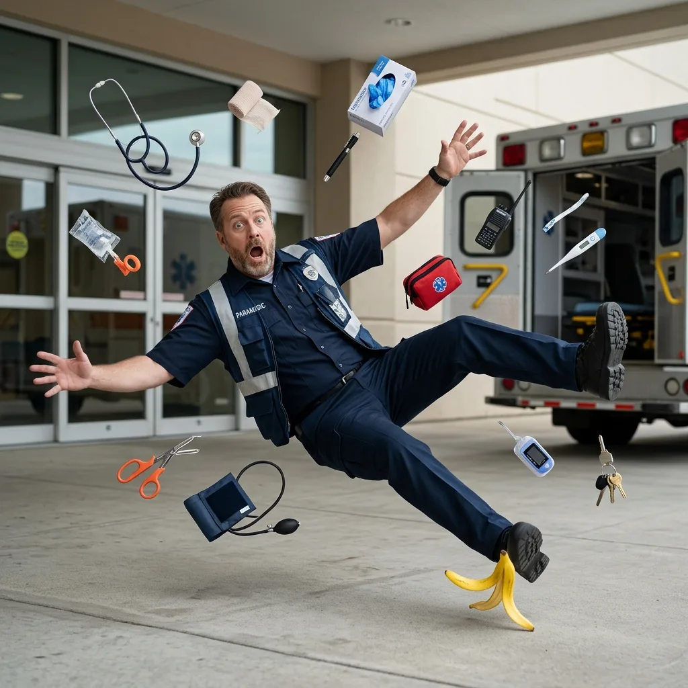

# Preserve identity exactly

[← Back to the collection](../../README.md) · Category: [Photography](../../gallery/photography.md) · Model: `Vinano Image v2` · ID: `vn-00185`

<a href="https://vinano.ai?utm_source=github&utm_medium=readme&utm_campaign=awesome-image-video-prompts-updating&utm_content=prompt-page-image"></a>

<sub>Preview generated with <a href="https://vinano.ai?utm_source=github&utm_medium=readme&utm_campaign=awesome-image-video-prompts-updating&utm_content=prompt-page-caption">vinano.ai</a></sub>

## Prompt

```text
8K Ultra true-to-life photorealistic cinematic freeze-frame of a {PROFESSION} slipping on a banana peel, mid-air fall exaggerated shock expression, arms and legs extended. Preserve identity exactly. 10–15 clear {PROFESSION}-related objects floating naturally clean spacing. Realistic environment matching the profession. Eye-level, full-body, natural lighting, realistic shadows. Style: cinematic, meme-like, controlled chaos. Avoid distortion, clutter, unrelated objects, bad lighting. Emphasise material texture and natural light so the final frame feels tactile and premium.
```

## Try it on vinano.ai

1. Copy the prompt above.
2. Open **[vinano.ai](https://vinano.ai?utm_source=github&utm_medium=readme&utm_campaign=awesome-image-video-prompts-updating&utm_content=prompt-page-try)**, paste it into the image generator and pick a model.
3. Swap any placeholders (brand, product, city, person…) for your own details, then generate.

More prompts like this: [Photography gallery](../../gallery/photography.md) · [all categories](../../README.md#contents)
