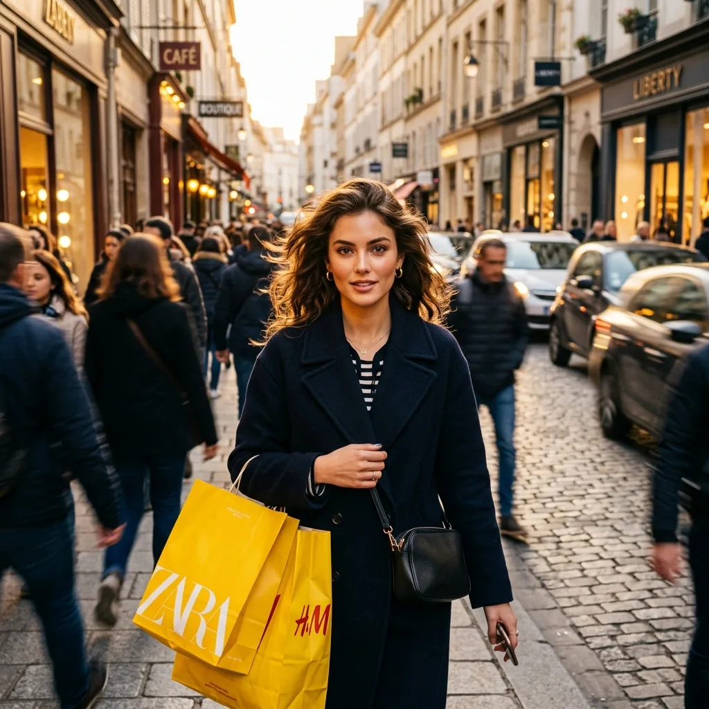

# Street portrait of a young woman walking through

[← Back to the collection](../../README.md) · Category: [Photography](../../gallery/photography.md) · Model: `Vinano Image v2` · ID: `vn-00192`

<a href="https://vinano.ai?utm_source=github&utm_medium=readme&utm_campaign=awesome-image-video-prompts-updating&utm_content=prompt-page-image"></a>

<sub>Preview generated with <a href="https://vinano.ai?utm_source=github&utm_medium=readme&utm_campaign=awesome-image-video-prompts-updating&utm_content=prompt-page-caption">vinano.ai</a></sub>

## Prompt

```text
Cinematic street portrait of a young woman walking through a busy shopping street at golden hour, holding bright yellow shopping bags, wind-blown wavy hair, soft natural makeup, intense eye contact camera, shot from a slightly low angle close-up, dynamic motion blur in the background crowd, sharp focus on face, warm sunlight casting dramatic highlights and shadows, urban European architecture, shallow depth of field, 35mm lens, f/1.8, high contrast, rich warm tones, editorial fashion photography style, ultra-realistic, 8k. Preserve realistic proportions and depth for a confident, professional finish.
```

## Try it on vinano.ai

1. Copy the prompt above.
2. Open **[vinano.ai](https://vinano.ai?utm_source=github&utm_medium=readme&utm_campaign=awesome-image-video-prompts-updating&utm_content=prompt-page-try)**, paste it into the image generator and pick a model.
3. Swap any placeholders (brand, product, city, person…) for your own details, then generate.

More prompts like this: [Photography gallery](../../gallery/photography.md) · [all categories](../../README.md#contents)
