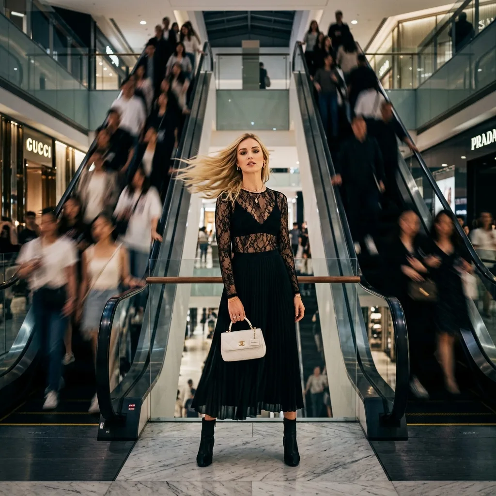

# Fashion photograph of a stylish blonde woman standing confidently

[← Back to the collection](../../README.md) · Category: [Photography](../../gallery/photography.md) · Model: `Vinano Image v2` · ID: `vn-00193`

<a href="https://vinano.ai?utm_source=github&utm_medium=readme&utm_campaign=awesome-image-video-prompts-updating&utm_content=prompt-page-image"></a>

<sub>Preview generated with <a href="https://vinano.ai?utm_source=github&utm_medium=readme&utm_campaign=awesome-image-video-prompts-updating&utm_content=prompt-page-caption">vinano.ai</a></sub>

## Prompt

```text
Ultra-realistic cinematic fashion photograph of a stylish blonde woman standing confidently between two moving escalators inside a luxury shopping mall, wearing a sheer black lace long-sleeve top and flowing skirt, holding a small white designer handbag, her hair dramatically blowing sideways as if caught in motion, blurred crowd moving up and down the escalators creating dynamic motion streaks around her, she remains sharp and perfectly focused in the center, dramatic fashion editorial lighting, shallow depth of field, high contrast, Vogue magazine style, motion blur photography, symmetrical escalator composition, luxury mall interior, 85mm lens, f/1.8, ultra detailed, film grain, cinematic color grading. Aim for an editorial, design-driven look with deliberate negative space.
```

## Try it on vinano.ai

1. Copy the prompt above.
2. Open **[vinano.ai](https://vinano.ai?utm_source=github&utm_medium=readme&utm_campaign=awesome-image-video-prompts-updating&utm_content=prompt-page-try)**, paste it into the image generator and pick a model.
3. Swap any placeholders (brand, product, city, person…) for your own details, then generate.

More prompts like this: [Photography gallery](../../gallery/photography.md) · [all categories](../../README.md#contents)
