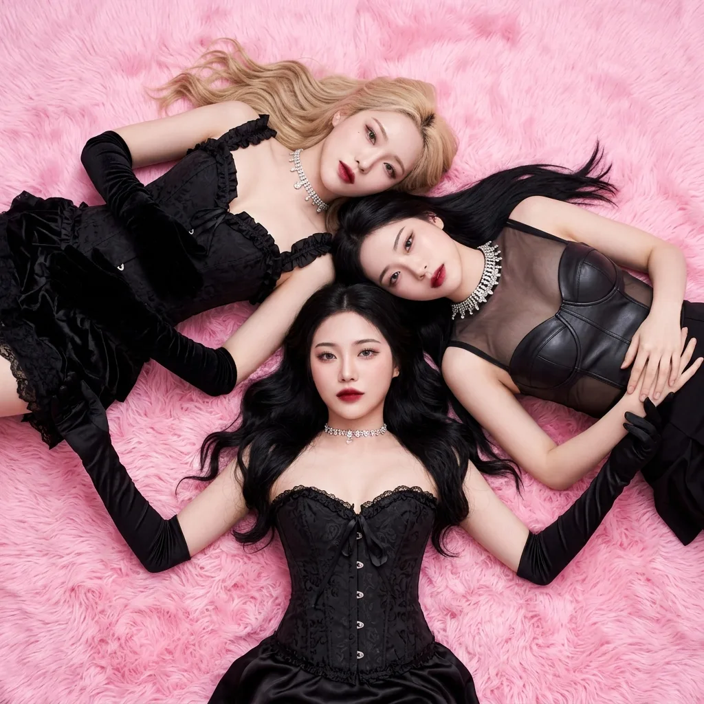

# Lying horizontally at the top

[← Back to the collection](../../README.md) · Category: [Photography](../../gallery/photography.md) · Model: `Vinano Image Pro` · ID: `vn-00198`

<a href="https://vinano.ai?utm_source=github&utm_medium=readme&utm_campaign=awesome-image-video-prompts-updating&utm_content=prompt-page-image"></a>

<sub>Preview generated with <a href="https://vinano.ai?utm_source=github&utm_medium=readme&utm_campaign=awesome-image-video-prompts-updating&utm_content=prompt-page-caption">vinano.ai</a></sub>

## Prompt

```text
{
 "scene_description": "Three young women lying down on a textured surface. The bodies are intertwined in a triangular composition.",
 "background": "Plush, high-pile bright pink faux fur rug or fabric.",
 "subject_details": {
 "demographics": "Three young Asian women (K-pop idol aesthetic), pale skin tones.",
 "styling_theme": "Gothic Lolita / Dark Coquette / Black on Pink.",
 "makeup": "Consistent across all three: dark red gradient lips, soft smoky eye makeup, defined brows.",
 "subject_1_top": {
 "position": "Lying horizontally at the top.",
 "hair": "Blonde, long wavy hair.",
 "outfit": "Black corset top ruffled straps, black velvet opera gloves, crystal choker necklace."
 },
 "subject_2_middle_right": {
 "position": "Lying diagonally below Subject 1, head resting near Subject 1's shoulder.",
 "hair": "Black, long straight hair.",
 "outfit": "Black leather/latex bustier top sheer mesh panel, crystal collar necklace."
 },
 "subject_3_bottom_center": {
 "position": "Lying vertically in the foreground, head resting near Subject 2's chest.",
 "hair": "Black, long wavy hair.",
 "outfit": "Black brocade corset lace trim, black opera gloves, black satin skirt, crystal choker.",
 "pose": "Arms extended upwards and outwards, framing the composition."
 }
 },
 "exact_pose_anatomical": {
 "viewpoint": "Bird's-eye view (Directly overhead).",
 "heads": "All three faces are angled upwards towards the camera lens.",
 "eyes": "Direct eye contact from all subjects.",
 "limbs": "Arms are positioned to create leading lines; Subject 3's gloved arms reach up towards the other two."
 },
 "camera_technical_values": {
 "angle": "90-degree Top Down.",
 "focal_length": "50mm (Standard lens to capture the group without wide-angle distortion).",
 "aperture": "f/5.6 (To ensure all three faces, which are on slightly different planes, are in sharp focus).",
 "shutter_speed": "1/125s (Studio setting).",
 "iso": "ISO 100 (Clean image quality).",
 "framing": "Tight framing, filling the canvas the subjects and the pink texture."
 },
 "lighting_setup": {
 "type": "Soft Studio Lighting (Beauty Dish or Softbox).",
 "direction": "Frontal/Overhead (relative to the camera).",
 "quality": "Even, shadowless illumination on the faces ('Butterfly lighting').",
 "contrast": "High contrast between the jet-black outfits and the bright pink background/pale skin.",
 "highlights": "Soft specular highlights on the black leather and latex textures."
 }
}

Preserve realistic proportions and depth for a confident, professional finish.
```

## Try it on vinano.ai

1. Copy the prompt above.
2. Open **[vinano.ai](https://vinano.ai?utm_source=github&utm_medium=readme&utm_campaign=awesome-image-video-prompts-updating&utm_content=prompt-page-try)**, paste it into the image generator and pick a model.
3. Swap any placeholders (brand, product, city, person…) for your own details, then generate.

More prompts like this: [Photography gallery](../../gallery/photography.md) · [all categories](../../README.md#contents)
