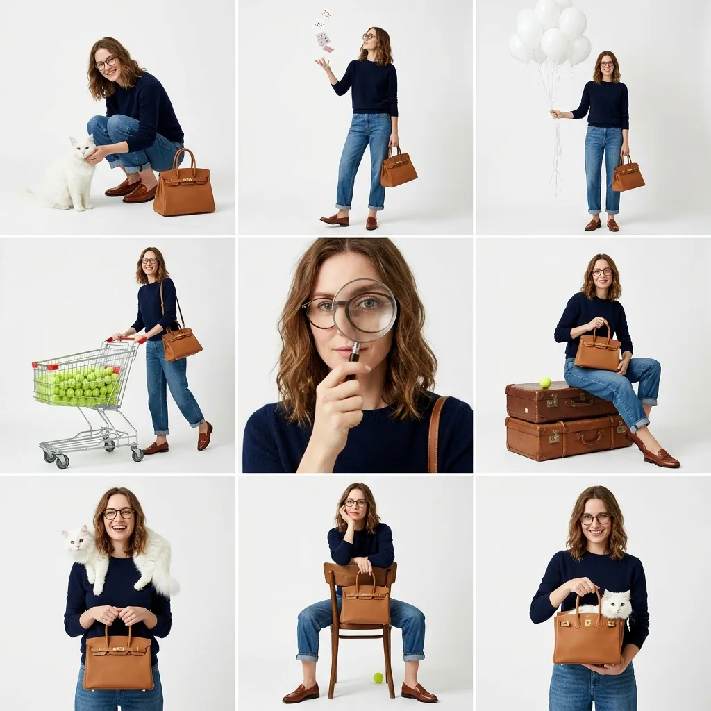

# Studio fashion collage, 3x3 grid layout, same subject repeated

[← Back to the collection](../../README.md) · Category: [Photography](../../gallery/photography.md) · Model: `Vinano Image Pro` · ID: `vn-00204`

<a href="https://vinano.ai?utm_source=github&utm_medium=readme&utm_campaign=awesome-image-video-prompts-updating&utm_content=prompt-page-image"></a>

<sub>Preview generated with <a href="https://vinano.ai?utm_source=github&utm_medium=readme&utm_campaign=awesome-image-video-prompts-updating&utm_content=prompt-page-caption">vinano.ai</a></sub>

## Prompt

```text
studio fashion collage, 3x3 grid layout, same subject repeated in different poses across all panels, clean seamless white background, soft diffused studio lighting, refined minimalist aesthetic, playful editorial storytelling
subject styled in smart casual outfit (navy sweater, relaxed denim, glasses, polished shoes), holding and interacting a structured luxury handbag as the central prop, quirky narrative scenes in each frame:
top row — crouching and interacting a white cat beside handbag, tossing playing cards mid-air while holding bag, standing holding a bunch of white balloons
middle row — pushing a shopping cart filled bright tennis balls, close-up portrait a magnifying glass toward camera, sitting on stacked vintage suitcases holding handbag a tennis ball
bottom row — standing cat draped over shoulders holding bag, sitting backwards on a wooden chair tennis ball under chair, standing pose cat sitting inside handbag
consistent styling across all frames, balanced composition, symmetrical spacing, editorial grid layout, subtle humor and surreal elements, crisp sharp focus, high fashion campaign vibe, true-to-life photorealistic, ultra clean shadows, 50mm lens look, f2.0

Preserve realistic proportions and depth for a confident, professional finish.
```

## Try it on vinano.ai

1. Copy the prompt above.
2. Open **[vinano.ai](https://vinano.ai?utm_source=github&utm_medium=readme&utm_campaign=awesome-image-video-prompts-updating&utm_content=prompt-page-try)**, paste it into the image generator and pick a model.
3. Swap any placeholders (brand, product, city, person…) for your own details, then generate.

More prompts like this: [Photography gallery](../../gallery/photography.md) · [all categories](../../README.md#contents)
