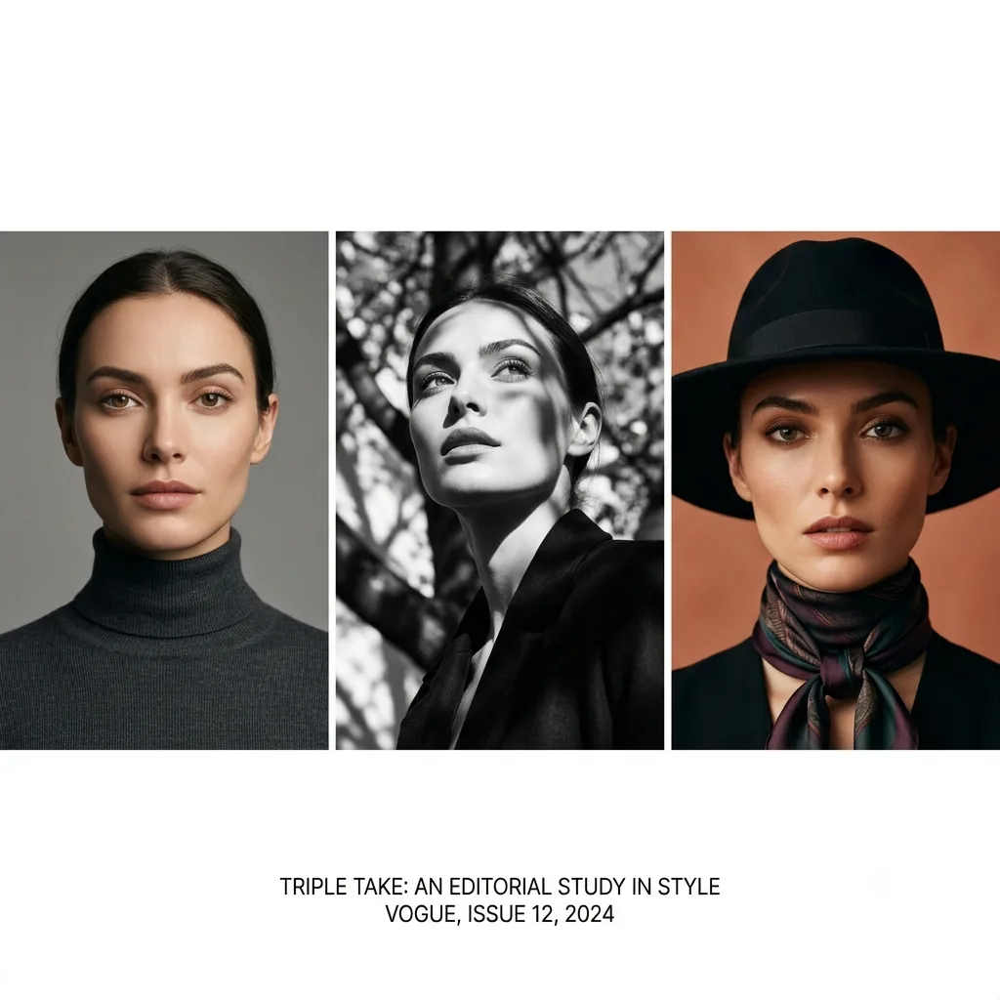

# Three-panel editorial portrait composition featuring the same person

[← Back to the collection](../../README.md) · Category: [Photography](../../gallery/photography.md) · Model: `Vinano Image Pro` · ID: `vn-00206`

<a href="https://vinano.ai?utm_source=github&utm_medium=readme&utm_campaign=awesome-image-video-prompts-updating&utm_content=prompt-page-image"></a>

<sub>Preview generated with <a href="https://vinano.ai?utm_source=github&utm_medium=readme&utm_campaign=awesome-image-video-prompts-updating&utm_content=prompt-page-caption">vinano.ai</a></sub>

## Prompt

```text
{
 "type": "image_generation_prompt",
 "style": "ultra-realistic editorial fashion photography, Vogue-style",
 "resolution": "8K HDR",
 "aspect_ratio": "3:1",
 "composition": {
 "layout": "3x1 horizontal grid",
 "description": "three-panel editorial portrait composition featuring the same person in different artistic styles",
 "symmetry": "balanced spacing and clean alignment across all panels"
 },
 "identity_preservation": {
 "gender": "female",
 "use_reference_image": true,
 "strict_identity_lock": true,
 "notes": "Maintain the exact facial features, skin tone, hair type, and natural proportions from the uploaded reference photo."
 },
 "panels": [{
 "position": "left",
 "style": "studio portrait",
 "environment": {
 "background": "neutral refined minimalist studio backdrop"
 },
 "lighting": "soft studio lighting cinematic face illumination",
 "clothing": "refined minimalist black or neutral turtleneck",
 "expression": "calm and confident",
 "focus": "sharp focus on the face shallow depth of field",
 "color_grading": "magazine-quality tones"
 },
 {
 "position": "center",
 "style": "black and white artistic portrait",
 "environment": {
 "location": "outdoor setting",
 "background": "tree shadows and natural light patterns"
 },
 "camera_angle": "dynamic upward angle",
 "lighting": "natural sunlight creating dramatic contrast",
 "expression": "elegant and dramatic",
 "color_mode": "monochrome black and white",
 "focus": "high detail on facial structure and hair"
 },
 {
 "position": "right",
 "style": "fashion close-up",
 "environment": {
 "background": "soft warm-toned backdrop"
 },
 "accessories": ["wide fashionable hat or elegant scarf"],
 "lighting": "soft warm lighting enhancing facial features",
 "details": "delicate fabric textures and sharp detail on eyes and skin",
 "expression": "stylish, confident, slightly intense"
 }],
 "visual_style": {
 "aesthetic": "high-end fashion editorial",
 "lighting": "filmic, cinematic lighting across panels",
 "depth_of_field": "shallow",
 "textures": "true-to-life photorealistic skin and fabric textures",
 "color_transition": "smooth transitions between frames",
 "finish": "glossy magazine look"
 },
 "constraints": ["no facial alterations",
 "no cartoon style",
 "no distortions",
 "no watermark",
 "no text overlays"],
 "output_goal": "Create a cohesive 3x1 editorial portrait grid of the same woman in three distinct fashion photography styles ultra-realistic detail and filmic, cinematic lighting."
}

Keep edges clean and the overall composition balanced for a polished, gallery-ready result.
```

## Try it on vinano.ai

1. Copy the prompt above.
2. Open **[vinano.ai](https://vinano.ai?utm_source=github&utm_medium=readme&utm_campaign=awesome-image-video-prompts-updating&utm_content=prompt-page-try)**, paste it into the image generator and pick a model.
3. Swap any placeholders (brand, product, city, person…) for your own details, then generate.

More prompts like this: [Photography gallery](../../gallery/photography.md) · [all categories](../../README.md#contents)
