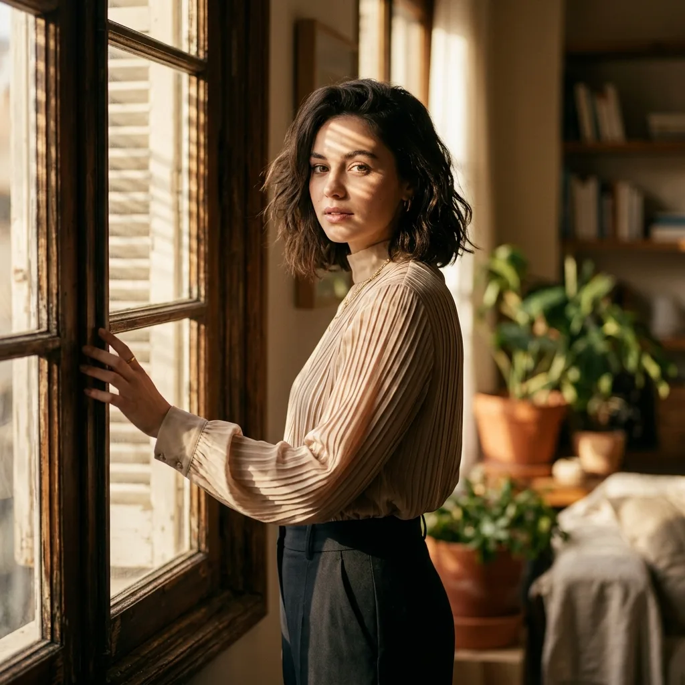

# High-fashion editorial portrait of a young woman standing

[← Back to the collection](../../README.md) · Category: [Photography](../../gallery/photography.md) · Model: `Vinano Image v2` · ID: `vn-00210`

<a href="https://vinano.ai?utm_source=github&utm_medium=readme&utm_campaign=awesome-image-video-prompts-updating&utm_content=prompt-page-image"></a>

<sub>Preview generated with <a href="https://vinano.ai?utm_source=github&utm_medium=readme&utm_campaign=awesome-image-video-prompts-updating&utm_content=prompt-page-caption">vinano.ai</a></sub>

## Prompt

```text
A high-fashion editorial portrait of a young woman standing by a large, rustic wooden window. She is captured in a candid, over-the-shoulder gaze, looking directly into the camera a soft, natural expression. One hand is gently resting on the window frame.

​Lighting & Atmosphere:

The scene is defined by golden hour sunlight streaming through the window, creating a dramatic "blind shadow" or shutter-effect across her face and blouse. The lighting is warm and high-contrast, a hazy, ethereal atmosphere that emphasizes a quiet, "Film Noir" mood in a modern setting.

​Wardrobe & Style:

She is wearing a translucent, pleated silk chiffon blouse in a muted champagne tone. The fabric is light and airy, catching the backlighting to create a soft glow. Her hair is styled in a tousled, effortless bob natural texture.

​Technical Specifications:

​Lens: Shot on 85mm f/1.4 for a shallow depth of field.

​Focus: Sharp focus on the eyes a creamy, soft bokeh background featuring indoor plants and warm interior tones.

​Quality: 8K resolution, cinematic color grading, fine grain, professional photography.

Aim for an editorial, design-driven look with deliberate negative space.
```

## Try it on vinano.ai

1. Copy the prompt above.
2. Open **[vinano.ai](https://vinano.ai?utm_source=github&utm_medium=readme&utm_campaign=awesome-image-video-prompts-updating&utm_content=prompt-page-try)**, paste it into the image generator and pick a model.
3. Swap any placeholders (brand, product, city, person…) for your own details, then generate.

More prompts like this: [Photography gallery](../../gallery/photography.md) · [all categories](../../README.md#contents)
